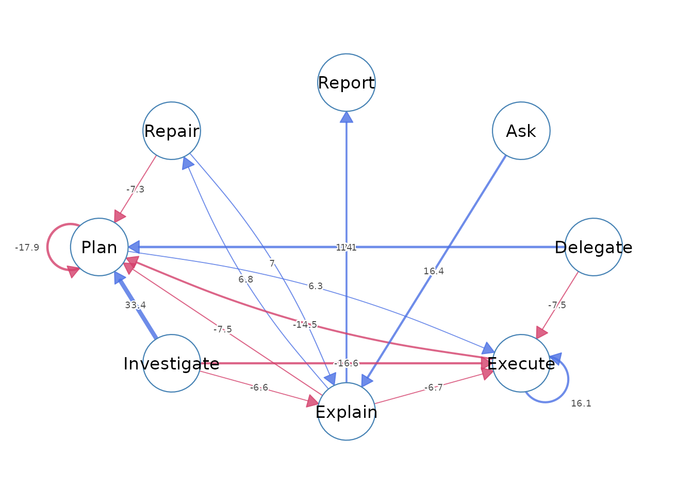

# Case study: AI behaviour in vibe-coding sessions

In vibe coding, a programmer describes what is wanted in natural
language and an AI assistant writes, runs and revises the code. The
assistant’s side of such a session is a sequence of behaviours: it
investigates the code base, plans, executes changes, explains, reports
results, asks questions, delegates work and repairs what went wrong. How
these behaviours are ordered says how the assistant works. An assistant
that investigates before it plans and plans before it executes follows a
different process from one that executes repeatedly and repairs
afterwards. The order of repairs is of particular interest: a repair
that follows execution suggests that the assistant corrects its own
failed actions, a repair that follows a report or an explanation
suggests that it corrects course after communicating with the
programmer.

Lag sequential analysis tests, for every ordered pair of behaviours,
whether the second follows the first more or less often than the
frequencies of the two behaviours predict (Bakeman & Quera, 2011). This
case study asks what follows what among the eight behaviour codes, what
the coarser cluster level adds, whether repair follows execution or
reporting more than chance, and how certain and stable the key
transitions are.

``` r

library(lagdynamics)
```

## Data

`ai_long` is a long event log of coded AI behaviours in human-AI
vibe-coding sessions, taken from the Nestimate package. Each row is one
coded behaviour of the assistant.

- **Session:** `session_id` — one working session, the sequence
  boundary; sessions belong to a `project`.
- **Order:** `order_in_session` — the position of the event in its
  session.
- **Behaviour:** `code` — one of eight codes: `Ask`, `Delegate`,
  `Execute`, `Explain`, `Investigate`, `Plan`, `Repair`, `Report`.
- **Cluster:** `cluster` — the code’s broader group: `Action`,
  `Communication` or `Repair`.
- **Message:** `message_id`, with `code_order` ordering several codes
  within one message.

``` r

head(ai_long)
#>   message_id   project   session_id  timestamp session_date        code cluster
#> 1       3441 Project_7 0086cabebd15 1772661600   2026-03-05    Delegate  Action
#> 2       3441 Project_7 0086cabebd15 1772661600   2026-03-05        Plan  Repair
#> 3       3443 Project_7 0086cabebd15 1772661600   2026-03-05     Execute  Action
#> 4       3443 Project_7 0086cabebd15 1772661600   2026-03-05        Plan  Repair
#> 5       3445 Project_7 0086cabebd15 1772661600   2026-03-05     Execute  Action
#> 6       3447 Project_7 0086cabebd15 1772661600   2026-03-05 Investigate  Action
#>   code_order order_in_session
#> 1          1                5
#> 2          2                6
#> 3          1                8
#> 4          2                9
#> 5          1               12
#> 6          1               14
with(ai_long, table(code, cluster))
#>              cluster
#> code          Action Communication Repair
#>   Ask              0            99      0
#>   Delegate       295             0      0
#>   Execute       3258             0      0
#>   Explain          0           524      0
#>   Investigate   2317             0      0
#>   Plan             0             0   1620
#>   Repair           0             0    257
#>   Report           0           181      0
```

The 8,551 events are dominated by `Execute` (3,258) and `Investigate`
(2,317), followed by `Plan` (1,620). `Ask` (99), `Report` (181) and
`Repair` (257) are rare. The cluster labels need care: the cluster
called `Repair` contains the `Repair` code and also `Plan`, and `Plan`
makes up 1,620 of its 1,877 events. A transition into the `Repair`
cluster is therefore mostly a transition into planning.

``` r

with(ai_long, c(projects = length(unique(project)),
                sessions = length(unique(session_id)),
                messages = length(unique(message_id))))
#> projects sessions messages 
#>       34      428     5970
aggregate(cbind(events = order_in_session) ~ session_id, data = ai_long,
          FUN = length) |>
  summary()
#>      session_id      events   
#>  Length   :428   Min.   :  1  
#>  N.unique :428   1st Qu.:  7  
#>  N.blank  :  0   Median : 13  
#>  Min.nchar: 12   Mean   : 20  
#>  Max.nchar: 12   3rd Qu.: 25  
#>                  Max.   :138
with(ai_long, table(codes_per_message = table(message_id)))
#> codes_per_message
#>    1    2    3    4    5    6 
#> 3781 1851  294   36    6    2
```

The events come from 428 sessions in 34 projects. Sessions range from 1
to 138 coded events, with a median of 13. Of the 5,970 messages, 3,781
carry one code and the others two to six. Within a message the codes are
ordered by `code_order` and follow each other in `order_in_session`, so
some transitions are between two codes of the same message rather than
between two messages. The analysis treats the coded order as the order
of behaviour.

## What follows what?

[`lsa()`](https://pak.dynasite.org/lagdynamics/reference/lsa.md) reads
the log in long format: `session` names the sequence boundary, `action`
the coded behaviour and `order` the position, so no transition is
counted across sessions.

``` r

fit <- lsa(ai_long, session = "session_id", action = "code",
           order = "order_in_session")
fit
#> Lag Sequential Analysis  -  classical  (lag 1, directed)
#>   8 states | 8123 transitions | 8551 events | 428 sequences
#>   states: Ask, Delegate, Execute, Explain, Investigate, Plan, Repair, Report
#>   independence: G² = 2168.1, df = 49, p <2e-16
#> 
#>   Significant transitions (p < 0.05): 40 of 64
#>   strongest over-represented (of 19):
#>     Investigate -> Plan  z =  +33.4  ***
#>     Delegate -> Plan     z =  +18.1  ***
#>     Ask -> Explain       z =  +16.4  ***
#>     Execute -> Execute   z =  +16.1  ***
#>     Explain -> Report    z =  +14.0  ***
#>     ... and 14 more
#> 
#>   Initial states:
#>     Investigate 0.715  ████████████████████████
#>     Delegate    0.185  ██████
#>     Execute     0.058  ██
#>     Plan        0.035  █
#>     Ask         0.005  
#>     Explain     0.002  
#>     Repair      0.000  
#>     Report      0.000
```

The fit has 8,123 transitions from 428 sessions. Independence is clearly
rejected (G² = 2,168, df = 49), and 40 of the 64 transitions depart
significantly from it. Sessions open with `Investigate` (71.5%) or
`Delegate` (18.5%). The over-represented transitions are the assistant’s
working routines.

``` r

transitions(fit, direction = "over", sort = "strength") |> head(10)
#>           from      to lag count expected   prob prob_col adj_res         p yules_q
#> 1  Investigate    Plan   1   977   441.61 0.4371   0.6087   33.41 1.11e-244   0.734
#> 2     Delegate    Plan   1   174    55.32 0.6214   0.1084   18.13  1.96e-73   0.761
#> 3          Ask Explain   1    44     5.86 0.4835   0.0841   16.38  2.56e-60   0.873
#> 4      Execute Execute   1  1575  1229.84 0.5097   0.4872   16.12  1.98e-58   0.358
#> 5      Explain  Report   1    56    11.23 0.1111   0.3094   13.95  3.12e-44   0.765
#> 6       Repair Explain   1    43    16.16 0.1713   0.0822    7.01  2.36e-12   0.522
#> 7      Explain  Repair   1    42    15.95 0.0833   0.1634    6.85  7.59e-12   0.516
#> 8         Plan Execute   1   709   600.99 0.4695   0.2193    6.29  3.10e-10   0.178
#> 9      Explain Explain   1    66    32.45 0.1310   0.1262    6.29  3.24e-10   0.405
#> 10      Repair     Ask   1    13     3.00 0.0518   0.1340    5.90  3.54e-09   0.670
#>     kappa kappa_z   kappa_p lift sign significant
#> 1  0.4556   33.41 1.15e-244 2.21 over        TRUE
#> 2  0.4940   17.86  2.49e-71 3.15 over        TRUE
#> 3  0.4082   15.99  1.56e-57 7.51 over        TRUE
#> 4  0.1655   15.30  7.73e-53 1.28 over        TRUE
#> 5  0.2643   14.07  6.11e-45 4.99 over        TRUE
#> 6  0.1130    7.20  6.20e-13 2.66 over        TRUE
#> 7  0.1088    6.93  4.15e-12 2.63 over        TRUE
#> 8  0.0915    5.21  1.84e-07 1.18 over        TRUE
#> 9  0.0689    6.37  1.88e-10 2.03 over        TRUE
#> 10 0.1044    5.93  2.94e-09 4.34 over        TRUE
```

The strongest routine is `Investigate` to `Plan`: 977 transitions
against 442 expected (z = 33.4); 43.7% of investigations are followed by
a plan. `Delegate` to `Plan` follows (z = 18.1; 62.1% of delegations
lead to a plan). `Execute` repeats itself (z = 16.1; 51.0% of executions
are followed by another). Communication forms its own chain: a question
is followed by an explanation (`Ask` to `Explain`, z = 16.4, lift 7.51)
and an explanation by a report (`Explain` to `Report`, z = 14.0). `Plan`
to `Execute` is over-represented as well (z = 6.29), completing the
routine of investigating, planning and executing.

``` r

transitions(fit, direction = "under", sort = "strength") |> head(8)
#>          from      to lag count expected   prob prob_col adj_res        p yules_q  kappa
#> 1        Plan    Plan   1    49    298.4 0.0325  0.03053  -17.86 2.36e-71  -0.803 -0.840
#> 2 Investigate Execute   1   563    889.5 0.2519  0.17414  -16.57 1.07e-61  -0.423 -0.362
#> 3     Execute    Plan   1   358    610.5 0.1159  0.22305  -14.50 1.30e-47  -0.431 -0.420
#> 4    Delegate Execute   1    51    111.4 0.1821  0.01577   -7.51 5.92e-14  -0.508 -0.546
#> 5     Explain    Plan   1    35     99.6 0.0694  0.02181   -7.46 8.65e-14  -0.553 -0.647
#> 6      Repair    Plan   1     4     49.6 0.0159  0.00249   -7.34 2.10e-13  -0.881 -0.918
#> 7     Explain Execute   1   129    200.6 0.2560  0.03990   -6.73 1.73e-11  -0.333 -0.354
#> 8 Investigate Explain   1    79    143.9 0.0353  0.15105   -6.57 5.04e-11  -0.380 -0.444
#>   kappa_z  kappa_p   lift  sign significant
#> 1  -18.16 1.04e-73 0.1642 under        TRUE
#> 2  -16.02 9.06e-58 0.6329 under        TRUE
#> 3  -14.73 4.13e-49 0.5864 under        TRUE
#> 4   -7.49 6.85e-14 0.4576 under        TRUE
#> 5   -7.39 1.42e-13 0.3515 under        TRUE
#> 6   -7.22 5.10e-13 0.0807 under        TRUE
#> 7   -6.56 5.42e-11 0.6431 under        TRUE
#> 8   -6.39 1.67e-10 0.5490 under        TRUE
```

The avoided transitions sharpen the routine. A plan is almost never
followed by another plan (49 against 298 expected, z = -17.9): planning
is a single step, not a loop. The assistant rarely executes straight
after investigating (z = -16.6) and rarely returns to planning after
executing (z = -14.5): it investigates, plans once, and then executes.
`Repair` to `Plan` is almost absent (4 against 49.6 expected).

A lag transition network shows the sixteen strongest residuals.

``` r

plot_transitions(fit, top = 16)
```



Each node is a behaviour and each arrow a transition, labelled with its
adjusted residual. Blue arrows are over-represented and red arrows
avoided; width grows with the size of the residual. Two clusters are
visible. The action routine runs from `Investigate` and `Delegate` into
`Plan`, with the thick blue arrow from `Investigate`, and from `Plan` to
`Execute`, which loops on itself. The communication chain runs from
`Ask` to `Explain` and on to `Report`. The red arrows mark the shortcuts
the assistant avoids: from `Investigate` directly to `Execute`, from
`Execute` back to `Plan` and from `Plan` to itself.

## The cluster-level view

The three clusters give a coarser description. The same call with
`action = "cluster"` fits the cluster sequence.

``` r

fit_cluster <- lsa(ai_long, session = "session_id", action = "cluster",
                   order = "order_in_session")
transitions(fit_cluster, sort = "strength")
#>            from            to lag count expected   prob prob_col adj_res        p yules_q
#> 1        Action        Repair   1  1646   1284.8 0.2937   0.8840   20.61 2.01e-94   0.632
#> 2        Repair        Repair   1   115    403.7 0.0653   0.0618  -18.49 2.40e-76  -0.688
#> 3 Communication Communication   1   206     74.6 0.2721   0.2572   16.82 1.87e-63   0.619
#> 4        Action Communication   1   377    552.7 0.0673   0.4707  -14.14 2.20e-45  -0.475
#> 5        Repair        Action   1  1428   1183.7 0.8109   0.2615   14.01 1.28e-44   0.425
#> 6        Action        Action   1  3582   3767.5 0.6391   0.6560   -9.48 2.55e-21  -0.247
#> 7 Communication        Repair   1   101    173.5 0.1334   0.0542   -6.59 4.54e-11  -0.342
#> 8 Communication        Action   1   450    508.8 0.5945   0.0824   -4.78 1.72e-06  -0.184
#> 9        Repair Communication   1   218    173.7 0.1238   0.2722    4.01 6.19e-05   0.167
#>     kappa kappa_z   kappa_p  lift  sign significant
#> 1  0.6075   20.13  3.90e-90 1.281  over        TRUE
#> 2 -0.7209  -18.75  2.06e-78 0.285 under        TRUE
#> 3  0.1790   16.55  1.50e-61 2.760  over        TRUE
#> 4 -0.3169  -13.97  2.39e-44 0.682 under        TRUE
#> 5  0.2370    7.86  3.98e-15 1.206  over        TRUE
#> 6 -0.1111  -22.49 5.56e-112 0.951 under        TRUE
#> 7 -0.4277   -6.76  1.41e-11 0.582 under        TRUE
#> 8 -0.1847   -8.14  3.97e-16 0.884 under        TRUE
#> 9  0.0662    3.72  2.02e-04 1.255  over        TRUE
```

All 9 cluster transitions are significant. `Action` to `Repair` is the
strongest (z = 20.6, 1,646 transitions), followed by `Communication`
repeating itself (z = 16.8) and `Repair` to `Action` (z = 14.0), while
`Repair` repeating itself is avoided (z = -18.5). Read with the cluster
labels alone, this would describe an assistant that acts, repairs and
acts again. The code-level fit shows what the clusters hide: `Action` to
`Repair` is mostly `Investigate`, `Delegate` and `Execute` followed by
`Plan`, and the avoided `Repair` loop reflects mainly the avoided `Plan`
loop (49 plans followed by a plan, against 298 expected). The cluster
level is a useful summary of the alternation between doing and planning,
but a statement about repair needs the codes.

## Does repair follow execution or reporting?

The question is answered on the `Repair` code.
[`lsa_lags()`](https://pak.dynasite.org/lagdynamics/reference/lsa_lags.md)
fits the model at lags 1 to 3, and
[`lag_profile()`](https://pak.dynasite.org/lagdynamics/reference/lag_profile.md)
follows the two candidate transitions.

``` r

lags <- lsa_lags(ai_long, lags = 1:3, session = "session_id",
                 action = "code", order = "order_in_session")
lag_profile(lags, from = "Execute", to = "Repair")
#>   lag    from     to count   prob adj_res     p significant
#> 1   1 Execute Repair    93 0.0301  -0.622 0.534       FALSE
#> 2   2 Execute Repair   101 0.0343   0.451 0.652       FALSE
#> 3   3 Execute Repair    82 0.0294  -1.595 0.111       FALSE
lag_profile(lags, from = "Report", to = "Repair")
#>   lag   from     to count   prob adj_res        p significant
#> 1   1 Report Repair    14 0.0864   4.024 5.73e-05        TRUE
#> 2   2 Report Repair     4 0.0263  -0.474 6.36e-01       FALSE
#> 3   3 Report Repair     6 0.0423   0.575 5.66e-01       FALSE
```

Repair does not follow execution more than chance. 93 executions, 3.0%,
are followed by a repair, close to the 97.8 expected (z = -0.62 at lag
1), and the residual stays between -1.6 and 0.5 at lags 2 and 3. A
report, by contrast, is followed by a repair in 8.6% of cases at lag 1
(14 transitions, z = 4.02, p \< 0.001). The effect is confined to the
next event: at lags 2 and 3 the share falls to 2.6% and 4.2% and is not
significant.

The full set of transitions into `Repair` shows which other behaviours
precede it.

``` r

transitions(fit) |> subset(to == "Repair")
#>           from     to lag count expected    prob prob_col adj_res        p yules_q
#> 49         Ask Repair   1     2     2.88 0.02198  0.00778  -0.529 5.96e-01  -0.187
#> 50    Delegate Repair   1     4     8.86 0.01429  0.01556  -1.688 9.14e-02  -0.394
#> 51     Execute Repair   1    93    97.76 0.03010  0.36187  -0.622 5.34e-01  -0.041
#> 52     Explain Repair   1    42    15.95 0.08333  0.16342   6.846 7.59e-12   0.516
#> 53 Investigate Repair   1    40    70.71 0.01790  0.15564  -4.359 1.30e-05  -0.355
#> 54        Plan Repair   1    60    47.77 0.03974  0.23346   1.992 4.64e-02   0.148
#> 55      Repair Repair   1     2     7.94 0.00797  0.00778  -2.176 2.95e-02  -0.613
#> 56      Report Repair   1    14     5.13 0.08642  0.05447   4.024 5.73e-05   0.501
#>      kappa kappa_z  kappa_p  lift  sign significant
#> 49 -0.3278  -0.578 5.64e-01 0.695 under       FALSE
#> 50 -0.5488  -1.689 9.13e-02 0.452 under       FALSE
#> 51 -0.0502  -0.642 5.21e-01 0.951 under       FALSE
#> 52  0.1088   6.932 4.15e-12 2.634  over        TRUE
#> 53 -0.4256  -4.223 2.41e-05 0.566 under        TRUE
#> 54  0.0543   1.828 6.75e-02 1.256  over        TRUE
#> 55 -0.7411  -2.123 3.37e-02 0.252 under        TRUE
#> 56  0.0488   3.766 1.66e-04 2.731  over        TRUE
```

`Explain` to `Repair` is the strongest (42 transitions, z = 6.85, lift
2.63), followed by `Report` to `Repair` (lift 2.73). `Investigate` to
`Repair` is avoided (z = -4.36). Repair therefore follows the
assistant’s communication, an explanation or a report, and not its
actions. A repair is in turn followed by an explanation (`Repair` to
`Explain`, z = 7.01) or a question (`Repair` to `Ask`, z = 5.90), as the
over-represented transitions above show. In these sessions repairs are
embedded in the communication with the programmer, consistent with a
correction prompted by what the programmer sees in the assistant’s
explanation or report.

## How certain are the key transitions?

[`bootstrap_lsa()`](https://pak.dynasite.org/lagdynamics/reference/bootstrap_lsa.md)
resamples whole sessions with replacement, R = 1,000 times, and returns
percentile intervals for every transition.

``` r

set.seed(2026)
boot <- bootstrap_lsa(fit, R = 1000)
boot
#> <lsa_bootstrap>
#>   engine:        classical
#>   level:         sequence
#>   replicates:    1000
#>   CI level:      95%
#>   stable edges:  42 of 64
transitions(boot, significant = TRUE, sort = "strength") |> head(6)
#>          from      to observed count_mean count_se count_ci_low count_ci_high
#> 1 Investigate    Plan      977      978.4    50.19          886          1078
#> 2    Delegate    Plan      174      173.7    14.65          146           204
#> 3        Plan    Plan       49       49.3     8.00           33            65
#> 4 Investigate Execute      563      564.0    41.32          485           644
#> 5         Ask Explain       44       43.8     8.04           29            60
#> 6     Execute Execute     1575     1573.3   132.92         1325          1835
#>   adj_res_observed adj_res_mean adj_res_se adj_res_ci_low adj_res_ci_high adj_res_p_boot
#> 1             33.4         33.4      1.458           30.6            36.1              0
#> 2             18.1         18.1      1.350           15.7            20.8              0
#> 3            -17.9        -17.9      0.756          -19.3           -16.3              0
#> 4            -16.6        -16.5      1.068          -18.6           -14.5              0
#> 5             16.4         16.3      2.450           11.6            21.1              0
#> 6             16.1         16.1      1.319           13.5            18.7              0
#>   adj_res_stable prob_observed prob_mean prob_ci_low prob_ci_high yules_q_observed
#> 1           TRUE        0.4371    0.4374      0.4083       0.4672            0.734
#> 2           TRUE        0.6214    0.6221      0.5674       0.6786            0.761
#> 3           TRUE        0.0325    0.0326      0.0231       0.0423           -0.803
#> 4           TRUE        0.2519    0.2519      0.2280       0.2747           -0.423
#> 5           TRUE        0.4835    0.4814      0.3636       0.5953            0.873
#> 6           TRUE        0.5097    0.5090      0.4848       0.5324            0.358
#>   yules_q_mean yules_q_ci_low yules_q_ci_high
#> 1        0.734          0.700           0.764
#> 2        0.760          0.705           0.809
#> 3       -0.803         -0.858          -0.748
#> 4       -0.422         -0.469          -0.374
#> 5        0.869          0.803           0.915
#> 6        0.357          0.307           0.406
```

42 of the 64 transitions have a residual interval that excludes zero.
The routines are certain: the residual of `Investigate` to `Plan` lies
between 30.6 and 36.1, and the probability of a plan after an
investigation between 0.408 and 0.467. The interval of `Ask` to
`Explain` is the widest of the six (11.6 to 21.1) because questions are
rare, but it is far from zero.

``` r

transitions(boot) |> subset(to == "Repair")
#>           from     to observed count_mean count_se count_ci_low count_ci_high
#> 49         Ask Repair        2       1.96     1.41            0             5
#> 50    Delegate Repair        4       4.05     1.94            1             8
#> 51     Execute Repair       93      92.58    13.83           66           121
#> 52     Explain Repair       42      41.76     7.66           28            58
#> 53 Investigate Repair       40      39.74     7.10           26            54
#> 54        Plan Repair       60      60.00     8.05           45            75
#> 55      Repair Repair        2       2.02     1.42            0             5
#> 56      Report Repair       14      13.93     3.64            7            21
#>    adj_res_observed adj_res_mean adj_res_se adj_res_ci_low adj_res_ci_high adj_res_p_boot
#> 49           -0.529       -0.535      0.874        -1.8431           1.365          0.506
#> 50           -1.688       -1.653      0.657        -2.7844          -0.223          0.020
#> 51           -0.622       -0.633      1.014        -2.5103           1.465          0.536
#> 52            6.846        6.805      1.597         3.9041          10.000          0.000
#> 53           -4.359       -4.372      0.831        -5.9750          -2.557          0.000
#> 54            1.992        2.030      1.031         0.0522           4.027          0.044
#> 55           -2.176       -2.158      0.547        -3.0745          -1.001          0.000
#> 56            4.024        3.987      1.516         1.2138           6.992          0.002
#>    adj_res_stable prob_observed prob_mean prob_ci_low prob_ci_high yules_q_observed
#> 49          FALSE       0.02198   0.02176     0.00000       0.0575           -0.187
#> 50           TRUE       0.01429   0.01447     0.00341       0.0286           -0.394
#> 51          FALSE       0.03010   0.02991     0.02304       0.0366           -0.041
#> 52           TRUE       0.08333   0.08289     0.05952       0.1097            0.516
#> 53           TRUE       0.01790   0.01773     0.01207       0.0236           -0.355
#> 54           TRUE       0.03974   0.03972     0.03054       0.0492            0.148
#> 55           TRUE       0.00797   0.00801     0.00000       0.0206           -0.613
#> 56           TRUE       0.08642   0.08554     0.04736       0.1271            0.501
#>    yules_q_mean yules_q_ci_low yules_q_ci_high
#> 49      -0.2914       -1.00000          0.3025
#> 50      -0.4136       -0.81571         -0.0434
#> 51      -0.0434       -0.17507          0.0926
#> 52       0.5084        0.36911          0.6314
#> 53      -0.3595       -0.51583         -0.2044
#> 54       0.1480        0.00442          0.2749
#> 55      -0.6362       -1.00000         -0.2328
#> 56       0.4798        0.22261          0.6549
```

`Explain` to `Repair` has a residual interval of 3.90 to 10.00 and
`Report` to `Repair` one of 1.21 to 6.99; both exclude zero. `Execute`
to `Repair` has an interval of -2.51 to 1.47, which contains zero and is
centred close to it: there is no link between execution and repair to
detect, rather than a link too uncertain to establish. The interval of
`Report` to `Repair` is wide because it rests on 14 transitions, but its
lower bound stays above 1. `Plan` to `Repair` is the weakest
over-represented transition into `Repair`; its interval (0.05 to 4.03)
barely excludes zero.

Stability asks the same question by subsampling.
[`stability_lsa()`](https://pak.dynasite.org/lagdynamics/reference/stability_lsa.md)
refits the model on R = 500 subsamples of 80% of the sessions.

``` r

set.seed(2026)
stab <- stability_lsa(fit, R = 500)
stab
#> <lsa_stability>
#>   engine:        classical
#>   replicates:    500
#>   proportion:    80%
#>   min stable:    95%
#>   failed:        0 of 500 replicates
#>   stable edges:  32 of 64 (>= 95% across replicates)
transitions(stab) |> subset(to == "Repair")
#>           from     to observed_sig stability stable
#> 49         Ask Repair        FALSE     0.000  FALSE
#> 50    Delegate Repair        FALSE     0.098  FALSE
#> 51     Execute Repair        FALSE     0.000  FALSE
#> 52     Explain Repair         TRUE     1.000   TRUE
#> 53 Investigate Repair         TRUE     1.000   TRUE
#> 54        Plan Repair         TRUE     0.354  FALSE
#> 55      Repair Repair         TRUE     0.394  FALSE
#> 56      Report Repair         TRUE     0.984   TRUE
```

32 of the 64 transitions are significant in at least 95% of the
subsamples. `Explain` to `Repair` and `Investigate` to `Repair` are
significant in all of them and `Report` to `Repair` in 98.4%, so it
passes the 95% threshold. `Plan` to `Repair`, significant in the full
fit at p = 0.046, is significant in only 35.4% of subsamples and should
not be interpreted.

## What the analysis shows

- The assistant follows a routine of investigating, planning once and
  executing: `Investigate` to `Plan` is the strongest transition (z =
  33.4), planning does not repeat (z = -17.9), and execution repeats (z
  = 16.1).
- Communication is a separate chain: questions lead to explanations and
  explanations to reports.
- At the cluster level, the alternation between `Action` and the
  `Repair` cluster is mostly an alternation between action and planning,
  because the `Repair` cluster is mostly `Plan`.
- Repair does not follow execution more than chance (z = -0.62,
  bootstrap interval containing zero). It follows explanations and
  reports, at lag 1 only, and is followed by further explanation or a
  question. The link from reports rests on 14 transitions but is stable
  in 98.4% of subsamples.

The analysis has limits. The data are coded behaviours of the assistant
only; the programmer’s turns between them are not in the log, so a
transition from `Report` to `Repair` may pass through a programmer’s
reply that the analysis cannot see. Several codes of one message are
ordered by the coding, not by time. The 428 sessions come from 34
projects, and the bootstrap and the subsampling treat sessions as
independent, which ignores any similarity of sessions within a project.
Finally, the model pools all sessions: a project or a phase of a session
with a different routine would need a grouped fit (see [the group
comparison
article](https://pak.dynasite.org/lagdynamics/articles/group-comparison.md)).
For the long-format arguments, see [the event logs
guide](https://pak.dynasite.org/lagdynamics/articles/event-logs.md); for
the network display, see [the lag transition networks
article](https://pak.dynasite.org/lagdynamics/articles/lag-transition-networks.md).

## References

Bakeman, R., & Quera, V. (2011). *Sequential analysis and observational
methods for the behavioral sciences*. Cambridge University Press.

Efron, B. (1979). Bootstrap methods: Another look at the jackknife.
*Annals of Statistics, 7*(1), 1-26.
