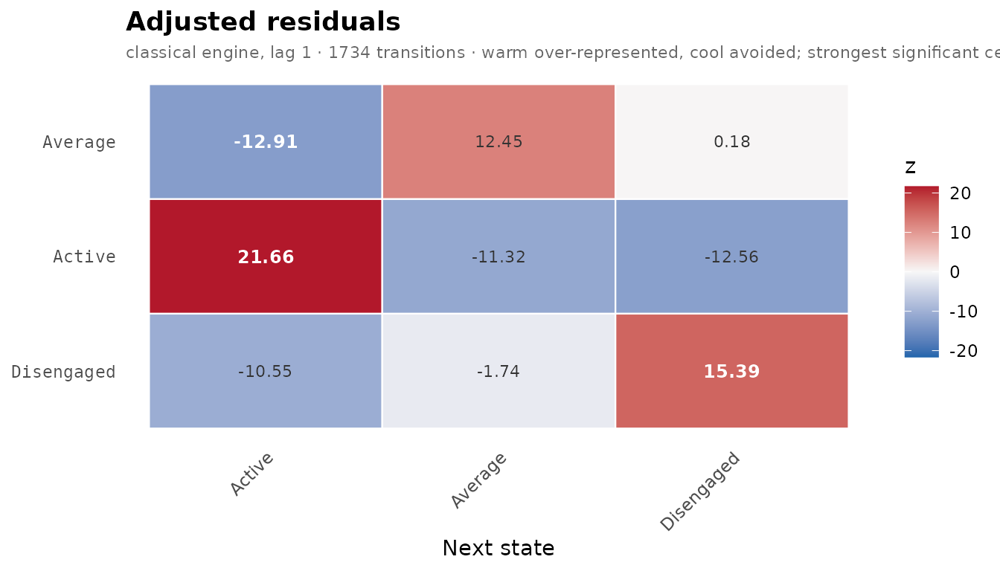
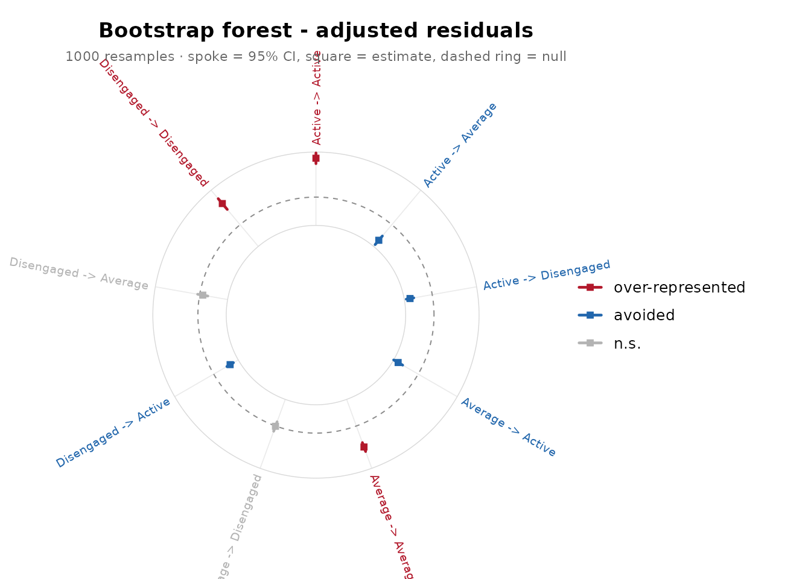

# Case study: the dynamics of course engagement

Engagement in a course is not a fixed trait. A student who is active in
one week may be average in the next and disengaged after that, and the
value of an engagement measure for teaching lies largely in what it says
about the weeks that follow. Two questions matter most. How persistent
is each state: once a student is disengaged, how likely is the student
to stay so? And which moves between states are more or less common than
the overall frequency of the states would predict: do disengaged
students return to active engagement directly, or only through an
intermediate state?

Lag sequential analysis answers both. For every ordered pair of states
it compares the observed number of transitions with the number expected
if the next state did not depend on the current one, and it expresses
the difference as an adjusted residual (Bakeman & Quera, 2011; Haberman,
1973). A positive residual marks a transition that occurs more often
than the base rates of its two states predict, a negative residual one
that is avoided. This case study asks how persistent each engagement
state is, which transitions are over- or under-represented, whether the
structure holds when the states are two and three weeks apart, and how
certain and how stable the key transitions are.

``` r

library(lagdynamics)
```

## Data

`engagement` is a synthetic data set of weekly engagement states,
derived from the `trajectories` example of the Nestimate package. It is
in wide format, one row per student and one column per week.

- **Sequence:** one row, one student.
- **Time:** the 15 columns, weeks 1 to 15, in order.
- **State:** `Active`, `Average` or `Disengaged`; `NA` marks a week
  without an observation.

``` r

dim(engagement)
#> [1] 138  15
table(unlist(engagement), useNA = "ifany")
#> 
#>     Active    Average Disengaged       <NA> 
#>        703        813        354        200
table(observed_weeks = rowSums(!is.na(engagement)))
#> observed_weeks
#>   0   1   2   4   7   8   9  11  12  14  15 
#>   2   5   2   4   1   1   1   1   1   2 118
```

The 138 rows hold 1,870 observed weeks and 200 missing ones. Two rows
are empty and contribute nothing, 118 students are observed in all 15
weeks, and the remaining 18 between 1 and 14 weeks. `Average` is the
most frequent state (813 weeks), followed by `Active` (703) and
`Disengaged` (354). Missing weeks are dropped and no transition is
counted into or out of them.

[`lsa()`](https://pak.dynasite.org/lagdynamics/reference/lsa.md) reads
the wide frame directly and fits the classical lag-1 model.

``` r

fit <- lsa(engagement)
as.data.frame(summary(fit))
#>      engine lag n_states n_sequences n_events n_transitions n_significant alpha lrx2
#> 1 classical   1        3         136     1870          1734             7  0.05  618
#>   lrx2_df    lrx2_p  x2 x2_df      x2_p
#> 1       4 1.69e-132 629     4 7.41e-135
```

The fit uses 136 sequences, 1,870 events and 1,734 week-to-week
transitions. The likelihood-ratio test of independence gives G² = 618 on
4 degrees of freedom (p \< 1e-100): next week’s state depends strongly
on this week’s, and 7 of the 9 transitions depart significantly from
independence.

## How persistent is each state?

Persistence is the probability of staying in a state from one week to
the next, the diagonal of the transition-probability table.

``` r

transition_probabilities(fit)
#>         from         to  prob
#> 1     Active     Active 0.698
#> 2     Active    Average 0.267
#> 3     Active Disengaged 0.035
#> 4    Average     Active 0.204
#> 5    Average    Average 0.610
#> 6    Average Disengaged 0.186
#> 7 Disengaged     Active 0.120
#> 8 Disengaged    Average 0.397
#> 9 Disengaged Disengaged 0.483
```

`Active` is the most persistent state: 69.8% of active weeks are
followed by another active week. `Average` persists with probability
0.610 and `Disengaged` with 0.483. The probabilities alone mislead about
disengagement, because `Disengaged` is the rarest state. The residual of
each self-transition measures persistence against what the base rates
predict.

``` r

transitions(fit, direction = "over", sort = "strength")
#>         from         to lag count expected  prob prob_col adj_res         p yules_q kappa
#> 1     Active     Active   1   459      247 0.698    0.705    21.7 4.60e-104   0.828 0.444
#> 2 Disengaged Disengaged   1   157       60 0.483    0.491    15.4  1.90e-53   0.754 0.314
#> 3    Average    Average   1   458      330 0.610    0.600    12.5  1.35e-35   0.553 0.227
#>   kappa_z  kappa_p lift sign significant
#> 1   19.19 4.68e-82 1.86 over        TRUE
#> 2   13.56 7.34e-42 2.62 over        TRUE
#> 3    9.83 7.97e-23 1.39 over        TRUE
```

All three self-transitions are over-represented, and no transition
between two different states is. `Active` to `Active` has the largest
residual (z = 21.7, 459 observed against 247 expected), but `Disengaged`
to `Disengaged` has the largest lift: it occurs 2.62 times as often as
expected (157 against 60), compared with 1.86 for `Active` and 1.39 for
`Average`. Relative to how rare it is, disengagement is the stickiest
state. Yule’s Q, which does not grow with sample size, ranks the same
way: 0.828 for `Active`, 0.754 for `Disengaged` and 0.553 for `Average`.

## Which transitions are over- or under-represented?

The under-represented transitions are the moves that students avoid.

``` r

transitions(fit, direction = "under", sort = "strength")
#>         from         to lag count expected  prob prob_col adj_res        p yules_q  kappa
#> 1    Average     Active   1   153      282 0.204   0.2350   -12.9 4.16e-38  -0.601 -0.499
#> 2     Active Disengaged   1    23      121 0.035   0.0719   -12.6 3.64e-36  -0.826 -0.827
#> 3     Active    Average   1   176      290 0.267   0.2307   -11.3 1.06e-29  -0.534 -0.424
#> 4 Disengaged     Active   1    39      122 0.120   0.0599   -10.5 5.11e-26  -0.698 -0.707
#>   kappa_z  kappa_p  lift  sign significant
#> 1   -14.7 6.81e-49 0.543 under        TRUE
#> 2   -13.4 5.14e-41 0.189 under        TRUE
#> 3   -12.5 9.39e-36 0.608 under        TRUE
#> 4   -11.5 2.03e-30 0.320 under        TRUE
```

Four of the six moves between different states are avoided. The
strongest avoidance is `Average` to `Active` (z = -12.9), followed by
`Active` to `Disengaged` (z = -12.6): only 23 active weeks, 3.5%, are
followed by a disengaged week, against 121 expected (lift 0.19, Yule’s Q
= -0.826). `Disengaged` to `Active` is avoided as well (39 observed, 122
expected). The two moves through `Average`, `Disengaged` to `Average` (z
= -1.74, p = 0.083) and `Average` to `Disengaged` (z = 0.18, p = 0.86),
occur about as often as chance predicts.

The structure is therefore a graded one. Students rarely jump between
the two extreme states in either direction; when they leave an extreme
state, they pass through `Average`, and the moves into and out of
`Average` from `Disengaged` are neither favoured nor avoided. A residual
heatmap shows the whole table at once.

``` r

plot(fit)
```



Each tile is one transition, the current state in rows and the next
state in columns, labelled and coloured by its adjusted residual on a
diverging scale: red above expectation, blue below. The three red tiles
are the persistence of each state; the blue tiles between `Active` and
`Disengaged` are the avoided jumps between the extremes; the two
near-white tiles, `Average` to `Disengaged` (0.18) and `Disengaged` to
`Average` (-1.74), are the transitions at chance level.

## Is the structure the same at lags 2 and 3?

A lag-1 pattern can hide a different pattern over longer intervals: a
student may avoid moving from `Active` to `Disengaged` in one week but
drift there over two or three.
[`lsa_lags()`](https://pak.dynasite.org/lagdynamics/reference/lsa_lags.md)
fits the same model at several lags, pairing each week with the week
one, two and three steps later.

``` r

lags <- lsa_lags(engagement, lags = 1:3)
lags
#> <lsa_lags>
#>   engine: classical
#>   lags:   1, 2, 3
#>     lag 1    7 of 9 transitions significant
#>     lag 2    8 of 9 transitions significant
#>     lag 3    8 of 9 transitions significant
```

The number of significant transitions rises from 7 of 9 at lag 1 to 8 of
9 at lags 2 and 3.
[`lag_profile()`](https://pak.dynasite.org/lagdynamics/reference/lag_profile.md)
follows one transition across the lags. The first two profiles are the
persistence of the extreme states.

``` r

lag_profile(lags, from = "Active", to = "Active")
#>   lag   from     to count  prob adj_res         p significant
#> 1   1 Active Active   459 0.698    21.7 4.60e-104        TRUE
#> 2   2 Active Active   409 0.664    18.7  5.20e-78        TRUE
#> 3   3 Active Active   359 0.631    16.0  7.53e-58        TRUE
lag_profile(lags, from = "Disengaged", to = "Disengaged")
#>   lag       from         to count  prob adj_res        p significant
#> 1   1 Disengaged Disengaged   157 0.483   15.39 1.90e-53        TRUE
#> 2   2 Disengaged Disengaged   144 0.497   15.18 5.17e-52        TRUE
#> 3   3 Disengaged Disengaged    98 0.363    8.63 6.25e-18        TRUE
```

Active engagement decays slowly: the probability of being active three
weeks after an active week is still 0.631 (z = 16.0). Disengagement
holds for two weeks (0.483 at lag 1, 0.497 at lag 2) and then falls to
0.363 at lag 3, with the residual dropping from 15.2 to 8.6. Both states
remain strongly over-represented at lag 3.

``` r

lag_profile(lags, from = "Active", to = "Disengaged")
#>   lag   from         to count   prob adj_res        p significant
#> 1   1 Active Disengaged    23 0.0350  -12.56 3.64e-36        TRUE
#> 2   2 Active Disengaged    33 0.0536  -10.65 1.77e-26        TRUE
#> 3   3 Active Disengaged    35 0.0615   -9.42 4.68e-21        TRUE
lag_profile(lags, from = "Disengaged", to = "Active")
#>   lag       from     to count  prob adj_res        p significant
#> 1   1 Disengaged Active    39 0.120  -10.55 5.11e-26        TRUE
#> 2   2 Disengaged Active    37 0.128   -9.70 3.08e-22        TRUE
#> 3   3 Disengaged Active    39 0.144   -8.69 3.74e-18        TRUE
```

The avoided jumps between the extremes stay avoided at every lag. The
share of active weeks followed by disengagement rises from 3.5% at lag 1
to 6.2% at lag 3, and the share of disengaged weeks followed by activity
from 12.0% to 14.4%, but all six residuals are below -8.6. The two moves
through `Average` are the only unstable part of the structure.

``` r

lag_profile(lags, from = "Average", to = "Disengaged")
#>   lag    from         to count  prob adj_res      p significant
#> 1   1 Average Disengaged   140 0.186   0.176 0.8605       FALSE
#> 2   2 Average Disengaged   118 0.169  -1.335 0.1818       FALSE
#> 3   3 Average Disengaged   133 0.209   2.518 0.0118        TRUE
lag_profile(lags, from = "Disengaged", to = "Average")
#>   lag       from      to count  prob adj_res      p significant
#> 1   1 Disengaged Average   129 0.397   -1.74 0.0825       FALSE
#> 2   2 Disengaged Average   109 0.376   -2.38 0.0174        TRUE
#> 3   3 Disengaged Average   133 0.493    1.79 0.0735       FALSE
```

Their residuals lie between -2.38 and 2.52 and change sign across the
lags; each reaches p \< 0.05 at one lag only. With 1,734 transitions,
residuals of this size are near the significance threshold, and the
significance flag flips with small changes in the counts. These are the
transitions that change the count of significant cells from 7 to 8; the
rest of the structure is the same at all three lags.

## How certain are the key transitions?

A residual from a single fit says nothing about how much it would vary
in another sample of students.
[`bootstrap_lsa()`](https://pak.dynasite.org/lagdynamics/reference/bootstrap_lsa.md)
resamples whole students with replacement, which keeps each student’s
weeks together, refits the model and returns percentile intervals for
every transition. The analysis uses R = 1,000 resamples.

``` r

set.seed(2026)
boot <- bootstrap_lsa(fit, R = 1000)
boot
#> <lsa_bootstrap>
#>   engine:        classical
#>   level:         sequence
#>   replicates:    1000
#>   CI level:      95%
#>   stable edges:  7 of 9
transitions(boot, significant = TRUE, sort = "strength")
#>         from         to observed count_mean count_se count_ci_low count_ci_high
#> 1     Active     Active      459      461.1    52.50          360           568
#> 2 Disengaged Disengaged      157      156.1    28.06          106           213
#> 3    Average     Active      153      152.8    14.79          124           182
#> 4     Active Disengaged       23       22.7     4.99           14            32
#> 5    Average    Average      458      458.8    39.30          383           532
#> 6     Active    Average      176      175.9    15.78          146           207
#> 7 Disengaged     Active       39       38.8     6.34           27            52
#>   adj_res_observed adj_res_mean adj_res_se adj_res_ci_low adj_res_ci_high adj_res_p_boot
#> 1             21.7         21.6       1.55          18.65           24.61              0
#> 2             15.4         15.3       1.96          11.10           18.95              0
#> 3            -12.9        -12.9       1.52         -15.79           -9.99              0
#> 4            -12.6        -12.5       1.06         -14.68          -10.42              0
#> 5             12.5         12.5       1.37           9.84           15.16              0
#> 6            -11.3        -11.3       1.63         -14.48           -8.21              0
#> 7            -10.5        -10.5       1.12         -12.69           -8.47              0
#>   adj_res_stable prob_observed prob_mean prob_ci_low prob_ci_high yules_q_observed
#> 1           TRUE         0.698    0.6974      0.6371        0.752            0.828
#> 2           TRUE         0.483    0.4800      0.3846        0.564            0.754
#> 3           TRUE         0.204    0.2041      0.1623        0.247           -0.601
#> 4           TRUE         0.035    0.0346      0.0205        0.049           -0.826
#> 5           TRUE         0.610    0.6102      0.5640        0.655            0.553
#> 6           TRUE         0.267    0.2680      0.2159        0.323           -0.534
#> 7           TRUE         0.120    0.1209      0.0818        0.166           -0.698
#>   yules_q_mean yules_q_ci_low yules_q_ci_high
#> 1        0.826          0.760           0.882
#> 2        0.750          0.633           0.834
#> 3       -0.601         -0.700          -0.489
#> 4       -0.826         -0.900          -0.745
#> 5        0.553          0.451           0.648
#> 6       -0.533         -0.649          -0.408
#> 7       -0.696         -0.794          -0.586
```

The same 7 transitions are significant in the resamples as in the fit.
The 95% interval of the residual excludes zero for every one of them,
and every interval is far from zero: the closest is `Active` to
`Average`, whose upper bound is -8.21. The persistence of disengagement
has the widest interval (11.1 to 19.0), because it depends on a few
students who stay disengaged for many weeks. The probability intervals
make the same point on the probability scale: staying disengaged has
probability 0.483 with a 95% interval of 0.385 to 0.564.

A circular forest plot draws the residual interval of every transition.

``` r

plot_forest(boot)
```



Each spoke is one transition and spans its bootstrap interval, the
square marks the observed residual and the dashed ring is zero. The
intervals are short relative to their distance from the ring: the three
red (over-represented) and four blue (avoided) transitions lie well away
from it, and the two grey ones, the moves between `Average` and
`Disengaged`, sit on it.

[`certainty_lsa()`](https://pak.dynasite.org/lagdynamics/reference/certainty_lsa.md)
gives a closed-form answer to a narrower question: how precisely is each
transition probability estimated, given the counts? It places a
Dirichlet posterior on each row of the table and flags a transition as
certain when its posterior stays within 25% of the observed probability.

``` r

certainty_lsa(fit) |> transitions(sort = "strength")
#>         from         to observed prob_observed prob_mean prob_se prob_ci_low prob_ci_high
#> 1     Active     Active      459         0.698    0.6967 0.01789      0.6611        0.731
#> 2 Disengaged Disengaged      157         0.483    0.4824 0.02761      0.4284        0.537
#> 3    Average     Active      153         0.204    0.2040 0.01468      0.1760        0.233
#> 4     Active Disengaged       23         0.035    0.0356 0.00721      0.0229        0.051
#> 5    Average    Average      458         0.610    0.6093 0.01777      0.5742        0.644
#> 6     Active    Average      176         0.267    0.2676 0.01723      0.2345        0.302
#> 7 Disengaged     Active       39         0.120    0.1210 0.01802      0.0879        0.158
#> 8 Disengaged    Average      129         0.397    0.3966 0.02703      0.3443        0.450
#> 9    Average Disengaged      140         0.186    0.1867 0.01420      0.1597        0.215
#>    p_value stable adj_res_observed adj_res_stable
#> 1 5.56e-20   TRUE           21.663           TRUE
#> 2 9.44e-06   TRUE           15.390           TRUE
#> 3 6.06e-04   TRUE          -12.906           TRUE
#> 4 2.19e-01  FALSE          -12.557          FALSE
#> 5 3.14e-17   TRUE           12.453           TRUE
#> 6 1.21e-04   TRUE          -11.319           TRUE
#> 7 9.45e-02  FALSE          -10.549          FALSE
#> 8 2.23e-04   TRUE           -1.736           TRUE
#> 9 1.17e-03   TRUE            0.176           TRUE
```

Seven of the nine probabilities are pinned to within 25%. The two that
are not are the rare cross-extreme moves. `Active` to `Disengaged` has a
95% credible interval of 0.023 to 0.051 around 0.035, and `Disengaged`
to `Active` one of 0.088 to 0.158 around 0.120. Both are certainly rare,
and the residuals are certainly negative, but their exact probability is
known only to within a factor of about two. Any claim of the form “one
disengaged week in eight is followed by an active one” rests on these
wider intervals.

## How stable is the structure?

Stability asks whether the significance pattern survives when part of
the sample is removed.
[`stability_lsa()`](https://pak.dynasite.org/lagdynamics/reference/stability_lsa.md)
draws R = 500 subsamples of 80% of the students without replacement,
refits the model on each and records how often each transition stays
significant.

``` r

set.seed(2026)
stab <- stability_lsa(fit, R = 500)
stab
#> <lsa_stability>
#>   engine:        classical
#>   replicates:    500
#>   proportion:    80%
#>   min stable:    95%
#>   failed:        0 of 500 replicates
#>   stable edges:  7 of 9 (>= 95% across replicates)
transitions(stab, sort = "strength")
#>         from         to observed_sig stability stable
#> 1     Active     Active         TRUE     1.000   TRUE
#> 2    Average     Active         TRUE     1.000   TRUE
#> 3 Disengaged     Active         TRUE     1.000   TRUE
#> 4     Active    Average         TRUE     1.000   TRUE
#> 5    Average    Average         TRUE     1.000   TRUE
#> 6     Active Disengaged         TRUE     1.000   TRUE
#> 7 Disengaged Disengaged         TRUE     1.000   TRUE
#> 8 Disengaged    Average        FALSE     0.256  FALSE
#> 9    Average Disengaged        FALSE     0.004  FALSE
```

The 7 significant transitions are significant in every one of the 500
subsamples (stability 1.000). `Disengaged` to `Average` is significant
in a quarter of them and `Average` to `Disengaged` almost never, which
matches their unstable behaviour across lags.

[`reliability_lsa()`](https://pak.dynasite.org/lagdynamics/reference/reliability_lsa.md)
splits the students at random into two halves, fits the model on each
half and correlates the two tables of transition probabilities. It
repeats the split R = 200 times.

``` r

set.seed(2026)
rel <- reliability_lsa(fit, R = 200)
as.data.frame(rel, what = "summary")
#>   weights  method   R n_failed  mean     sd ci_low ci_high
#> 1    prob pearson 200        0 0.968 0.0261  0.885   0.996
```

The mean split-half correlation is 0.968 with a 95% interval of 0.885 to
0.996, and no replicate failed. Two disjoint halves of 68 students each
reproduce nearly the same transition table.

## What the analysis shows

- Engagement is persistent. Each state is more likely to be followed by
  itself than its frequency predicts; `Active` persists with probability
  0.698 and `Disengaged`, the rarest state, has the highest lift (2.62).
- Students do not jump between the extremes. `Active` to `Disengaged`
  and `Disengaged` to `Active` are strongly avoided at lags 1, 2 and 3.
  Moves out of an extreme state run through `Average`.
- The persistence of disengagement weakens after two weeks (probability
  0.497 at lag 2, 0.363 at lag 3), while active engagement decays slowly
  (0.631 at lag 3).
- Every significant transition has a bootstrap interval (R = 1,000) that
  excludes zero and is significant in all 500 subsamples, and split
  halves of the students agree with a mean correlation of 0.968. The two
  moves between `Average` and `Disengaged` are at chance level, and
  their significance flag is not stable.

The analysis has limits. The data are synthetic, so the results
illustrate the method rather than describe real students. The model is
first order and pools all students and all weeks: it assumes the same
transition structure in week 2 and in week 14, and for every student. A
student-level or week-level difference would need a grouped fit and a
group comparison (see [the group comparison
article](https://pak.dynasite.org/lagdynamics/articles/group-comparison.md)).
The residuals and their tests treat transitions as independent; the
bootstrap and the subsampling resample whole students and do not rely on
that assumption, and they agree with the fit here. For the
interpretation of residuals and the choice of lags, see [the lag
sequential analysis
article](https://pak.dynasite.org/lagdynamics/articles/lsa.md) and [the
confirmatory
article](https://pak.dynasite.org/lagdynamics/articles/confirmatory.md).

## References

Bakeman, R., & Quera, V. (2011). *Sequential analysis and observational
methods for the behavioral sciences*. Cambridge University Press.

Efron, B. (1979). Bootstrap methods: Another look at the jackknife.
*Annals of Statistics, 7*(1), 1-26.

Epskamp, S., Borsboom, D., & Fried, E. I. (2018). Estimating
psychological networks and their accuracy: A tutorial paper. *Behavior
Research Methods, 50*(1), 195-212.

Haberman, S. J. (1973). The analysis of residuals in cross-classified
tables. *Biometrics, 29*, 205-220.
