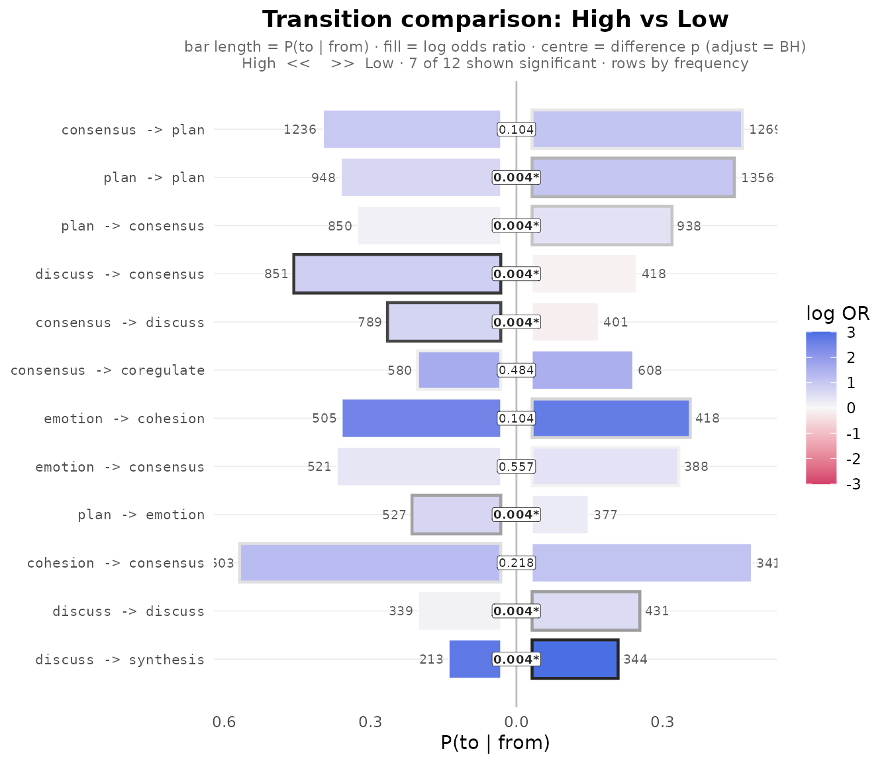

# Case study: regulation in high and low achieving groups

Students who learn together have to regulate their joint work: they
plan, monitor progress, build consensus, discuss, manage the emotional
climate and adapt when something fails. Socially shared regulation is a
sequence of such acts, and its quality lies less in how often each act
occurs than in what follows what. Planning that leads to monitoring is a
different process from planning that leads to more planning. A
comparison of high and low achieving students therefore asks whether the
two groups order their regulation differently, not only whether they use
different acts.

Lag sequential analysis gives the per-transition answer. Within each
group, it tests every ordered pair of acts against the frequency
expected if the next act did not depend on the current one (Bakeman &
Quera, 2011). Between groups,
[`compare_lsa()`](https://pak.dynasite.org/lagdynamics/reference/compare_lsa.md)
asks whether a transition’s departure from independence differs more
than a random relabelling of the students would produce, and
[`bayes_compare_lsa()`](https://pak.dynasite.org/lagdynamics/reference/bayes_compare_lsa.md)
estimates how large the difference in transition probability is. This
case study sets up the sequences, describes the regulation transitions
of each achievement group, locates the transitions where the groups
differ and checks those differences with a Bayesian comparison.

``` r

library(lagdynamics)
```

## Data

`group_regulation_long` is a long event log of coded regulation acts in
collaborative learning, the long companion of the `group_regulation`
sequence data, taken from the tna package. Each row is one act.

- **Student:** `Actor` — 2,000 students; each student’s acts form one
  sequence.
- **Achievement group:** `Achiever` — `High` or `Low`, the grouping
  variable of the comparison.
- **Collaboration group:** `Group` — 200 groups of students who work
  together.
- **Course:** `Course` — `A`, `B` or `C`.
- **Time stamp:** `Time` — date and clock time of the act; orders the
  acts within a student.
- **Act:** `Action` — one of nine regulation acts: `adapt`, `cohesion`,
  `consensus`, `coregulate`, `discuss`, `emotion`, `monitor`, `plan`,
  `synthesis`.

``` r

head(group_regulation_long)
#>   Actor Achiever Group Course                Time    Action
#> 1     1     High     1      A 2025-01-01 08:27:07  cohesion
#> 2     1     High     1      A 2025-01-01 08:35:20 consensus
#> 3     1     High     1      A 2025-01-01 08:42:18   discuss
#> 4     1     High     1      A 2025-01-01 08:50:00 synthesis
#> 5     1     High     1      A 2025-01-01 08:52:25     adapt
#> 6     1     High     1      A 2025-01-01 08:57:31 consensus
with(group_regulation_long, table(Action))
#> Action
#>      adapt   cohesion  consensus coregulate    discuss    emotion    monitor       plan 
#>        554       1839       6797       2133       4267       3075       1516       6623 
#>  synthesis 
#>        729
with(group_regulation_long, table(Course, Achiever))
#>       Achiever
#> Course  High   Low
#>      A 12390     0
#>      B  1331  8295
#>      C     0  5517
```

The 27,533 acts are dominated by `consensus` (6,797) and `plan` (6,623);
`adapt` (554) and `synthesis` (729) are the rarest. The course table
carries an important constraint for interpretation: course `A` holds
only high achievers and course `C` only low achievers, and only course
`B` holds both. Achievement and course are therefore largely confounded,
and every difference between the groups below is also, in part, a
difference between courses.

``` r

aggregate(cbind(students = Actor, achievement_levels = Achiever) ~ Group,
          data = group_regulation_long,
          FUN = \(x) length(unique(x))) |>
  summary()
#>      Group          students  achievement_levels
#>  Min.   :  1.0   Min.   :10   Min.   :1         
#>  1st Qu.: 50.8   1st Qu.:10   1st Qu.:1         
#>  Median :100.5   Median :10   Median :1         
#>  Mean   :100.5   Mean   :10   Mean   :1         
#>  3rd Qu.:150.2   3rd Qu.:10   3rd Qu.:1         
#>  Max.   :200.0   Max.   :10   Max.   :1
```

Every collaboration group has 10 students, all with the same achievement
level. Students are nested in collaboration groups, and the 1,000
students in each achievement group come from 100 collaboration groups.

## How are the sequences built?

In a long log, a sequence is defined by the columns that bound it. With
`actor = "Actor"`, each student’s acts form a sequence, ordered by
`Time`. When a time column is given,
[`lsa()`](https://pak.dynasite.org/lagdynamics/reference/lsa.md) also
starts a new sequence whenever two consecutive acts of a student are
more than `time_threshold` seconds apart (900 seconds, 15 minutes, by
default). The largest gap between consecutive acts of each student shows
whether that rule splits anything here.

``` r

aggregate(cbind(largest_gap_s = as.numeric(Time)) ~ Actor,
          data = group_regulation_long,
          FUN = \(x) max(diff(sort(x)))) |>
  summary()
#>      Actor      largest_gap_s
#>  Min.   :   1   Min.   : 13  
#>  1st Qu.: 501   1st Qu.:432  
#>  Median :1000   Median :471  
#>  Mean   :1000   Mean   :441  
#>  3rd Qu.:1500   3rd Qu.:488  
#>  Max.   :2000   Max.   :500
```

No student has a gap longer than 500 seconds, so the default threshold
keeps each student’s acts in one sequence. A shorter threshold would cut
through the ordinary pace of the work.

``` r

lsa(group_regulation_long, actor = "Actor", action = "Action",
    time = "Time") |>
  summary() |>
  as.data.frame()
#>      engine lag n_states n_sequences n_events n_transitions n_significant alpha  lrx2
#> 1 classical   1        9        2000    27533         25533            72  0.05 13204
#>   lrx2_df lrx2_p    x2 x2_df x2_p
#> 1      64      0 15435    64    0
lsa(group_regulation_long, actor = "Actor", action = "Action",
    time = "Time", time_threshold = 300) |>
  summary() |>
  as.data.frame()
#>      engine lag n_states n_sequences n_events n_transitions n_significant alpha lrx2
#> 1 classical   1        9       12305    27533         15228            69  0.05 7927
#>   lrx2_df lrx2_p   x2 x2_df x2_p
#> 1      64      0 9222    64    0
```

With the default threshold the log yields 2,000 sequences, one per
student, and 25,533 transitions. A 300-second threshold splits the same
log into 12,305 sequences and keeps only 15,228 transitions, because
every transition across a gap is dropped. Gaps of up to about eight
minutes between the acts of a student working in a group are part of one
session, not a break between sessions, so the analysis keeps the
default.

## Which transitions characterise each group?

`group = "Achiever"` fits one model per achievement group. Both fits
share the same nine states, so their tables are directly comparable.

``` r

g <- lsa(group_regulation_long, actor = "Actor", action = "Action",
         time = "Time", group = "Achiever")
summary(g)
#>   group    engine lag n_states n_sequences n_events n_transitions n_significant alpha
#> 1  High classical   1        9        1000    13721         12721            66  0.05
#> 2   Low classical   1        9        1000    13812         12812            67  0.05
#>   lrx2 lrx2_df lrx2_p   x2 x2_df x2_p
#> 1 6147      64      0 6807    64    0
#> 2 7715      64      0 9197    64    0
```

Each group contributes 1,000 sequences; the high achievers have 12,721
transitions and the low achievers 12,812. In both groups the
independence model fails (G² = 6,147 and 7,715 on 64 degrees of
freedom), and 66 and 67 of the 81 transitions are significant. With more
than 12,000 transitions per group almost every cell is significant, so
the comparison of the groups rests on the size of the effects rather
than on the significance flags. The frequent over-represented
transitions, those observed at least 400 times, are the backbone of each
group’s regulation.

``` r

transitions(g, direction = "over", min_count = 400, sort = "strength")
#>    group      from         to lag count expected  prob prob_col adj_res         p yules_q
#> 1   High   emotion   cohesion   1   505    114.0 0.326    0.540   40.59  0.00e+00  0.8467
#> 2   High consensus coregulate   1   580    254.4 0.171    0.608   24.79 1.21e-135  0.6632
#> 3   High consensus       plan   1  1236    777.0 0.364    0.424   21.90 2.64e-106  0.4466
#> 4   High  cohesion  consensus   1   503    253.6 0.536    0.146   19.05  6.28e-81  0.5540
#> 5   High   discuss  consensus   1   851    541.5 0.425    0.247   16.96  1.53e-64  0.3977
#> 6   High      plan       plan   1   948    662.5 0.328    0.325   14.37  7.58e-47  0.3221
#> 7   High consensus    discuss   1   789    529.6 0.233    0.397   14.33  1.39e-46  0.3462
#> 8   High      plan    emotion   1   527    344.9 0.182    0.347   11.89  1.36e-32  0.3310
#> 9   High   emotion  consensus   1   521    419.0 0.336    0.151    6.22  4.87e-10  0.1776
#> 10  High      plan  consensus   1   850    781.8 0.294    0.247    3.25  1.17e-03  0.0758
#> 11   Low   emotion   cohesion   1   418     78.6 0.325    0.535   41.67  0.00e+00  0.8730
#> 12   Low consensus coregulate   1   608    261.6 0.207    0.533   25.56 3.80e-144  0.6413
#> 13   Low consensus       plan   1  1269    756.5 0.432    0.385   24.63 5.60e-134  0.4922
#> 14   Low      plan       plan   1  1356    841.0 0.415    0.411   23.88 5.24e-126  0.4706
#> 15   Low   discuss    discuss   1   431    293.4 0.221    0.223    9.46  3.03e-21  0.2793
#> 16   Low      plan  consensus   1   938    746.7 0.287    0.320    9.24  2.57e-20  0.2091
#>     kappa kappa_z   kappa_p lift sign significant
#> 1  0.4255   37.69 6.36e-311 4.43 over        TRUE
#> 2  0.4615   24.61 9.79e-134 2.28 over        TRUE
#> 3  0.1804   18.96  3.49e-80 1.59 over        TRUE
#> 4  0.3107   17.11  1.27e-65 1.98 over        TRUE
#> 5  0.1728   14.55  5.70e-48 1.57 over        TRUE
#> 6  0.1028   12.04  2.27e-33 1.43 over        TRUE
#> 7  0.1338   11.27  1.92e-29 1.49 over        TRUE
#> 8  0.1118    9.07  1.24e-19 1.53 over        TRUE
#> 9  0.0585    4.26  2.06e-05 1.24 over        TRUE
#> 10 0.0108    1.14  2.56e-01 1.09 over        TRUE
#> 11 0.4543   40.13  0.00e+00 5.32 over        TRUE
#> 12 0.3757   24.78 1.58e-135 2.32 over        TRUE
#> 13 0.1992   21.74 8.64e-105 1.68 over        TRUE
#> 14 0.1747   20.54  1.04e-93 1.61 over        TRUE
#> 15 0.0625    7.35  1.99e-13 1.47 over        TRUE
#> 16 0.0580    6.33  2.43e-10 1.26 over        TRUE
```

Both groups share a common core. `emotion` to `cohesion` is the
strongest transition in both (z = 40.6 for high and 41.7 for low
achievers, lift 4.43 and 5.32): an emotional expression is followed by
an act of group cohesion. `consensus` leads to `coregulate` and to
`plan` in both groups, and `plan` persists in both. The groups differ in
what surrounds this core. Among the high achievers, `cohesion` leads on
to `consensus` (z = 19.1), `discuss` leads to `consensus` (z = 17.0),
`consensus` returns to `discuss` (z = 14.3) and `plan` leads to
`emotion` (z = 11.9); none of these reaches 400 observations with a
positive residual among the low achievers. The low achievers’ backbone
has one transition the high achievers’ lacks, `discuss` persisting (z =
9.5), and a stronger persistence of `plan` (1,356 transitions, z = 23.9,
against 948 and z = 14.4). The high achievers’ regulation moves between
discussion, consensus and cohesion; the low achievers’ stays longer
within planning and within discussion.

## Where do the groups differ?

[`compare_lsa()`](https://pak.dynasite.org/lagdynamics/reference/compare_lsa.md)
tests the groups transition by transition. Its default measure is the
log odds ratio of each transition, a measure of the departure from
independence that does not grow with the number of transitions. The test
permutes the achievement label of whole students, R = 1,000 times, and
compares each observed difference with its permutation distribution.
Transitions with fewer than 5 pooled observations are not tested, and
the p-values are adjusted for the number of transitions tested with the
Benjamini-Hochberg false discovery rate procedure (`adjust = "BH"`).

``` r

set.seed(2026)
cmp <- compare_lsa(g, R = 1000, adjust = "BH")
cmp
#> <lsa_comparison>
#>   groups:   High vs Low
#>   measure:  log_or difference (High - Low)
#>   R:        1000 label permutations
#>   edges:    39 significant of 78 tested (adjust = BH)
#>   omnibus:  statistic = 79.48, p = 0.000999
as.data.frame(cmp, what = "global")
#>   group_a group_b statistic  p_value    R
#> 1    High     Low      79.5 0.000999 1000
```

The omnibus test, the sum of squared differences across all transitions,
gives p = 0.001, the smallest value 1,000 permutations can produce: the
two transition structures differ. 78 of the 81 transitions are tested
and 39 of them differ after the adjustment. The strongest differences:

``` r

transitions(cmp, significant = TRUE, sort = "strength") |> head(12)
#>          from         to log_or_a log_or_b  diff   p_perm   p_adj significant
#> 1    cohesion      adapt   -0.794   -3.921  3.13 0.000999 0.00354        TRUE
#> 2     emotion  synthesis   -1.619   -4.522  2.90 0.000999 0.00354        TRUE
#> 3        plan  synthesis   -2.145   -4.951  2.81 0.001998 0.00577        TRUE
#> 4    cohesion  synthesis   -1.355   -3.945  2.59 0.005994 0.01461        TRUE
#> 5   synthesis    monitor   -3.229   -0.975 -2.25 0.008991 0.02063        TRUE
#> 6   synthesis       plan   -0.581   -2.680  2.10 0.000999 0.00354        TRUE
#> 7       adapt coregulate   -3.146   -1.176 -1.97 0.013986 0.02871        TRUE
#> 8        plan      adapt   -2.338   -4.230  1.89 0.024975 0.04995        TRUE
#> 9  coregulate      adapt    0.778   -1.077  1.85 0.000999 0.00354        TRUE
#> 10   cohesion   cohesion   -0.587   -2.338  1.75 0.000999 0.00354        TRUE
#> 11  synthesis coregulate   -1.734   -0.319 -1.41 0.002997 0.00806        TRUE
#> 12    discuss      adapt    1.010    2.251 -1.24 0.000999 0.00354        TRUE
```

`diff` is the log odds ratio of the high achievers minus that of the low
achievers. The largest differences involve the rare acts `synthesis` and
`adapt`, which is where low achievers avoid transitions much more
strongly. `cohesion` to `adapt` has a log odds ratio of -0.79 among high
achievers and -3.92 among low achievers (difference 3.13); `emotion` to
`synthesis` and `plan` to `synthesis` are avoided by both groups but far
more by the low achievers (differences 2.90 and 2.81). In the other
direction, low achievers move from `discuss` to `adapt` more than high
achievers do (difference -1.24), and they avoid the moves from
`synthesis` to `monitor` and to `coregulate` far less (log odds ratios
-0.97 and -0.32, against -3.23 and -1.73). The picture is that high
achievers reach synthesis from more points of the process, while low
achievers adapt and monitor after discussion and synthesis.

The largest differences sit in rare transitions. The frequent
transitions, which carry most of the regulation, are better seen in a
back-to-back barrel plot of the twelve most frequent transitions.

``` r

plot(cmp, top_n = 12)
```



Each row is one transition; the high achievers’ bar runs to the left and
the low achievers’ to the right. Bar length is the transition
probability, bar colour the group’s log odds ratio (blue above
independence, red below), the number at the end of each bar the observed
count, and the central chip the BH-adjusted p-value of the difference,
starred when significant. A dark border marks the group with the higher
value when the difference is large. Seven of the twelve frequent
transitions differ. `discuss` to `consensus` and `consensus` to
`discuss` have long blue bars on the high achievers’ side and short,
near-white bars on the low achievers’ side: discussion and consensus
alternate among high achievers and not among low achievers. On the low
achievers’ side, `plan` to `plan`, `discuss` to `discuss` and `discuss`
to `synthesis` are the longer bars. `emotion` to `cohesion`, the
strongest transition in both groups, does not differ.

## A Bayesian check

The permutation test compares log odds ratios.
[`bayes_compare_lsa()`](https://pak.dynasite.org/lagdynamics/reference/bayes_compare_lsa.md)
compares the transition probabilities themselves. It places a Dirichlet
posterior on each row of each group’s table, draws from the posterior of
the difference in each transition probability and reports its 95%
credible interval. A transition is flagged as credibly different when
the interval excludes zero, the difference exceeds 0.01 and the interval
bound nearest zero exceeds 0.001. The `p_adj` column holds the Bayesian
two-sided p-values, also Benjamini-Hochberg adjusted (`adjust = "BH"`);
the flag itself is set by the credible interval.

``` r

bc <- bayes_compare_lsa(g, adjust = "BH", seed = 2026)
as.data.frame(bc, what = "global")
#>   group_a group_b n_credible
#> 1    High     Low         38
transitions(bc, significant = TRUE, sort = "strength") |> head(10)
#>          from         to prob_a prob_b    diff  ci_low ci_high pd effect_size p_value
#> 1     discuss  consensus 0.4242 0.2143  0.2098  0.1808  0.2381  1       14.46   0e+00
#> 2   synthesis  consensus 0.5681 0.3818  0.1864  0.1097  0.2606  1        4.79   0e+00
#> 3   synthesis      adapt 0.1434 0.2999 -0.1565 -0.2168 -0.0937  1       -5.01   0e+00
#> 4   synthesis       plan 0.1434 0.0251  0.1183  0.0766  0.1650  1        5.27   0e+00
#> 5   consensus    discuss 0.2324 0.1365  0.0960  0.0767  0.1147  1        9.89   0e+00
#> 6     discuss      adapt 0.0242 0.1201 -0.0959 -0.1120 -0.0803  1      -11.92   0e+00
#> 7        plan       plan 0.3275 0.4149 -0.0874 -0.1114 -0.0632  1       -7.09   0e+00
#> 8    cohesion  consensus 0.5342 0.4485  0.0858  0.0373  0.1341  1        3.48   6e-04
#> 9    cohesion coregulate 0.0812 0.1661 -0.0850 -0.1169 -0.0543  1       -5.24   0e+00
#> 10 coregulate    discuss 0.2343 0.3050 -0.0707 -0.1089 -0.0314  1       -3.58   4e-04
#>      p_adj significant
#> 1  0.00000        TRUE
#> 2  0.00000        TRUE
#> 3  0.00000        TRUE
#> 4  0.00000        TRUE
#> 5  0.00000        TRUE
#> 6  0.00000        TRUE
#> 7  0.00000        TRUE
#> 8  0.00202        TRUE
#> 9  0.00000        TRUE
#> 10 0.00141        TRUE
```

38 of the 81 transition probabilities differ credibly. The largest
difference is `discuss` to `consensus`: 42.4% of the high achievers’
discussion acts are followed by consensus, against 21.4% of the low
achievers’, a difference of 0.210 with a 95% credible interval of 0.181
to 0.238. High achievers also move from `synthesis` to `consensus` more
often (difference 0.186) and from `synthesis` to `plan` (0.118), while
low achievers move from `synthesis` to `adapt` (difference -0.16) and
from `discuss` to `adapt` (-0.096) more often.

The two comparisons answer different questions and agree where they
overlap. `discuss` to `adapt` and `synthesis` to `plan` differ on both
scales, in the same direction. `discuss` to `consensus` has the largest
probability difference and a significant log odds ratio difference that
is not among the twelve largest, because the log odds ratio discounts
the high base rate of `consensus`. Transitions among rare acts, such as
`cohesion` to `adapt`, have the largest log odds ratio differences but
probability differences too small to be flagged by the Bayesian
comparison. Both tests treat each student as independent, and the next
section returns to that assumption.

## What the analysis shows

- The log yields one sequence per student; no student pauses for more
  than 500 seconds, so the 15-minute session threshold splits nothing.
- High and low achievers share a regulation core: `emotion` to
  `cohesion`, `consensus` to `coregulate` and to `plan`, and persistent
  planning.
- The transition structures differ (omnibus permutation p = 0.001), with
  39 of 78 tested transitions differing after Benjamini-Hochberg
  adjustment and 38 of 81 transition probabilities differing credibly.
- High achievers alternate between discussion and consensus and move
  from synthesis to consensus and planning; low achievers move from
  discussion and synthesis to adaptation and stay longer in planning and
  discussion.
- The largest differences in log odds ratio involve the rare acts
  `synthesis` and `adapt`; the largest differences in probability
  involve the frequent move from `discuss` to `consensus`.

The design limits what these differences mean. Achievement is confounded
with course: courses `A` and `C` each hold a single achievement level,
so a course effect cannot be separated from an achievement effect in
these data. A comparison restricted to course `B` would separate them.
Students are also nested in collaboration groups of 10 that share their
interaction, while both comparisons treat the 2,000 students as
independent units. Within-group dependence makes the p-values and
credible intervals narrower than they should be, so the differences near
the significance threshold deserve less weight than the large ones.
Finally, the models are first order and pool all acts of a student: they
describe what follows what, not how the process changes over a session.
For the comparison methods themselves, see [the group comparison
article](https://pak.dynasite.org/lagdynamics/articles/group-comparison.md);
for building sequences from logs, see [the event logs
guide](https://pak.dynasite.org/lagdynamics/articles/event-logs.md).

## References

Bakeman, R., & Quera, V. (2011). *Sequential analysis and observational
methods for the behavioral sciences*. Cambridge University Press.
