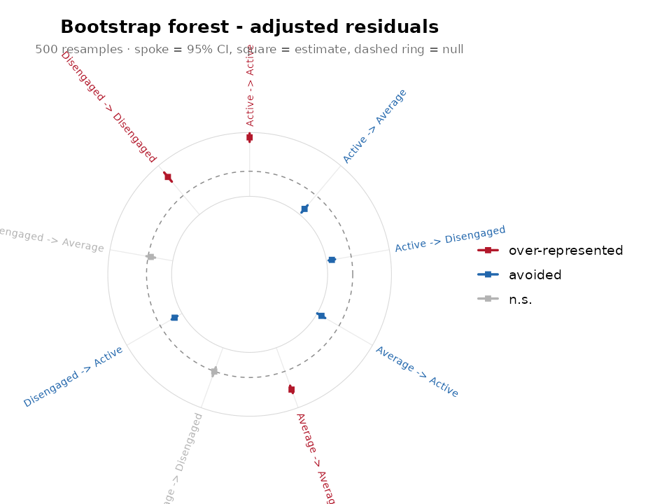

# Evaluating transitions

A fitted lag sequential model is an estimate, not a finding. The
adjusted residual tests each transition against independence, but that
test rests on large-sample assumptions that sequential data can violate:
transitions within one sequence are not independent observations, and a
few long or atypical sequences can carry a large share of the table. A
claim about a transition therefore needs evidence matched to its scope.
A claim about one edge needs an estimate of how precisely that edge is
known; a claim that a significant edge is real needs to survive the loss
of part of the sample; a claim about the whole network needs to
reproduce in independent halves of the data; and a claim that the
structure exceeds chance needs a null that does not rest on the
residual’s approximation.

`lagdynamics` pairs each kind of claim with a procedure. All of them
take the fitted model as their first argument and are read with
[`transitions()`](https://pak.dynasite.org/lagdynamics/reference/transitions.md),
the same verb that reads the fit.

| Claim | Evidence | Function |
|----|----|----|
| a transition is precisely estimated | edge-level uncertainty | [`certainty_lsa()`](https://pak.dynasite.org/lagdynamics/reference/certainty_lsa.md), [`bootstrap_lsa()`](https://pak.dynasite.org/lagdynamics/reference/bootstrap_lsa.md) |
| a significant transition is not fragile | robustness to case loss | [`stability_lsa()`](https://pak.dynasite.org/lagdynamics/reference/stability_lsa.md) |
| the whole network is reproducible | split-half reliability | [`reliability_lsa()`](https://pak.dynasite.org/lagdynamics/reference/reliability_lsa.md) |
| the structure exceeds chance | an empirical null | [`permute_lsa()`](https://pak.dynasite.org/lagdynamics/reference/permute_lsa.md) |

Differences between groups are a claim of their own and are covered in
[Comparing
groups](https://pak.dynasite.org/lagdynamics/articles/group-comparison.html).

## Data

`engagement` records the weekly engagement state of 138 students over 15
weeks; two rows are entirely missing, so the model uses 136 sequences.

- **Sequence:** each row is one student.
- **Order:** the column order, weeks 1 to 15.
- **State:** `Active`, `Average`, or `Disengaged`.

The student is the unit that all resampling procedures below draw, drop,
or split, because the transitions of one student are dependent.

``` r

library(lagdynamics)
fit <- lsa(engagement)
transitions(fit, significant = TRUE, sort = "strength")
#>         from         to lag count expected  prob prob_col adj_res         p yules_q
#> 1     Active     Active   1   459      247 0.698   0.7051    21.7 4.60e-104   0.828
#> 2 Disengaged Disengaged   1   157       60 0.483   0.4906    15.4  1.90e-53   0.754
#> 3    Average     Active   1   153      282 0.204   0.2350   -12.9  4.16e-38  -0.601
#> 4     Active Disengaged   1    23      121 0.035   0.0719   -12.6  3.64e-36  -0.826
#> 5    Average    Average   1   458      330 0.610   0.6003    12.5  1.35e-35   0.553
#> 6     Active    Average   1   176      290 0.267   0.2307   -11.3  1.06e-29  -0.534
#> 7 Disengaged     Active   1    39      122 0.120   0.0599   -10.5  5.11e-26  -0.698
#>    kappa kappa_z  kappa_p  lift  sign significant
#> 1  0.444   19.19 4.68e-82 1.858  over        TRUE
#> 2  0.314   13.56 7.34e-42 2.618  over        TRUE
#> 3 -0.499  -14.70 6.81e-49 0.543 under        TRUE
#> 4 -0.827  -13.41 5.14e-41 0.189 under        TRUE
#> 5  0.227    9.83 7.97e-23 1.386  over        TRUE
#> 6 -0.424  -12.48 9.39e-36 0.608 under        TRUE
#> 7 -0.707  -11.46 2.03e-30 0.320 under        TRUE
```

Seven of the nine transitions are significant: the three
self-transitions are over-represented, and the four moves into or out of
`Active` are avoided. The procedures below ask how much of this survives
scrutiny.

## Edge uncertainty

A claim about one transition requires an estimate of how much it could
vary.
[`certainty_lsa()`](https://pak.dynasite.org/lagdynamics/reference/certainty_lsa.md)
derives that uncertainty analytically: each state’s outgoing transitions
are modelled as Dirichlet-Multinomial, which gives a posterior mean, a
credible interval, and a certainty decision for every transition
probability without resampling.

``` r

cert <- certainty_lsa(fit)
cert
#> <lsa_certainty>  (analytic Dirichlet-Multinomial)
#>   engine:        classical
#>   prior:         Dirichlet(0.50)
#>   CI level:      95%  |  inference: stability
#>   certain edges: 7 of 9
transitions(cert)
#>         from         to observed prob_observed prob_mean prob_se prob_ci_low prob_ci_high
#> 1     Active     Active      459         0.698    0.6967 0.01789      0.6611        0.731
#> 2    Average     Active      153         0.204    0.2040 0.01468      0.1760        0.233
#> 3 Disengaged     Active       39         0.120    0.1210 0.01802      0.0879        0.158
#> 4     Active    Average      176         0.267    0.2676 0.01723      0.2345        0.302
#> 5    Average    Average      458         0.610    0.6093 0.01777      0.5742        0.644
#> 6 Disengaged    Average      129         0.397    0.3966 0.02703      0.3443        0.450
#> 7     Active Disengaged       23         0.035    0.0356 0.00721      0.0229        0.051
#> 8    Average Disengaged      140         0.186    0.1867 0.01420      0.1597        0.215
#> 9 Disengaged Disengaged      157         0.483    0.4824 0.02761      0.4284        0.537
#>    p_value stable adj_res_observed adj_res_stable
#> 1 5.56e-20   TRUE           21.663           TRUE
#> 2 6.06e-04   TRUE          -12.906           TRUE
#> 3 9.45e-02  FALSE          -10.549          FALSE
#> 4 1.21e-04   TRUE          -11.319           TRUE
#> 5 3.14e-17   TRUE           12.453           TRUE
#> 6 2.23e-04   TRUE           -1.736           TRUE
#> 7 2.19e-01  FALSE          -12.557          FALSE
#> 8 1.17e-03   TRUE            0.176           TRUE
#> 9 9.44e-06   TRUE           15.390           TRUE
```

The persistence `Active -> Active` is pinned down tightly: a probability
of 0.698 with a 95% credible interval from 0.661 to 0.731. Two edges are
not classed as stable. `Disengaged -> Active` has an interval from 0.088
to 0.158 around a probability of 0.120, wide relative to its size
because `Disengaged` is the least visited source state, and
`Active -> Disengaged` (0.035, interval 0.023 to 0.051) is equally
imprecise relative to its size. A residual can be large while the
probability behind it is still uncertain, which is why both are
reported.

[`bootstrap_lsa()`](https://pak.dynasite.org/lagdynamics/reference/bootstrap_lsa.md)
reaches the same question by resampling. It draws students with
replacement, refits the model on each resample, and records a percentile
interval for the count, the residual, the probability, and Yule’s Q of
every edge (Efron, 1979). Resampling whole sequences preserves the
dependence within each student that the analytic model ignores, so the
bootstrap is preferred when students may differ systematically. The seed
is set once here and governs every resampling procedure in this article;
the bootstrap draws 500 resamples.

``` r

set.seed(2026)
boot <- bootstrap_lsa(fit, R = 500)
boot
#> <lsa_bootstrap>
#>   engine:        classical
#>   level:         sequence
#>   replicates:    500
#>   CI level:      95%
#>   stable edges:  7 of 9
transitions(boot, significant = TRUE) |> head(4)
#>         from      to observed count_mean count_se count_ci_low count_ci_high
#> 1     Active  Active      459      462.9    49.96          367           558
#> 2    Average  Active      153      152.9    14.83          124           184
#> 3 Disengaged  Active       39       38.6     6.36           27            50
#> 4     Active Average      176      176.4    15.53          148           207
#>   adj_res_observed adj_res_mean adj_res_se adj_res_ci_low adj_res_ci_high adj_res_p_boot
#> 1             21.7         21.7       1.48           18.8           24.31              0
#> 2            -12.9        -13.0       1.52          -16.1          -10.12              0
#> 3            -10.5        -10.5       1.11          -12.6           -8.35              0
#> 4            -11.3        -11.4       1.61          -14.4           -8.28              0
#>   adj_res_stable prob_observed prob_mean prob_ci_low prob_ci_high yules_q_observed
#> 1           TRUE         0.698     0.698      0.6402        0.748            0.828
#> 2           TRUE         0.204     0.204      0.1629        0.247           -0.601
#> 3           TRUE         0.120     0.121      0.0797        0.164           -0.698
#> 4           TRUE         0.267     0.268      0.2218        0.323           -0.534
#>   yules_q_mean yules_q_ci_low yules_q_ci_high
#> 1        0.827          0.761           0.877
#> 2       -0.602         -0.702          -0.483
#> 3       -0.697         -0.796          -0.583
#> 4       -0.533         -0.641          -0.406
```

Seven of the nine edges are stable under the bootstrap: their residual
interval excludes zero. `transitions(boot, significant = TRUE)` keeps
those seven, and the first four are shown. The residual of
`Active -> Active` ranges from 18.8 to 24.31 across resamples, far from
zero. Its probability interval, 0.640 to 0.748, is wider than the
analytic credible interval (0.661 to 0.731) because resampling students
carries the variation between students that the Dirichlet-Multinomial
model treats as absent. `Disengaged -> Active` shows why the two
procedures answer different questions: its residual interval (-12.6 to
-8.35) is firmly negative, so the avoidance itself is not in doubt,
while its probability (0.080 to 0.164) remains imprecise.

The bootstrap forest shows the interval of every edge at once.

``` r

plot(boot)
```



Each spoke is one edge: the square is the bootstrap estimate of the
adjusted residual, the bar its 95% interval, and the dashed ring the
null value of zero. The seven significant edges lie clearly inside or
outside the ring, over-represented edges outside and avoided edges
inside, while the two grey, non-significant edges,
`Average -> Disengaged` and `Disengaged -> Average`, sit on it. No
significant edge has an interval that reaches the null.

## Robustness to case loss

[`stability_lsa()`](https://pak.dynasite.org/lagdynamics/reference/stability_lsa.md)
repeatedly drops a share of the students, refits, and records the
fraction of replicates in which each edge is significant (`stability`).
By default it keeps 80% of the students per replicate and flags an edge
as stable when it is significant in at least 95% of replicates. The call
below runs 200 replicates.

``` r

stab <- stability_lsa(fit, R = 200)
stab
#> <lsa_stability>
#>   engine:        classical
#>   replicates:    200
#>   proportion:    80%
#>   min stable:    95%
#>   failed:        0 of 200 replicates
#>   stable edges:  7 of 9 (>= 95% across replicates)
transitions(stab)
#>         from         to observed_sig stability stable
#> 1     Active     Active         TRUE     1.000   TRUE
#> 2    Average     Active         TRUE     1.000   TRUE
#> 3 Disengaged     Active         TRUE     1.000   TRUE
#> 4     Active    Average         TRUE     1.000   TRUE
#> 5    Average    Average         TRUE     1.000   TRUE
#> 6 Disengaged    Average        FALSE     0.255  FALSE
#> 7     Active Disengaged         TRUE     1.000   TRUE
#> 8    Average Disengaged        FALSE     0.005  FALSE
#> 9 Disengaged Disengaged         TRUE     1.000   TRUE
```

None of the 200 replicates failed, and all seven significant edges
remain significant in every replicate (stability 1.000), so the
significance pattern does not depend on particular students. Of the two
non-significant edges, `Average -> Disengaged` is significant in 0.5% of
replicates and `Disengaged -> Average` in 25.5%: the latter has a
residual of -1.7, close to the threshold, and crosses it in some
subsamples. Its non-significance is therefore a borderline result rather
than a firm absence of effect.

## Reproducibility of the whole network

[`reliability_lsa()`](https://pak.dynasite.org/lagdynamics/reference/reliability_lsa.md)
raises the claim from one edge to the whole network. It splits the
students at random into two halves, fits a model to each, and correlates
the two vectors of edge weights (transition probabilities by default);
the distribution of this split-half correlation over replicates measures
how reproducible the network is within the sample (Epskamp, Borsboom, &
Fried, 2018). The call below draws 100 splits.

``` r

rel <- reliability_lsa(fit, R = 100)
rel
#> <lsa_reliability>
#>   engine:        classical
#>   replicates:    100
#>   weights:       prob
#>   method:        pearson
#>   n sequences:   136
#>   split-half r:  0.966  (sd = 0.034)
#>   95% CI:        [0.866, 0.998]
#>   failed:        0 of 100 replicates
as.data.frame(rel, what = "summary")
#>   weights  method   R n_failed  mean     sd ci_low ci_high
#> 1    prob pearson 100        0 0.966 0.0335  0.866   0.998
```

The mean split-half correlation of the transition probabilities is 0.966
(sd 0.034), with 95% of replicates between 0.866 and 0.998: two
independent halves of the students produce nearly the same network. The
printout and the summary table also report failed replicates, splits in
which a half could not be fitted (for example because a state is absent
from it); here the count is 0 of 100, so the correlation rests on every
split drawn. A non-zero count is reported rather than silently dropped
and is read before the correlation.

## An empirical null

[`permute_lsa()`](https://pak.dynasite.org/lagdynamics/reference/permute_lsa.md)
builds the null of no sequential structure by shuffling the order of
states within each student and refitting. Shuffling within a sequence
keeps every student’s mix of states, so the null asks whether a
transition is more or less frequent than that mix implies, and the
p-value does not depend on the residual’s large-sample approximation.
The call below runs 500 permutations, so the smallest attainable p-value
is 1/501.

``` r

perm <- permute_lsa(fit, R = 500)
perm
#> <lsa_permutation>
#>   engine:        classical
#>   replicates:    500
#>   within seq:    TRUE
#>   significant edges (p_perm < 0.050): 7 of 9
transitions(perm)
#>         from         to observed_count observed_adj_res  p_perm significant
#> 1     Active     Active            459           21.663 0.00200        TRUE
#> 2    Average     Active            153          -12.906 0.00200        TRUE
#> 3 Disengaged     Active             39          -10.549 0.07784       FALSE
#> 4     Active    Average            176          -11.319 0.00998        TRUE
#> 5    Average    Average            458           12.453 0.00200        TRUE
#> 6 Disengaged    Average            129           -1.736 0.02196        TRUE
#> 7     Active Disengaged             23          -12.557 0.00200        TRUE
#> 8    Average Disengaged            140            0.176 0.82036       FALSE
#> 9 Disengaged Disengaged            157           15.390 0.00200        TRUE
```

Seven edges are significant under the permutation null, as under the
residual test, but not the same seven. Five edges reach p = 0.00200, the
smallest value 500 permutations can produce. `Disengaged -> Active`,
with a residual of -10.5, has a permutation p-value of 0.078 and is not
significant. Shuffling within each student keeps that student’s mix of
states, so a student who is rarely both disengaged and active produces
few such moves under the null as well; the avoidance is explained by
which students are disengaged, not by the order of their weeks. The
reverse holds for `Disengaged -> Average`: its residual (-1.7) is not
significant, but its permutation p-value is 0.022, so disengaged
students move to `Average` less often than their own mix of states
implies. `Disengaged -> Active` is also the edge whose probability
[`certainty_lsa()`](https://pak.dynasite.org/lagdynamics/reference/certainty_lsa.md)
did not class as stable, so the claim that disengaged students avoid
becoming active rests on the residual alone and is not reported as an
established sequential effect.

## When to use which

- **A descriptive reading of a transition** needs only the fit:
  `transitions(fit)`.
- **How precisely a transition is known:**
  [`certainty_lsa()`](https://pak.dynasite.org/lagdynamics/reference/certainty_lsa.md)
  when sequences are homogeneous and a fast analytic answer is enough,
  [`bootstrap_lsa()`](https://pak.dynasite.org/lagdynamics/reference/bootstrap_lsa.md)
  when sequences may differ.
- **Whether a significant transition depends on particular cases:**
  [`stability_lsa()`](https://pak.dynasite.org/lagdynamics/reference/stability_lsa.md).
- **Whether the whole network reproduces:**
  [`reliability_lsa()`](https://pak.dynasite.org/lagdynamics/reference/reliability_lsa.md).
- **Whether a transition exceeds what each sequence’s own mix of states
  implies:**
  [`permute_lsa()`](https://pak.dynasite.org/lagdynamics/reference/permute_lsa.md).
- **Whether two groups differ:**
  [`compare_lsa()`](https://pak.dynasite.org/lagdynamics/reference/compare_lsa.md)
  and
  [`bayes_compare_lsa()`](https://pak.dynasite.org/lagdynamics/reference/bayes_compare_lsa.md),
  in [Comparing
  groups](https://pak.dynasite.org/lagdynamics/articles/group-comparison.html).

A transition that is significant, precisely estimated, stable under case
loss, and beyond the permutation null is the kind to report as a
finding.

## References

Efron, B. (1979). Bootstrap methods: Another look at the jackknife.
*Annals of Statistics, 7*(1), 1-26.

Epskamp, S., Borsboom, D., & Fried, E. I. (2018). Estimating
psychological networks and their accuracy: A tutorial paper. *Behavior
Research Methods, 50*(1), 195-212.
