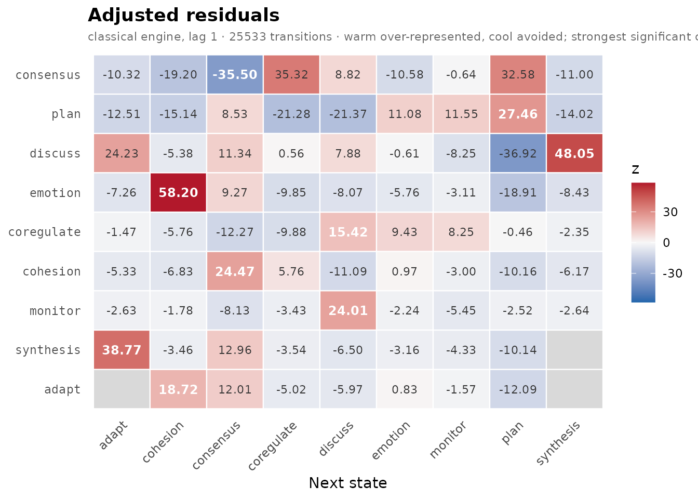
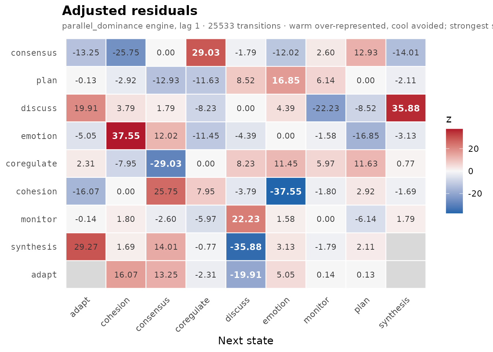

# Engines: classical, two-cell, bidirectional and dominance tests

Lag sequential analysis starts from one table: the counts $`O_{ij}`$ of
how often state $`i`$ was followed by state $`j`$ at a given lag.
Several classical tests can be computed from that table, and they answer
different questions. The classical test asks whether a directed
transition $`i \to j`$ occurs more or less often than the base rates of
$`i`$ and $`j`$ predict (Bakeman & Quera, 2011). The two-cell test asks
the same question through the odds ratio of a $`2 \times 2`$ collapse
(Bakeman & Gottman, 1997). The bidirectional test drops direction and
asks whether the pair $`\{i, j\}`$ co-occurs more than expected. The two
dominance tests ask whether, within the pair, $`i \to j`$ outnumbers
$`j \to i`$ (Sackett, 1979; Wampold, 1984).

In `lagdynamics` each of these tests is an *engine*: a function that
takes the transition table and returns per-cell statistics. Every engine
is reached through `lsa(data, engine = )` or through a wrapper with the
engine fixed
([`lsa_classical()`](https://pak.dynasite.org/lagdynamics/reference/lsa.md),
[`lsa_two_cell()`](https://pak.dynasite.org/lagdynamics/reference/lsa.md),
[`lsa_bidirectional()`](https://pak.dynasite.org/lagdynamics/reference/lsa.md),
[`lsa_parallel_dominance()`](https://pak.dynasite.org/lagdynamics/reference/lsa.md),
[`lsa_nonparallel_dominance()`](https://pak.dynasite.org/lagdynamics/reference/lsa.md)),
and every fit is read with the same verbs:
[`transitions()`](https://pak.dynasite.org/lagdynamics/reference/transitions.md),
[`tests()`](https://pak.dynasite.org/lagdynamics/reference/tests.md),
[`plot()`](https://rdrr.io/r/graphics/plot.default.html). This guide
gives, for each engine, the statistic, the null hypothesis, the columns
it adds to
[`transitions()`](https://pak.dynasite.org/lagdynamics/reference/transitions.md),
and the question it answers. It then fits all five on the same data,
shows where they agree and where they part ways, and ends with how to
register an engine of your own. The model and its reading verbs are
introduced in [the LSA
vignette](https://pak.dynasite.org/lagdynamics/articles/lsa.md);
structural zeros, which only the classical engine supports, are covered
in [the lags and structural zeros
guide](https://pak.dynasite.org/lagdynamics/articles/lags-structural-zeros.md).

``` r

library(lagdynamics)
```

## Data

Two bundled datasets are used.

- **`engagement`**: weekly engagement states of 138 students over 15
  weeks, one row per student (wide format). States: `Active`, `Average`,
  `Disengaged`. Two rows are entirely missing, so fits use 136
  sequences. With three states each table has nine cells, small enough
  to print in full.
- **`group_regulation`**: coded regulation actions in 2,000
  collaborative learning sessions, one row per group session and one
  column per ordered time point (`T1` to `T26`, shorter sessions padded
  with `NA`). Nine states: `adapt`, `cohesion`, `consensus`,
  `coregulate`, `discuss`, `emotion`, `monitor`, `plan`, `synthesis`.
  Used to compare the engines on a larger table.

The registry lists the engines available in the session.

``` r

list_lsa_engines()
#>                    name
#> 1         bidirectional
#> 2             classical
#> 3 nonparallel_dominance
#> 4    parallel_dominance
#> 5              two_cell
#>                                                            description requires
#> 1 Sackett's bidirectional / matched-pair test on the symmetrized table         
#> 2                    Bakeman & Quera classical lag sequential analysis         
#> 3       Sackett's non-parallel-dominance (observed-SE + binomial) test         
#> 4                      Sackett's parallel-dominance (expected-SE) test         
#> 5                  2x2 cell test (odds ratio, log-OR Wald z, Yule's Q)
```

The five built-in engines are registered when the package loads. Any
engine added with
[`register_lsa_engine()`](https://pak.dynasite.org/lagdynamics/reference/register_lsa_engine.md)
appears in the same table.

## Classical: adjusted residuals under independence

The classical engine tests each directed cell against sequential
independence. With row totals $`R_i`$, column totals $`C_j`$ and $`N`$
transitions, the expected count and the adjusted residual (Haberman,
1973) are

``` math
E_{ij} = \frac{R_i C_j}{N}, \qquad
z_{ij} = \frac{O_{ij} - E_{ij}}{\sqrt{E_{ij}\,(1 - R_i/N)\,(1 - C_j/N)}}.
```

The null for each cell is that the next state does not depend on the
current one; $`z_{ij}`$ is referred to the standard normal. Alongside
the residual, the engine reports Yule’s $`Q = (ad - bc)/(ad + bc)`$ from
the $`2 \times 2`$ collapse of the cell ($`a = O_{ij}`$,
$`b = R_i - O_{ij}`$, $`c = C_j - O_{ij}`$,
$`d = N - R_i - C_j + O_{ij}`$), Wampold’s unidirectional kappa with its
own $`z`$ and $`p`$ (computed from event totals rather than transition
totals), and the tablewise likelihood-ratio $`G^2 = 2\sum O \log(O/E)`$
and Pearson $`X^2`$ tests with $`(K-1)^2`$ degrees of freedom. It is the
only engine that supports structural zeros.

``` r

fit_classical <- lsa_classical(engagement)
fit_classical
#> Lag Sequential Analysis  -  classical  (lag 1, directed)
#>   3 states | 1734 transitions | 1870 events | 136 sequences
#>   states: Active, Average, Disengaged
#>   independence: G² = 618.3, df = 4, p <2e-16
#> 
#>   Significant transitions (p < 0.05): 7 of 9
#>   strongest over-represented (of 3):
#>     Active -> Active          z =  +21.7  ***
#>     Disengaged -> Disengaged  z =  +15.4  ***
#>     Average -> Average        z =  +12.5  ***
#> 
#>   Initial states:
#>     Active     0.382  ████████████████████████
#>     Average    0.368  ███████████████████████
#>     Disengaged 0.250  ████████████████
transitions(fit_classical)
#>         from         to lag count expected  prob prob_col adj_res         p yules_q
#> 1     Active     Active   1   459      247 0.698   0.7051  21.663 4.60e-104   0.828
#> 2    Average     Active   1   153      282 0.204   0.2350 -12.906  4.16e-38  -0.601
#> 3 Disengaged     Active   1    39      122 0.120   0.0599 -10.549  5.11e-26  -0.698
#> 4     Active    Average   1   176      290 0.267   0.2307 -11.319  1.06e-29  -0.534
#> 5    Average    Average   1   458      330 0.610   0.6003  12.453  1.35e-35   0.553
#> 6 Disengaged    Average   1   129      143 0.397   0.1691  -1.736  8.25e-02  -0.108
#> 7     Active Disengaged   1    23      121 0.035   0.0719 -12.557  3.64e-36  -0.826
#> 8    Average Disengaged   1   140      139 0.186   0.4375   0.176  8.60e-01   0.011
#> 9 Disengaged Disengaged   1   157       60 0.483   0.4906  15.390  1.90e-53   0.754
#>     kappa kappa_z  kappa_p  lift  sign significant
#> 1  0.4438   19.19 4.68e-82 1.858  over        TRUE
#> 2 -0.4994  -14.70 6.81e-49 0.543 under        TRUE
#> 3 -0.7069  -11.46 2.03e-30 0.320 under        TRUE
#> 4 -0.4242  -12.48 9.39e-36 0.608 under        TRUE
#> 5  0.2275    9.83 7.97e-23 1.386  over        TRUE
#> 6 -0.1618   -2.96 3.03e-03 0.902 under       FALSE
#> 7 -0.8272  -13.41 5.14e-41 0.189 under        TRUE
#> 8 -0.0903   -1.66 9.79e-02 1.010  over       FALSE
#> 9  0.3136   13.56 7.34e-42 2.618  over        TRUE
tests(fit_classical)
#>   test statistic df         p
#> 1 lrx2       618  4 1.69e-132
#> 2   x2       629  4 7.41e-135
```

Seven of the nine transitions depart from independence. The three
self-transitions are the over-represented cells (Active to Active,
$`z = 21.7`$, 459 observed against 247 expected), and every move between
`Active` and the other two states is under-represented. The two
transitions out of `Disengaged` into `Average` and out of `Average` into
`Disengaged` are the only ones consistent with independence
($`z = -1.74`$ and $`z = 0.18`$). The tablewise test rejects
independence for the table as a whole ($`G^2 = 618`$, df = 4). The
answer to the classical question is that weekly engagement is sticky:
students tend to stay where they are, and direct moves between `Active`
and `Disengaged` are rare (23 and 39 transitions against expectations of
121 and 122).

## Two-cell: the log odds ratio

The two-cell engine collapses each cell into the same $`2 \times 2`$
table ($`a, b, c, d`$ above) and tests the odds ratio $`OR = ad/(bc)`$
with a Wald test on its logarithm:

``` math
z_{ij} = \frac{\log OR_{ij}}{\sqrt{1/a + 1/b + 1/c + 1/d}}.
```

When any of the four counts is zero, 0.5 is added to all four (the
Haldane-Anscombe correction; the amount is the engine parameter
`continuity`). The null is $`OR = 1`$: being in state $`i`$ does not
change the odds that the next state is $`j`$. The residual column
`adj_res` holds this Wald $`z`$, and the engine appends `odds_ratio`,
`log_or` and `log_or_se`. Kappa is not computed and there is no
tablewise test.

``` r

transitions(lsa_two_cell(engagement))
#>         from         to lag count expected  prob prob_col adj_res        p yules_q kappa
#> 1     Active     Active   1   459      247 0.698   0.7051  20.302 1.22e-91   0.828    NA
#> 2    Average     Active   1   153      282 0.204   0.2350 -12.541 4.46e-36  -0.601    NA
#> 3 Disengaged     Active   1    39      122 0.120   0.0599  -9.658 4.57e-22  -0.698    NA
#> 4     Active    Average   1   176      290 0.267   0.2307 -11.096 1.32e-28  -0.534    NA
#> 5    Average    Average   1   458      330 0.610   0.6003  12.243 1.83e-34   0.553    NA
#> 6 Disengaged    Average   1   129      143 0.397   0.1691  -1.735 8.28e-02  -0.108    NA
#> 7     Active Disengaged   1    23      121 0.035   0.0719 -10.558 4.66e-26  -0.826    NA
#> 8    Average Disengaged   1   140      139 0.186   0.4375   0.176 8.60e-01   0.011    NA
#> 9 Disengaged Disengaged   1   157       60 0.483   0.4906  14.168 1.44e-45   0.754    NA
#>   kappa_z kappa_p  lift  sign significant odds_ratio  log_or log_or_se
#> 1      NA      NA 1.858  over        TRUE     10.620  2.3627     0.116
#> 2      NA      NA 0.543 under        TRUE      0.249 -1.3896     0.111
#> 3      NA      NA 0.320 under        TRUE      0.178 -1.7283     0.179
#> 4      NA      NA 0.608 under        TRUE      0.304 -1.1901     0.107
#> 5      NA      NA 1.386  over        TRUE      3.475  1.2455     0.102
#> 6      NA      NA 0.902 under       FALSE      0.805 -0.2175     0.125
#> 7      NA      NA 0.189 under        TRUE      0.095 -2.3539     0.223
#> 8      NA      NA 1.010  over       FALSE      1.022  0.0219     0.125
#> 9      NA      NA 2.618  over        TRUE      7.144  1.9662     0.139
```

The two-cell test flags the same seven transitions as the classical
test, with the same signs, and its Yule’s Q column is identical because
both engines compute $`Q`$ from the same collapse. The $`z`$ values are
close but not equal (Active to Active: 20.3 against 21.7) because the
Wald statistic uses the standard error of the log odds ratio rather than
the expected-count variance. The engine earns its place through its
effect size: an odds ratio of 10.6 for Active to Active says that an
active week multiplies the odds of another active week by more than ten,
and an odds ratio of 0.095 for Active to Disengaged says that an active
week cuts the odds of a disengaged one by about a factor of ten.

## Bidirectional: the unordered pair

The bidirectional engine asks whether two states follow each other in
either order more often than expected. It symmetrises the table,
$`W = O + O^\top`$, and computes adjusted residuals on $`W`$ with
symmetric margins $`R^W_i = \sum_j W_{ij}`$:

``` math
E^W_{ij} = \frac{R^W_i R^W_j}{N_W}, \qquad
z_{ij} = \frac{W_{ij} - E^W_{ij}}{\sqrt{E^W_{ij}\,(1 - R^W_i/N_W)\,(1 - R^W_j/N_W)}}.
```

The statistic is symmetric, so the rows $`i \to j`$ and $`j \to i`$
carry the same `adj_res` and `p`; the fit is marked undirected. A
diagonal cell of $`W`$ is twice the self-transition count. The engine
appends `symmetric_obs` ($`W_{ij}`$) and `symmetric_exp` ($`E^W_{ij}`$);
`expected` also holds $`E^W_{ij}`$. The `count`, `prob`, `lift` and
`sign` columns are computed from the directed counts, so the
bidirectional result is read from `adj_res`, `symmetric_obs` and
`symmetric_exp`, not from `lift` or `sign`.

``` r

transitions(lsa_bidirectional(engagement))
#>         from         to lag count expected  prob prob_col adj_res         p yules_q kappa
#> 1     Active     Active   1   459      494 0.698   0.7051   30.63 4.29e-206  0.8278    NA
#> 2    Average     Active   1   153      571 0.204   0.2350  -17.13  9.61e-66 -0.5675    NA
#> 3 Disengaged     Active   1    39      243 0.120   0.0599  -16.34  5.43e-60 -0.7630    NA
#> 4     Active    Average   1   176      571 0.267   0.2307  -17.13  9.61e-66 -0.5675    NA
#> 5    Average    Average   1   458      661 0.610   0.6003   17.61  2.18e-69  0.5529    NA
#> 6 Disengaged    Average   1   129      282 0.397   0.1691   -1.11  2.68e-01 -0.0489    NA
#> 7     Active Disengaged   1    23      243 0.035   0.0719  -16.34  5.43e-60 -0.7630    NA
#> 8    Average Disengaged   1   140      282 0.186   0.4375   -1.11  2.68e-01 -0.0489    NA
#> 9 Disengaged Disengaged   1   157      120 0.483   0.4906   21.76 5.10e-105  0.7544    NA
#>   kappa_z kappa_p   lift  sign significant symmetric_obs symmetric_exp
#> 1      NA      NA 0.9290 under        TRUE           918           494
#> 2      NA      NA 0.2677 under        TRUE           329           571
#> 3      NA      NA 0.1602 under        TRUE            62           243
#> 4      NA      NA 0.3080 under        TRUE           329           571
#> 5      NA      NA 0.6929 under        TRUE           916           661
#> 6      NA      NA 0.4581 under       FALSE           269           282
#> 7      NA      NA 0.0945 under        TRUE            62           243
#> 8      NA      NA 0.4972 under       FALSE           269           282
#> 9      NA      NA 1.3088  over        TRUE           314           120
```

The pair `Active`/`Disengaged` occurs 62 times in either order against
243 expected ($`z = -16.3`$), and the pair `Active`/`Average` 329 times
against 571 ($`z = -17.1`$). The pair `Average`/`Disengaged` is not
distinguishable from independence ($`z = -1.11`$). The bidirectional
reading agrees with the classical one but compresses it: the classical
engine needed two cells to say that `Active` and `Disengaged` avoid each
other, the bidirectional engine says it once.

## Dominance: which direction wins within a pair

The dominance engines take each pair of states and ask whether one
direction outnumbers the other. Both use the difference
$`D_{ij} = O_{ij} - O_{ji}`$ and differ in its standard error. The
parallel-dominance engine scales by the counts expected under
independence,

``` math
z_{ij} = \frac{O_{ij} - O_{ji}}{\sqrt{E_{ij} + E_{ji}}},
```

and the non-parallel-dominance engine scales by the observed pair total,

``` math
z_{ij} = \frac{O_{ij} - O_{ji}}{\sqrt{O_{ij} + O_{ji}}},
```

which is the normal approximation to the exact test of
$`O_{ij} \sim \text{Binomial}(O_{ij} + O_{ji}, 1/2)`$; that exact
p-value is also returned. The null is symmetry within the pair:
$`i \to j`$ and $`j \to i`$ are equally likely. The statistic is
antisymmetric ($`z_{ij} = -z_{ji}`$) and a self-transition has no
direction, so the diagonal is $`z = 0`$, $`p = 1`$. Both engines put the
dominance $`z`$ in `adj_res` and append `dominance` ($`D_{ij}`$); the
parallel engine adds `dominance_se`, the non-parallel engine adds
`pair_totals` and `binomial_p`. The `expected`, `lift` and `sign`
columns still describe the independence model, not the dominance test.

``` r

transitions(lsa_parallel_dominance(engagement))
#>         from         to lag count expected  prob prob_col adj_res     p yules_q kappa
#> 1     Active     Active   1   459      247 0.698   0.7051   0.000 1.000   0.828    NA
#> 2    Average     Active   1   153      282 0.204   0.2350  -0.962 0.336  -0.601    NA
#> 3 Disengaged     Active   1    39      122 0.120   0.0599   1.025 0.305  -0.698    NA
#> 4     Active    Average   1   176      290 0.267   0.2307   0.962 0.336  -0.534    NA
#> 5    Average    Average   1   458      330 0.610   0.6003   0.000 1.000   0.553    NA
#> 6 Disengaged    Average   1   129      143 0.397   0.1691  -0.656 0.512  -0.108    NA
#> 7     Active Disengaged   1    23      121 0.035   0.0719  -1.025 0.305  -0.826    NA
#> 8    Average Disengaged   1   140      139 0.186   0.4375   0.656 0.512   0.011    NA
#> 9 Disengaged Disengaged   1   157       60 0.483   0.4906   0.000 1.000   0.754    NA
#>   kappa_z kappa_p  lift  sign significant dominance dominance_se
#> 1      NA      NA 1.858  over       FALSE         0         22.2
#> 2      NA      NA 0.543 under       FALSE       -23         23.9
#> 3      NA      NA 0.320 under       FALSE        16         15.6
#> 4      NA      NA 0.608 under       FALSE        23         23.9
#> 5      NA      NA 1.386  over       FALSE         0         25.7
#> 6      NA      NA 0.902 under       FALSE       -11         16.8
#> 7      NA      NA 0.189 under       FALSE       -16         15.6
#> 8      NA      NA 1.010  over       FALSE        11         16.8
#> 9      NA      NA 2.618  over       FALSE         0         11.0
```

No pair has a dominant direction under the parallel test. The largest
count difference is between `Active` and `Average` ($`D = 23`$,
$`z = 0.96`$): students move from `Active` down to `Average` 176 times
and back up 153 times, a difference well within chance.

``` r

transitions(lsa_nonparallel_dominance(engagement))
#>         from         to lag count expected  prob prob_col adj_res      p yules_q kappa
#> 1     Active     Active   1   459      247 0.698   0.7051   0.000 1.0000   0.828    NA
#> 2    Average     Active   1   153      282 0.204   0.2350  -1.268 0.2048  -0.601    NA
#> 3 Disengaged     Active   1    39      122 0.120   0.0599   2.032 0.0422  -0.698    NA
#> 4     Active    Average   1   176      290 0.267   0.2307   1.268 0.2048  -0.534    NA
#> 5    Average    Average   1   458      330 0.610   0.6003   0.000 1.0000   0.553    NA
#> 6 Disengaged    Average   1   129      143 0.397   0.1691  -0.671 0.5024  -0.108    NA
#> 7     Active Disengaged   1    23      121 0.035   0.0719  -2.032 0.0422  -0.826    NA
#> 8    Average Disengaged   1   140      139 0.186   0.4375   0.671 0.5024   0.011    NA
#> 9 Disengaged Disengaged   1   157       60 0.483   0.4906   0.000 1.0000   0.754    NA
#>   kappa_z kappa_p  lift  sign significant dominance pair_totals binomial_p
#> 1      NA      NA 1.858  over       FALSE         0         918         NA
#> 2      NA      NA 0.543 under       FALSE       -23         329     0.2251
#> 3      NA      NA 0.320 under        TRUE        16          62     0.0559
#> 4      NA      NA 0.608 under       FALSE        23         329     0.2251
#> 5      NA      NA 1.386  over       FALSE         0         916         NA
#> 6      NA      NA 0.902 under       FALSE       -11         269     0.5421
#> 7      NA      NA 0.189 under        TRUE       -16          62     0.0559
#> 8      NA      NA 1.010  over       FALSE        11         269     0.5421
#> 9      NA      NA 2.618  over       FALSE         0         314         NA
```

The non-parallel test flags one pair: `Disengaged` to `Active`
outnumbers `Active` to `Disengaged`, 39 against 23 ($`D = 16`$,
$`z = 2.03`$, $`p = 0.042`$). The two dominance tests differ here
because the pair is rare. Under independence the pair would occur 243
times, so the parallel standard error is $`\sqrt{243} = 15.6`$; it
actually occurs 62 times, so the non-parallel standard error is
$`\sqrt{62} = 7.87`$. The exact binomial p-value for the same pair is
0.056, above 0.05, while the `significant` column follows the normal
$`p`$. With a pair total of 62 the exact test is the one to report, and
it does not support a dominant direction: direct jumps between `Active`
and `Disengaged` run upward somewhat more often than downward, but not
reliably so.

## Where the engines agree and disagree

On the larger `group_regulation` table the engines can be compared on
the transitions they rank first. The classical and two-cell engines are
printed first.

``` r

fit_gr <- lsa_classical(group_regulation)
transitions(fit_gr, significant = TRUE, sort = "strength") |> head(6)
#>        from         to lag count expected   prob prob_col adj_res         p yules_q
#> 1   emotion   cohesion   1   923    190.9 0.3253   0.5373    58.2  0.00e+00   0.860
#> 2   discuss  synthesis   1   557    106.8 0.1410   0.8072    48.0  0.00e+00   0.927
#> 3 synthesis      adapt   1   153     13.6 0.2347   0.2881    38.8  0.00e+00   0.904
#> 4   discuss       plan   1    46    961.6 0.0116   0.0074   -36.9 2.20e-298  -0.943
#> 5 consensus  consensus   1   519   1578.7 0.0820   0.0815   -35.5 5.32e-276  -0.661
#> 6 consensus coregulate   1  1188    519.3 0.1877   0.5671    35.3 3.36e-273   0.647
#>    kappa kappa_z   kappa_p    lift  sign significant
#> 1  0.439    55.0  0.00e+00  4.8353  over        TRUE
#> 2  0.721    46.1  0.00e+00  5.2168  over        TRUE
#> 3  0.256    37.0 2.44e-299 11.2837  over        TRUE
#> 4 -0.955   -38.2 2.88e-319  0.0478 under        TRUE
#> 5 -0.691   -37.6 7.65e-309  0.3287 under        TRUE
#> 6  0.412    34.6 5.06e-262  2.2877  over        TRUE
transitions(lsa_two_cell(group_regulation), significant = TRUE,
            sort = "strength") |> head(6)
#>        from         to lag count expected  prob prob_col adj_res         p yules_q kappa
#> 1   emotion   cohesion   1   923    190.9 0.325   0.5373    48.0  0.00e+00   0.860    NA
#> 2   discuss  synthesis   1   557    106.8 0.141   0.8072    33.3 1.08e-243   0.927    NA
#> 3 consensus coregulate   1  1188    519.3 0.188   0.5671    32.9 6.20e-237   0.647    NA
#> 4 consensus  consensus   1   519   1578.7 0.082   0.0815   -32.8 1.73e-236  -0.661    NA
#> 5 consensus       plan   1  2505   1540.3 0.396   0.4031    31.9 1.49e-223   0.465    NA
#> 6 synthesis      adapt   1   153     13.6 0.235   0.2881    28.2 3.83e-175   0.904    NA
#>   kappa_z kappa_p   lift  sign significant odds_ratio log_or log_or_se
#> 1      NA      NA  4.835  over        TRUE     13.285   2.59    0.0539
#> 2      NA      NA  5.217  over        TRUE     26.467   3.28    0.0983
#> 3      NA      NA  2.288  over        TRUE      4.662   1.54    0.0468
#> 4      NA      NA  0.329 under        TRUE      0.204  -1.59    0.0484
#> 5      NA      NA  1.626  over        TRUE      2.737   1.01    0.0315
#> 6      NA      NA 11.284  over        TRUE     19.876   2.99    0.1060
```

Both engines rank `emotion -> cohesion` first (classical $`z = 58.2`$,
two-cell $`z = 48.0`$) and agree on the sign of every listed cell, but
their orderings differ below the top: the classical engine puts
`synthesis -> adapt` third and `discuss -> plan` fourth, the two-cell
engine puts `consensus -> coregulate` third and `consensus -> consensus`
fourth. The Wald $`z`$ falls furthest below the adjusted residual for
the most lopsided cells: `discuss -> synthesis` (odds ratio 26.5) drops
from 48.0 to 33.3 and `synthesis -> adapt` from 38.8 to 28.2, while
`consensus -> coregulate` (odds ratio 4.66) moves only from 35.3 to
32.9. The classical $`z`$ is the statistic to rank by; the odds ratio is
the effect size to report next to it.

The bidirectional engine ranks pairs, so its top rows come in mirrored
pairs.

``` r

transitions(lsa_bidirectional(group_regulation), significant = TRUE,
            sort = "strength") |> head(6)
#>        from        to lag count expected   prob prob_col adj_res p yules_q kappa kappa_z
#> 1 consensus consensus   1   519     3157 0.0820   0.0815   -50.2 0  -0.661    NA      NA
#> 2   emotion  cohesion   1   923      375 0.3253   0.5373    42.2 0   0.648    NA      NA
#> 3  cohesion   emotion   1   196      375 0.1156   0.0707    42.2 0   0.648    NA      NA
#> 4      plan   discuss   1   418     1906 0.0679   0.1067   -41.3 0  -0.717    NA      NA
#> 5   discuss      plan   1    46     1906 0.0116   0.0074   -41.3 0  -0.717    NA      NA
#> 6      plan      plan   1  2304     2997 0.3742   0.3708    38.8 0   0.406    NA      NA
#>   kappa_p   lift  sign significant symmetric_obs symmetric_exp
#> 1      NA 0.1644 under        TRUE          1038          3157
#> 2      NA 2.4621  over        TRUE          1119           375
#> 3      NA 0.5228 under        TRUE          1119           375
#> 4      NA 0.2193 under        TRUE           464          1906
#> 5      NA 0.0241 under        TRUE           464          1906
#> 6      NA 0.7688 under        TRUE          4608          2997
```

The strongest bidirectional result is a self-transition: `consensus`
follows itself far less often than independence predicts
($`z = -50.2`$). The pair `emotion`/`cohesion` follows ($`z = 42.2`$),
with 923 transitions one way and 196 the other. The pair
`plan`/`discuss` is avoided in both directions ($`z = -41.3`$). The
bidirectional view hides the fact that `emotion -> cohesion` is the
dominant direction of the pair, which is the question the dominance
engines answer.

``` r

transitions(lsa_parallel_dominance(group_regulation), direction = "over",
            sort = "strength") |> head(5)
#>        from         to lag count expected  prob prob_col adj_res         p yules_q kappa
#> 1   emotion   cohesion   1   923    190.9 0.325    0.537    37.5 1.59e-308   0.860    NA
#> 2   discuss  synthesis   1   557    106.8 0.141    0.807    35.9 5.32e-282   0.927    NA
#> 3 synthesis      adapt   1   153     13.6 0.235    0.288    29.3 2.17e-188   0.904    NA
#> 4 consensus coregulate   1  1188    519.3 0.188    0.567    29.0 2.53e-185   0.647    NA
#> 5  cohesion  consensus   1   844    422.8 0.498    0.133    25.7 3.65e-146   0.534    NA
#>   kappa_z kappa_p  lift sign significant dominance dominance_se
#> 1      NA      NA  4.84 over        TRUE       727        19.36
#> 2      NA      NA  5.22 over        TRUE       516        14.38
#> 3      NA      NA 11.28 over        TRUE       153         5.23
#> 4      NA      NA  2.29 over        TRUE       923        31.79
#> 5      NA      NA  2.00 over        TRUE       750        29.13
transitions(lsa_nonparallel_dominance(group_regulation), direction = "over",
            sort = "strength") |> head(5)
#>        from         to lag count expected  prob prob_col adj_res         p yules_q kappa
#> 1  cohesion  consensus   1   844      423 0.498    0.133    24.5 1.97e-132   0.534    NA
#> 2 consensus coregulate   1  1188      519 0.188    0.567    24.2 1.58e-129   0.647    NA
#> 3   emotion   cohesion   1   923      191 0.325    0.537    21.7 1.00e-104   0.860    NA
#> 4   discuss  synthesis   1   557      107 0.141    0.807    21.1  7.82e-99   0.927    NA
#> 5      plan    emotion   1   904      668 0.147    0.326    18.0  1.25e-72   0.235    NA
#>   kappa_z kappa_p lift sign significant dominance pair_totals binomial_p
#> 1      NA      NA 2.00 over        TRUE       750         938  1.75e-151
#> 2      NA      NA 2.29 over        TRUE       923        1453  1.50e-139
#> 3      NA      NA 4.84 over        TRUE       727        1119  3.36e-113
#> 4      NA      NA 5.22 over        TRUE       516         598  1.07e-116
#> 5      NA      NA 1.35 over        TRUE       621        1187   5.20e-76
```

With `direction = "over"`, each pair appears once, in its dominant
direction. The parallel test ranks `emotion -> cohesion` first
($`D = 727`$, $`z = 37.5`$) and the non-parallel test ranks
`cohesion -> consensus` first ($`D = 750`$, $`z = 24.5`$). Both sets
point the same way: the turn-taking of these groups runs from emotion to
cohesion, from cohesion to consensus, from consensus to coregulation,
and from discussion to synthesis, much more than the reverse. The two
tests disagree on order because the parallel standard error is large for
pairs that independence expects often and small for pairs it expects
rarely, which promotes `synthesis -> adapt` ($`D = 153`$, $`z = 29.3`$,
all 153 transitions of the pair in one direction) to third place.

A residual heatmap of the classical fit and of the parallel-dominance
fit shows the difference in what the two engines test. The classical map
has its strongest cells wherever a transition is common or rare relative
to the base rates; the dominance map is antisymmetric, with each
over-represented cell mirrored by an under-represented one across the
diagonal.

``` r

plot(fit_gr)
```



``` r

plot(lsa_parallel_dominance(group_regulation))
```



The dominance map mirrors itself: `consensus -> coregulate` is
$`+29.03`$ and `coregulate -> consensus` is $`-29.03`$, and the diagonal
is 0. The cells that dominate are not the cells that are most
over-represented: `consensus -> plan` is the fifth largest positive cell
of the classical map (32.58) but only 12.93 in the dominance map,
because `plan -> consensus` is common too. The three grey cells in both
maps are transitions with no observed count, which the heatmap leaves
blank.

## Writing your own engine

The registry is open. An engine is a function that accepts `transitions`
(the `lsa_transitions` object of counts) and `...`, and returns a named
list with at least the $`K \times K`$ matrices `obs`, `exp`, `prob`,
`adj_res` and `p`. Any further $`K \times K`$ matrix it returns becomes
an extra column of
[`transitions()`](https://pak.dynasite.org/lagdynamics/reference/transitions.md).
The example below defines Pearson residuals, $`(O - E)/\sqrt{E}`$, which
omit the margin correction of the adjusted residual.

``` r

pearson_engine <- function(transitions, ...) {
  obs <- transitions$obs
  expected <- outer(rowSums(obs), colSums(obs)) / sum(obs)
  residual <- (obs - expected) / sqrt(expected)
  list(obs = obs, exp = expected, prob = obs / rowSums(obs),
       adj_res = residual, p = 2 * stats::pnorm(-abs(residual)))
}
register_lsa_engine("pearson", pearson_engine,
                    description = "Pearson residuals under independence")
list_lsa_engines()
#>                    name
#> 1         bidirectional
#> 2             classical
#> 3 nonparallel_dominance
#> 4    parallel_dominance
#> 5               pearson
#> 6              two_cell
#>                                                            description requires
#> 1 Sackett's bidirectional / matched-pair test on the symmetrized table         
#> 2                    Bakeman & Quera classical lag sequential analysis         
#> 3       Sackett's non-parallel-dominance (observed-SE + binomial) test         
#> 4                      Sackett's parallel-dominance (expected-SE) test         
#> 5                                 Pearson residuals under independence         
#> 6                  2x2 cell test (odds ratio, log-OR Wald z, Yule's Q)
transitions(lsa(engagement, engine = "pearson"), significant = TRUE)
#>         from         to lag count expected  prob prob_col adj_res        p yules_q kappa
#> 1     Active     Active   1   459      247 0.698   0.7051   13.49 1.89e-41      NA    NA
#> 2    Average     Active   1   153      282 0.204   0.2350   -7.68 1.60e-14      NA    NA
#> 3 Disengaged     Active   1    39      122 0.120   0.0599   -7.52 5.67e-14      NA    NA
#> 4     Active    Average   1   176      290 0.267   0.2307   -6.67 2.52e-11      NA    NA
#> 5    Average    Average   1   458      330 0.610   0.6003    7.02 2.28e-12      NA    NA
#> 6     Active Disengaged   1    23      121 0.035   0.0719   -8.93 4.17e-19      NA    NA
#> 7 Disengaged Disengaged   1   157       60 0.483   0.4906   12.53 5.24e-36      NA    NA
#>   kappa_z kappa_p  lift  sign significant
#> 1      NA      NA 1.858  over        TRUE
#> 2      NA      NA 0.543 under        TRUE
#> 3      NA      NA 0.320 under        TRUE
#> 4      NA      NA 0.608 under        TRUE
#> 5      NA      NA 1.386  over        TRUE
#> 6      NA      NA 0.189 under        TRUE
#> 7      NA      NA 2.618  over        TRUE
```

The Pearson engine flags the same seven transitions as the classical
engine, with smaller values (Active to Active: 13.5 against 21.7),
because the adjusted residual divides by the smaller standard deviation
that accounts for the fixed margins. The Pearson residual is not
standard normal under the null and understates departures; it is shown
here as a template, not as an alternative to the classical engine.
Columns the engine did not return, such as Yule’s Q and kappa, are `NA`.
An engine stays registered for the session; remove it with
[`unregister_lsa_engine()`](https://pak.dynasite.org/lagdynamics/reference/unregister_lsa_engine.md).

``` r

unregister_lsa_engine("pearson")
```

## Which engine to use

| Question | Engine | Statistic in `adj_res` | Extra columns |
|----|----|----|----|
| Does $`i \to j`$ occur more or less than base rates predict? | `classical` | adjusted residual | kappa, `kappa_z`, `kappa_p`; tablewise tests |
| How large is that association, as an odds ratio? | `two_cell` | Wald $`z`$ of $`\log OR`$ | `odds_ratio`, `log_or`, `log_or_se` |
| Do $`i`$ and $`j`$ follow each other, in either order, more than expected? | `bidirectional` | adjusted residual of $`O + O^\top`$ | `symmetric_obs`, `symmetric_exp` |
| Within a pair, does one direction outnumber the other? (common pairs) | `parallel_dominance` | $`D/\sqrt{E_{ij}+E_{ji}}`$ | `dominance`, `dominance_se` |
| The same, for rare pairs | `nonparallel_dominance` | $`D/\sqrt{O_{ij}+O_{ji}}`$ | `dominance`, `pair_totals`, `binomial_p` |

The classical engine is the default and the one every inference verb
(bootstrap, permutation, group comparison) is built around; start there.
Add the two-cell engine when an effect size on the odds scale is needed
for reporting. Use the bidirectional engine when the coding does not fix
direction (two partners whose turns alternate) or when the question is
about pairing rather than sequence. Use a dominance engine when the
question is about direction within a pair, as in who leads and who
follows; prefer the non-parallel engine and its exact `binomial_p` when
pair totals are small. Only the classical engine supports structural
zeros (`loops = FALSE` or a `structural_zeros` matrix); the others stop
with an error of class `lagdynamics_unsupported_option`.

## References

Bakeman, R., & Gottman, J. M. (1997). *Observing interaction: An
introduction to sequential analysis* (2nd ed.). Cambridge University
Press.

Bakeman, R., & Quera, V. (2011). *Sequential analysis and observational
methods for the behavioral sciences*. Cambridge University Press.

Haberman, S. J. (1973). The analysis of residuals in cross-classified
tables. *Biometrics, 29*, 205-220.

Sackett, G. P. (1979). The lag sequential analysis of contingency and
cyclicity in behavioral interaction research. In J. D. Osofsky (Ed.),
*Handbook of infant development* (pp. 623-649). Wiley.

Wampold, B. E. (1984). Tests of dominance in sequential categorical
data. *Psychological Bulletin, 96*(2), 424-429.
