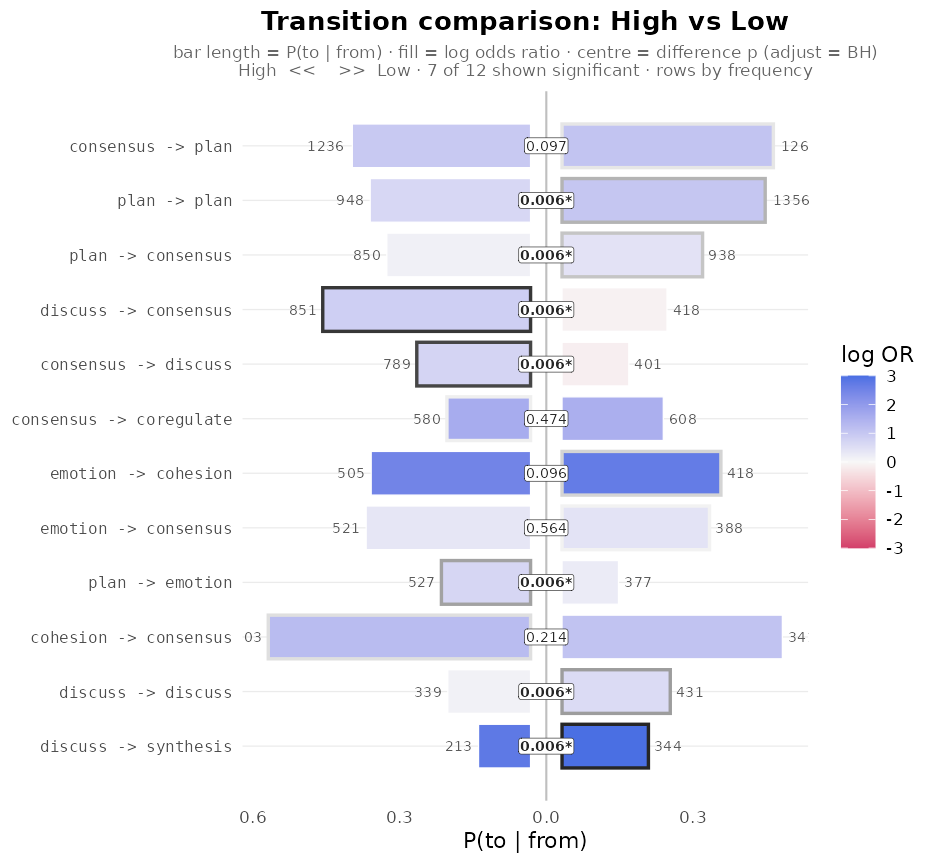

# Comparing groups

Groups of learners, conditions, or courses can differ in the order of
their actions: one group may move from discussion to consensus where
another moves from discussion to planning. A lag sequential model fitted
to each group describes its transitions, but two models estimated
separately almost always look different, if only because of sampling
variation. The question a group comparison answers is whether a
difference in a transition, or in the transition structure as a whole,
is larger than would arise if group membership carried no information
about the sequences.

`lagdynamics` answers it in two steps. `lsa(data, group = )` fits one
model per group in a shared state space, so the groups can be compared
cell by cell even when one group never visits a state.
[`compare_lsa()`](https://pak.dynasite.org/lagdynamics/reference/compare_lsa.md)
then tests the differences by permuting group labels over whole
sequences, and
[`bayes_compare_lsa()`](https://pak.dynasite.org/lagdynamics/reference/bayes_compare_lsa.md)
gives the Bayesian counterpart, a credible interval for each difference
in transition probability.

## Data

`group_regulation_long` is a long event log of collaborative regulation
actions, one row per action: 27,533 actions. Two achievement groups
contribute about equally: 13,721 actions from high achievers and 13,812
from low achievers.

- **Actor:** `Actor` identifies the person whose actions form one
  sequence.
- **Action:** `Action`, the coded regulation action (9 states: `adapt`,
  `cohesion`, `consensus`, `coregulate`, `discuss`, `emotion`,
  `monitor`, `plan`, `synthesis`).
- **Time:** `Time`, the timestamp that orders the actions; a gap of more
  than 900 seconds (the default `time_threshold`) starts a new sequence.
- **Group:** `Achiever`, `High` or `Low`.

`Group` and `Course` are further metadata and are not used here.

``` r

library(lagdynamics)
head(group_regulation_long)
#>   Actor Achiever Group Course                Time    Action
#> 1     1     High     1      A 2025-01-01 08:27:07  cohesion
#> 2     1     High     1      A 2025-01-01 08:35:20 consensus
#> 3     1     High     1      A 2025-01-01 08:42:18   discuss
#> 4     1     High     1      A 2025-01-01 08:50:00 synthesis
#> 5     1     High     1      A 2025-01-01 08:52:25     adapt
#> 6     1     High     1      A 2025-01-01 08:57:31 consensus
```

## One model per group

Naming the grouping column in `group` fits one model per group under the
same state labels, engine, and lag.

``` r

gfit <- lsa(group_regulation_long, actor = "Actor", action = "Action",
            time = "Time", group = "Achiever")
gfit
#> <lsa_group>
#>   engine:    classical
#>   states:    9 (adapt, cohesion, consensus, coregulate, discuss, emotion, monitor, plan, synthesis)
#>   groups:    2
#>     - High:        1000 sequences
#>     - Low:         1000 sequences
```

The log yields 1000 sequences in each group over the same 9 states, so
the two models have the same cells and can be compared one transition at
a time.

[`summary()`](https://rdrr.io/r/base/summary.html) of a grouped fit is a
data frame with one row per group.

``` r

summary(gfit)
#>   group    engine lag n_states n_sequences n_events n_transitions n_significant alpha
#> 1  High classical   1        9        1000    13721         12721            66  0.05
#> 2   Low classical   1        9        1000    13812         12812            67  0.05
#>   lrx2 lrx2_df lrx2_p   x2 x2_df x2_p
#> 1 6147      64      0 6807    64    0
#> 2 7715      64      0 9197    64    0
```

The two groups are of nearly equal size: 12,721 transitions among high
achievers and 12,812 among low achievers. Both reject independence
decisively ($`G^2 = 6147`$ and $`7715`$ on 64 degrees of freedom), and
both have most of their 81 transitions significant (66 and 67). Each
group therefore has a strongly ordered process, and the comparison asks
whether the order is the same.

The reading verbs work on the grouped fit and return a leading `group`
column. The strongest significant transitions of both groups:

``` r

transitions(gfit, significant = TRUE, sort = "strength") |> head(8)
#>   group      from         to lag count expected   prob prob_col adj_res         p yules_q
#> 1  High   emotion   cohesion   1   505   114.05 0.3258  0.53953    40.6  0.00e+00   0.847
#> 2  High consensus  consensus   1   283   916.99 0.0834  0.08229   -28.6 3.68e-180  -0.698
#> 3  High   discuss  synthesis   1   213    46.13 0.1063  0.72696    27.1 1.79e-161   0.881
#> 4  High   discuss       plan   1    25   458.83 0.0125  0.00858   -25.1 2.35e-139  -0.934
#> 5  High consensus coregulate   1   580   254.38 0.1710  0.60797    24.8 1.21e-135   0.663
#> 6  High consensus       plan   1  1236   777.01 0.3644  0.42416    21.9 2.64e-106   0.447
#> 7  High synthesis      adapt   1    40     3.13 0.1439  0.27972    21.2 7.61e-100   0.905
#> 8  High  cohesion  consensus   1   503   253.58 0.5362  0.14626    19.1  6.28e-81   0.554
#>    kappa kappa_z   kappa_p    lift  sign significant
#> 1  0.425    37.7 6.36e-311  4.4280  over        TRUE
#> 2 -0.709   -30.1 5.36e-199  0.3086 under        TRUE
#> 3  0.613    25.5 5.39e-143  4.6169  over        TRUE
#> 4 -0.949   -26.0 3.81e-149  0.0545 under        TRUE
#> 5  0.462    24.6 9.79e-134  2.2801  over        TRUE
#> 6  0.180    19.0  3.49e-80  1.5907  over        TRUE
#> 7  0.241    19.6  1.08e-85 12.7997  over        TRUE
#> 8  0.311    17.1  1.27e-65  1.9836  over        TRUE
```

Sorting applies within each group, so the first rows are those of the
high achievers; the low achievers’ rows follow in the full table. Among
high achievers, `emotion -> cohesion` is the strongest regularity (505
observed against 114 expected, z = 40.6, Q = 0.847),
`discuss -> synthesis` follows (z = 27.1), and repeating `consensus` is
strongly avoided (z = -28.6). Each group’s table describes its own
process; whether a transition differs between the groups is a separate
test.

## A permutation test of group differences

[`compare_lsa()`](https://pak.dynasite.org/lagdynamics/reference/compare_lsa.md)
shuffles the group labels of whole sequences, refits both models, and
sets each observed difference against the differences produced by the
shuffles. Permuting whole sequences keeps the dependence between the
actions of one sequence, so only the link between group and transition
structure is tested. The compared measure is by default the log odds
ratio of each transition against all other transitions, which does not
grow with the number of transitions observed; `diff` is the
high-achiever value minus the low-achiever value. Transitions with a
combined count below `min_count` (default 5) are left untested. The call
below draws 500 permutations, so the smallest attainable p-value is
1/501, and `adjust = "BH"` corrects the per-transition p-values for
multiple comparisons with the Benjamini-Hochberg procedure. The seed is
set once, before the permutations.

``` r

set.seed(2026)
cmp <- compare_lsa(gfit, R = 500, adjust = "BH")
cmp
#> <lsa_comparison>
#>   groups:   High vs Low
#>   measure:  log_or difference (High - Low)
#>   R:        500 label permutations
#>   edges:    38 significant of 78 tested (adjust = BH)
#>   omnibus:  statistic = 79.48, p = 0.001996
```

Of the 81 transitions, 78 have enough observations to be tested; the
other three have a combined count below 5 and carry `NA` p-values. After
the Benjamini-Hochberg adjustment, 38 of the 78 differ between the
groups. The omnibus test, the sum of squared differences over the tested
transitions, has a statistic of 79.48 and p = 0.001996, the smallest
value 500 permutations can give: no relabelling of the sequences
produced a difference as large as the observed one, so the transition
structures of the two groups differ.

The omnibus test is read as a table with `what = "global"`.

``` r

as.data.frame(cmp, what = "global")
#>   group_a group_b statistic p_value   R
#> 1    High     Low      79.5   0.002 500
```

The global table has one row per pair of groups, with the statistic, its
permutation p-value, and the number of permutations, the form to report
alongside the per-transition results.

[`transitions()`](https://pak.dynasite.org/lagdynamics/reference/transitions.md)
reads the per-transition differences. `significant = TRUE` keeps the
transitions whose Benjamini-Hochberg adjusted p-value (`p_adj`) is below
0.05, and `sort = "strength"` orders them by the absolute difference.

``` r

transitions(cmp, significant = TRUE, sort = "strength") |> head(8)
#>         from         to log_or_a log_or_b  diff  p_perm   p_adj significant
#> 1   cohesion      adapt   -0.794   -3.921  3.13 0.00200 0.00599        TRUE
#> 2    emotion  synthesis   -1.619   -4.522  2.90 0.00200 0.00599        TRUE
#> 3       plan  synthesis   -2.145   -4.951  2.81 0.00200 0.00599        TRUE
#> 4   cohesion  synthesis   -1.355   -3.945  2.59 0.00798 0.01887        TRUE
#> 5  synthesis    monitor   -3.229   -0.975 -2.25 0.00998 0.02162        TRUE
#> 6  synthesis       plan   -0.581   -2.680  2.10 0.00200 0.00599        TRUE
#> 7      adapt coregulate   -3.146   -1.176 -1.97 0.01597 0.03278        TRUE
#> 8 coregulate      adapt    0.778   -1.077  1.85 0.00200 0.00599        TRUE
```

The p-values in `p_adj` are Benjamini-Hochberg adjusted. The largest
differences in log odds ratio concern transitions into `adapt` and
`synthesis`. `cohesion -> adapt` has a log odds ratio of -0.794 among
high achievers and -3.921 among low achievers (difference 3.13, adjusted
p = 0.00599): in the low group, cohesion is followed by adaptation far
less than base rates predict, whereas in the high group the avoidance is
mild. `emotion -> synthesis` (2.90) and `plan -> synthesis` (2.81)
follow the same pattern: high achievers reach synthesis from emotional
and planning moves that low achievers almost never convert into
synthesis. In the other direction, `synthesis -> monitor` (-2.25) is
relatively more frequent among low achievers.

## Barrel plot

[`plot()`](https://rdrr.io/r/graphics/plot.default.html) draws a group
barrel plot: for the most frequent transitions, the transition
probability of each group is drawn back to back, with the result of the
permutation test on each transition.

``` r

plot(cmp)
```



The 12 most frequent transitions are shown, ordered by frequency, with
the high achievers on the left and the low achievers on the right; each
bar is labelled with its count and the centre with the adjusted p-value,
and 7 of the 12 differ significantly. High achievers move from `discuss`
to `consensus` about twice as often as low achievers (851 against 418
transitions) and from `consensus` back to `discuss` likewise (789
against 401), while low achievers repeat `plan` more often (1356 against
948). The most frequent transition, `consensus -> plan`, does not differ
(adjusted p = 0.097), nor do `emotion -> cohesion` or
`cohesion -> consensus`: the groups share the backbone of the process
and differ in how discussion connects to consensus and planning.

## A Bayesian comparison

[`bayes_compare_lsa()`](https://pak.dynasite.org/lagdynamics/reference/bayes_compare_lsa.md)
asks a different question: given the counts, what is the plausible range
of the true difference between the two groups’ transition probabilities?
Each state’s outgoing transitions have a Dirichlet posterior in each
group, and the comparison reports the posterior mean difference, its 95%
credible interval, and the probability of direction (`pd`). A transition
is credibly different when its interval excludes zero and the difference
is not negligible. No sequences are resampled, so the comparison is
fast, but it treats transitions as independent draws. `adjust = "BH"`
applies the Benjamini-Hochberg correction to the two-sided Bayesian
p-value (`p_adj`); the `significant` flag itself is decided by the
credible interval. `seed` fixes the Monte Carlo draws.

``` r

bcmp <- bayes_compare_lsa(gfit, adjust = "BH", seed = 1)
bcmp
#> <lsa_bayes>  (Bayesian Dirichlet-Multinomial comparison)
#>   groups:    High vs Low
#>   prior:     Dirichlet(0.50)  |  draws: 10000  |  CI: 95%
#>   edges:     38 credibly different of 81 compared
transitions(bcmp, significant = TRUE, sort = "strength") |> head(8)
#>        from        to prob_a prob_b    diff  ci_low ci_high pd effect_size p_value  p_adj
#> 1   discuss consensus 0.4242 0.2143  0.2098  0.1816  0.2380  1       14.56   0e+00 0.0000
#> 2 synthesis consensus 0.5681 0.3818  0.1864  0.1092  0.2601  1        4.86   0e+00 0.0000
#> 3 synthesis     adapt 0.1434 0.2999 -0.1565 -0.2179 -0.0940  1       -4.97   0e+00 0.0000
#> 4 synthesis      plan 0.1434 0.0251  0.1183  0.0764  0.1641  1        5.30   0e+00 0.0000
#> 5 consensus   discuss 0.2324 0.1365  0.0960  0.0771  0.1153  1        9.92   0e+00 0.0000
#> 6   discuss     adapt 0.0242 0.1201 -0.0959 -0.1119 -0.0803  1      -11.77   0e+00 0.0000
#> 7      plan      plan 0.3275 0.4149 -0.0874 -0.1112 -0.0639  1       -7.21   0e+00 0.0000
#> 8  cohesion consensus 0.5342 0.4485  0.0858  0.0370  0.1328  1        3.49   8e-04 0.0024
#>   significant
#> 1        TRUE
#> 2        TRUE
#> 3        TRUE
#> 4        TRUE
#> 5        TRUE
#> 6        TRUE
#> 7        TRUE
#> 8        TRUE
```

The Bayesian comparison finds 38 of 81 transitions credibly different.
The largest is `discuss -> consensus`: a posterior probability of 0.424
among high achievers and 0.214 among low achievers, a difference of
0.210 with a credible interval from 0.182 to 0.238.
`synthesis -> consensus` differs by 0.186, but its interval (0.109 to
0.260) is wider because `synthesis` is a rarely visited source state.

The two comparisons do not flag the same transitions, because they
compare different quantities. `synthesis -> adapt` illustrates the
difference: its posterior transition probability is 0.143 among high
achievers and 0.300 among low achievers, a credible difference of -0.16
(interval -0.218 to -0.094). The transitions with the smallest
difference in the permutation comparison are at the end of its sorted
table:

``` r

transitions(cmp, sort = "strength") |> tail(6)
#>         from        to log_or_a log_or_b    diff p_perm p_adj significant
#> 76     adapt   emotion    0.202    0.148  0.0536  0.854 0.888       FALSE
#> 77 synthesis     adapt    3.002    2.952  0.0502  0.824 0.869       FALSE
#> 78 consensus   emotion   -0.549   -0.599  0.0495  0.621 0.682       FALSE
#> 79     adapt      plan   -3.041   -3.078  0.0369  0.894 0.910       FALSE
#> 80     adapt   monitor   -0.420   -0.450  0.0307  0.926 0.926       FALSE
#> 81     adapt consensus    1.078    1.103 -0.0248  0.898 0.910       FALSE
```

`synthesis -> adapt` is among them: its log odds ratio is 3.002 among
high achievers and 2.952 among low achievers (adjusted p = 0.869). The
association between the two states, relative to their base rates, is the
same in both groups; the larger probability among low achievers follows
from a higher base rate of `adapt` in that group, not from a stronger
link between synthesis and adaptation. The Bayesian comparison answers
how large a difference in transition probability is; the permutation
test on the log odds ratio answers whether the sequential association
itself differs.

## When to use which

- **Describe each group:** `lsa(data, group = )`, then
  [`summary()`](https://rdrr.io/r/base/summary.html) and
  [`transitions()`](https://pak.dynasite.org/lagdynamics/reference/transitions.md)
  on the grouped fit.
- **Test whether groups differ, transition by transition and overall:**
  [`compare_lsa()`](https://pak.dynasite.org/lagdynamics/reference/compare_lsa.md)
  with an explicit `adjust`. It respects the dependence within sequences
  and can compare odds ratios, residuals, Yule’s Q, or probabilities
  (`measure`).
- **Estimate how large a difference in transition probability is:**
  [`bayes_compare_lsa()`](https://pak.dynasite.org/lagdynamics/reference/bayes_compare_lsa.md),
  which reports a credible interval for every difference without
  resampling.
- **More than two groups:** both functions compare every pair and apply
  the correction across all pairs.

A difference between groups can also arise from a difference in their
composition, such as the courses each group comes from; when such a
confound is plausible, compare within subgroups. The checks for a single
model are in [Evaluating
transitions](https://pak.dynasite.org/lagdynamics/articles/confirmatory.html),
and the method itself in [Lag sequential
analysis](https://pak.dynasite.org/lagdynamics/articles/lsa.html).
