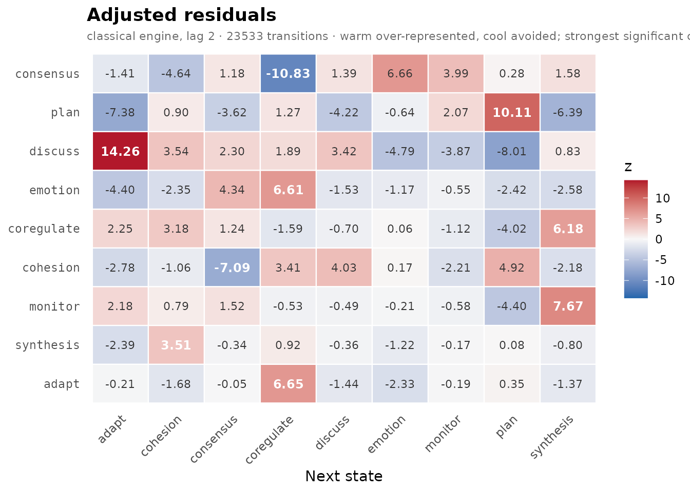

# Lags and structural zeros

A lag sequential model is defined by two choices that precede any test:
the distance at which events are paired, and the set of transitions the
model treats as possible. The lag $`\ell`$ fixes the pairing. At
$`\ell = 1`$ each event is paired with the next one; at $`\ell = 2`$
with the one after that; at $`\ell = -1`$ with the one before it.
Comparing lags tells whether a sequential dependency is immediate and
short-lived or persists over several steps (Bakeman & Quera, 2011). The
set of possible transitions fixes the reference model. Some transitions
cannot occur by construction, the standard case being a coding scheme in
which a state cannot follow itself. Those cells are *structural zeros*:
they are empty because they are impossible, not because they are
avoided, and the independence model has to be fitted to the remaining
cells only. Expected counts then come from the quasi-independence model
fitted by iterative proportional fitting (Wickens, 1989), and residuals
use the design-matrix form of Christensen (1997).

This guide covers both choices: single fits at a lag other than 1,
negative lags, lag profiles with
[`lsa_lags()`](https://pak.dynasite.org/lagdynamics/reference/lsa_lags.md)
and
[`lag_profile()`](https://pak.dynasite.org/lagdynamics/reference/lag_profile.md),
and structural zeros declared with `loops = FALSE` or an explicit
`structural_zeros` matrix. The basic model and its reading verbs are
introduced in [the LSA
vignette](https://pak.dynasite.org/lagdynamics/articles/lsa.md); the
other engines, which do not support structural zeros, are described in
[the engines
guide](https://pak.dynasite.org/lagdynamics/articles/engines.md).

``` r

library(lagdynamics)
```

## Data

- **`engagement`**: weekly engagement states (`Active`, `Average`,
  `Disengaged`) of 138 students over 15 weeks, one row per student. Two
  rows are entirely missing, so fits use 136 sequences.
- **`group_regulation`**: coded regulation actions in 2,000
  collaborative learning sessions, one row per session and one column
  per ordered time point (`T1` to `T26`). Nine states: `adapt`,
  `cohesion`, `consensus`, `coregulate`, `discuss`, `emotion`,
  `monitor`, `plan`, `synthesis`.

Transitions are counted within a sequence only, at every lag: a pair
never spans two students or two sessions.

## A single fit at another lag

The `lag` argument of
[`lsa()`](https://pak.dynasite.org/lagdynamics/reference/lsa.md) sets
the distance between the paired events. At lag 2 the model asks whether
the state two weeks later depends on the current one.

``` r

lsa(engagement, lag = 2)
#> Lag Sequential Analysis  -  classical  (lag 2, directed)
#>   3 states | 1603 transitions | 1870 events | 136 sequences
#>   states: Active, Average, Disengaged
#>   independence: G² = 486.6, df = 4, p <2e-16
#> 
#>   Significant transitions (p < 0.05): 8 of 9
#>   strongest over-represented (of 3):
#>     Active -> Active          z =  +18.7  ***
#>     Disengaged -> Disengaged  z =  +15.2  ***
#>     Average -> Average        z =  +11.6  ***
#> 
#>   Initial states:
#>     Active     0.382  ████████████████████████
#>     Average    0.368  ███████████████████████
#>     Disengaged 0.250  ████████████████
```

The lag-2 table has 1,603 transitions against 1,734 at lag 1, because
each sequence contributes one pair fewer. The dependency survives the
extra week: eight of the nine cells depart from independence, and the
three self-transitions remain the strongest over-represented cells
(Active to Active, $`z = 18.7`$). A student’s engagement two weeks ahead
is still predicted by this week’s state.

## Predecessors: negative lags

A negative lag pairs each event with an earlier one. At `lag = -1` the
row `from -> to` counts how often an event in `from` was *preceded* by
`to`, so the table answers the question “what came before this state?”.

``` r

transitions(lsa(engagement, lag = -1))
#>         from         to lag count expected   prob prob_col adj_res         p yules_q
#> 1     Active     Active  -1   459      247 0.7051    0.698  21.663 4.60e-104   0.828
#> 2    Average     Active  -1   176      290 0.2307    0.267 -11.319  1.06e-29  -0.534
#> 3 Disengaged     Active  -1    23      121 0.0719    0.035 -12.557  3.64e-36  -0.826
#> 4     Active    Average  -1   153      282 0.2350    0.204 -12.906  4.16e-38  -0.601
#> 5    Average    Average  -1   458      330 0.6003    0.610  12.453  1.35e-35   0.553
#> 6 Disengaged    Average  -1   140      139 0.4375    0.186   0.176  8.60e-01   0.011
#> 7     Active Disengaged  -1    39      122 0.0599    0.120 -10.549  5.11e-26  -0.698
#> 8    Average Disengaged  -1   129      143 0.1691    0.397  -1.736  8.25e-02  -0.108
#> 9 Disengaged Disengaged  -1   157       60 0.4906    0.483  15.390  1.90e-53   0.754
#>     kappa kappa_z  kappa_p  lift  sign significant
#> 1  0.4438   19.19 4.68e-82 1.858  over        TRUE
#> 2 -0.4242  -12.48 9.39e-36 0.608 under        TRUE
#> 3 -0.8272  -13.41 5.14e-41 0.189 under        TRUE
#> 4 -0.4994  -14.70 6.81e-49 0.543 under        TRUE
#> 5  0.2275    9.83 7.97e-23 1.386  over        TRUE
#> 6 -0.0903   -1.66 9.79e-02 1.010  over       FALSE
#> 7 -0.7069  -11.46 2.03e-30 0.320 under        TRUE
#> 8 -0.1618   -2.96 3.03e-03 0.902 under       FALSE
#> 9  0.3136   13.56 7.34e-42 2.618  over        TRUE
```

The lag $`-1`$ table is the transpose of the lag 1 table. The row
`Average -> Active` counts 176 events in `Average` preceded by `Active`,
which are the same 176 pairs as `Active -> Average` at lag 1, with the
same adjusted residual ($`z = -11.3`$). What changes is the conditioning
of `prob`: at lag $`-1`$ it is the probability of the predecessor given
the current state. Of all events in `Average`, 23.1% were preceded by
`Active`; at lag 1 the same number appears as `prob_col`, the share of
`Average` events that came from `Active`. Negative lags do not add new
tests to a single fit; they re-express the table from the target’s side,
and they make a lag profile read symmetrically around the present event.

## Lag profiles

[`lsa_lags()`](https://pak.dynasite.org/lagdynamics/reference/lsa_lags.md)
fits the same model at several lags in one call. Its print method
reports how many transitions are significant at each lag.

``` r

engagement_lags <- lsa_lags(engagement, lags = c(-2, -1, 1, 2, 3))
engagement_lags
#> <lsa_lags>
#>   engine: classical
#>   lags:   -2, -1, 1, 2, 3
#>     lag -2   8 of 9 transitions significant
#>     lag -1   7 of 9 transitions significant
#>     lag 1    7 of 9 transitions significant
#>     lag 2    8 of 9 transitions significant
#>     lag 3    8 of 9 transitions significant
```

Most of the table departs from independence at every lag from $`-2`$ to
3, so the engagement process has a long memory. The lag 0 fit is left
out on purpose: at lag 0 each event is paired with itself, so the table
is diagonal and every cell trivially departs from independence.

[`lag_profile()`](https://pak.dynasite.org/lagdynamics/reference/lag_profile.md)
follows a single transition across lags as a one-row-per-lag table.

``` r

lag_profile(engagement, from = "Active", to = "Active", lags = 1:5)
#>   lag   from     to count  prob adj_res         p significant
#> 1   1 Active Active   459 0.698    21.7 4.60e-104        TRUE
#> 2   2 Active Active   409 0.664    18.7  5.20e-78        TRUE
#> 3   3 Active Active   359 0.631    16.0  7.53e-58        TRUE
#> 4   4 Active Active   333 0.650    16.3  6.66e-60        TRUE
#> 5   5 Active Active   290 0.618    13.9  6.31e-44        TRUE
```

Staying `Active` remains strongly over-represented five weeks ahead
($`z = 13.9`$ at lag 5, against 21.7 at lag 1). The decline is gradual
and not strictly monotone (16.0 at lag 3, 16.3 at lag 4). Engagement in
this cohort is a durable state, not a week-to-week fluctuation.

The
[`transitions()`](https://pak.dynasite.org/lagdynamics/reference/transitions.md)
verb reads the multi-lag result with the same filters as a single fit.
The call below keeps the over-represented transitions at lags 1 to 3,
strongest first within each lag.

``` r

transitions(lsa_lags(engagement, lags = 1:3), direction = "over",
            sort = "strength")
#>          from         to lag count expected  prob prob_col adj_res         p yules_q
#> 1      Active     Active   1   459    247.0 0.698    0.705   21.66 4.60e-104   0.828
#> 2  Disengaged Disengaged   1   157     60.0 0.483    0.491   15.39  1.90e-53   0.754
#> 3     Average    Average   1   458    330.5 0.610    0.600   12.45  1.35e-35   0.553
#> 4      Active     Active   2   409    232.5 0.664    0.676   18.70  5.20e-78   0.777
#> 5  Disengaged Disengaged   2   144     53.4 0.497    0.488   15.18  5.17e-52   0.767
#> 6     Average    Average   2   420    305.7 0.603    0.597   11.61  3.73e-31   0.539
#> 7      Active     Active   3   359    213.9 0.631    0.648   16.03  7.53e-58   0.723
#> 8  Disengaged Disengaged   3    98     48.7 0.363    0.368    8.63  6.25e-18   0.557
#> 9     Average    Average   3   346    281.7 0.545    0.529    6.80  1.02e-11   0.347
#> 10    Average Disengaged   3   133    114.6 0.209    0.500    2.52  1.18e-02   0.169
#>      kappa kappa_z  kappa_p lift sign significant
#> 1   0.4438  19.188 4.68e-82 1.86 over        TRUE
#> 2   0.3136  13.556 7.34e-42 2.62 over        TRUE
#> 3   0.2275   9.835 7.97e-23 1.39 over        TRUE
#> 4   0.3299  14.261 3.85e-46 1.76 over        TRUE
#> 5   0.2683  11.597 4.25e-31 2.70 over        TRUE
#> 6   0.1448   6.260 3.85e-10 1.37 over        TRUE
#> 7   0.2159   9.334 1.02e-20 1.68 over        TRUE
#> 8   0.1080   4.668 3.04e-06 2.01 over        TRUE
#> 9  -0.0211  -0.702 4.83e-01 1.23 over        TRUE
#> 10 -0.1358  -2.489 1.28e-02 1.16 over        TRUE
```

The self-transitions are the only over-represented cells at lags 1 and
2. At lag 3 one more cell appears, `Average -> Disengaged`
($`z = 2.52`$): an average week raises the chance of a disengaged week
three weeks later, an effect that is absent at lag 1 ($`z = 0.18`$,
shown above in transposed form as `Disengaged -> Average` at lag
$`-1`$). Delayed effects of this kind are invisible to a lag 1 analysis.

The collaborative regulation data behave differently.

``` r

regulation_lags <- lsa_lags(group_regulation, lags = 1:3)
regulation_lags
#> <lsa_lags>
#>   engine: classical
#>   lags:   1, 2, 3
#>     lag 1    72 of 81 transitions significant
#>     lag 2    41 of 81 transitions significant
#>     lag 3    10 of 81 transitions significant
lag_profile(regulation_lags, from = "emotion", to = "cohesion")
#>   lag    from       to count   prob adj_res      p significant
#> 1   1 emotion cohesion   923 0.3253   58.20 0.0000        TRUE
#> 2   2 emotion cohesion   142 0.0547   -2.35 0.0189        TRUE
#> 3   3 emotion cohesion   138 0.0575   -1.58 0.1144       FALSE
lag_profile(regulation_lags, from = "plan", to = "consensus")
#>   lag from        to count  prob adj_res        p significant
#> 1   1 plan consensus  1788 0.290    8.53 1.51e-17        TRUE
#> 2   2 plan consensus  1316 0.232   -3.62 2.96e-04        TRUE
#> 3   3 plan consensus  1261 0.243   -1.14 2.56e-01       FALSE
```

The number of significant transitions falls from 72 of 81 at lag 1 to 41
at lag 2 and 10 at lag 3. The sequential structure of these sessions is
local: an action constrains the next action, much less the one after.
The `emotion -> cohesion` transition, the strongest of the lag 1 table
($`z = 58.2`$), turns slightly under-represented at lag 2
($`z = -2.35`$) and is indistinguishable from independence at lag 3.
`plan -> consensus` changes sign: over-represented at lag 1
($`z = 8.53`$), under-represented at lag 2 ($`z = -3.62`$). A lag 1
network of these data describes immediate responses, not longer chains.

A residual heatmap of the lag 2 fit shows which dependencies remain once
the immediate response is skipped.

``` r

plot(lsa(group_regulation, lag = 2))
```



Two actions apart, `discuss -> adapt` ($`z = 14.26`$) and `plan -> plan`
($`z = 10.11`$) are the strongest over-represented cells, and
`consensus -> coregulate` is the most avoided ($`z = -10.83`$). The
residuals are about a quarter of the size of the lag 1 residuals, which
reach 58.2.

## Declaring structural zeros

Three cells of the `group_regulation` table are empty: `adapt -> adapt`,
`adapt -> synthesis` and `synthesis -> synthesis`. Sorting the
transitions by count puts them in the last three rows.

``` r

regulation_fit <- lsa(group_regulation)
transitions(regulation_fit, sort = "count") |> tail(3)
#>         from        to lag count expected prob prob_col adj_res        p yules_q kappa
#> 79     adapt     adapt   1     0     10.6    0        0   -3.32 8.96e-04      -1    -1
#> 80     adapt synthesis   1     0     13.8    0        0   -3.80 1.46e-04      -1    -1
#> 81 synthesis synthesis   1     0     17.6    0        0   -4.31 1.63e-05      -1    -1
#>    kappa_z  kappa_p lift  sign significant
#> 79   -3.41 6.56e-04    0 under        TRUE
#> 80   -3.92 8.81e-05    0 under        TRUE
#> 81   -4.51 6.40e-06    0 under        TRUE
```

Under ordinary independence each empty cell is a significant avoidance
($`z`$ from $`-3.32`$ to $`-4.31`$), because the margins predict between
10.6 and 17.6 transitions there. Whether that is a finding depends on
the coding scheme. If these transitions are possible but never chosen,
the residuals are the result. If the scheme makes them impossible, the
residuals are an artefact, and the cells must be removed from the model
rather than tested.

The `structural_zeros` argument takes a $`K \times K`$ matrix with 0 for
a forbidden cell and 1 for an estimable one. Rows and columns follow the
state order that the fit reports (`nodes(regulation_fit)` lists it;
states are sorted alphabetically). The matrix below is built from the
names of the forbidden transitions.

``` r

states <- c("adapt", "cohesion", "consensus", "coregulate", "discuss",
            "emotion", "monitor", "plan", "synthesis")
forbidden <- c("adapt -> adapt", "adapt -> synthesis",
               "synthesis -> synthesis")
allowed <- outer(states, states,
                 \(from, to) 1 * !(paste(from, "->", to) %in% forbidden))
allowed
#>       [,1] [,2] [,3] [,4] [,5] [,6] [,7] [,8] [,9]
#>  [1,]    0    1    1    1    1    1    1    1    0
#>  [2,]    1    1    1    1    1    1    1    1    1
#>  [3,]    1    1    1    1    1    1    1    1    1
#>  [4,]    1    1    1    1    1    1    1    1    1
#>  [5,]    1    1    1    1    1    1    1    1    1
#>  [6,]    1    1    1    1    1    1    1    1    1
#>  [7,]    1    1    1    1    1    1    1    1    1
#>  [8,]    1    1    1    1    1    1    1    1    1
#>  [9,]    1    1    1    1    1    1    1    1    0
```

Fitting with the matrix switches the classical engine to the
quasi-independence model.

``` r

constrained_fit <- lsa(group_regulation, structural_zeros = allowed)
constrained_fit
#> Lag Sequential Analysis  -  classical  (lag 1, directed)
#>   9 states | 25533 transitions | 27533 events | 2000 sequences
#>   states: adapt, cohesion, consensus, coregulate, discuss, emotion, monitor, plan, synthesis
#>   independence: G² = 13116.4, df = 61, p <2e-16
#> 
#>   Significant transitions (p < 0.05): 69 of 78
#>   strongest over-represented (of 23):
#>     emotion -> cohesion      z =  +58.3  ***
#>     discuss -> synthesis     z =  +46.6  ***
#>     synthesis -> adapt       z =  +37.7  ***
#>     consensus -> coregulate  z =  +35.4  ***
#>     consensus -> plan        z =  +32.7  ***
#>     ... and 18 more
#> 
#>   Initial states:
#>     consensus  0.214  ████████████████████████
#>     plan       0.204  ███████████████████████
#>     discuss    0.175  ████████████████████
#>     emotion    0.151  █████████████████
#>     monitor    0.144  ████████████████
#>     cohesion   0.060  ███████
#>     synthesis  0.019  ██
#>     coregulate 0.019  ██
#>     adapt      0.011  █
tests(regulation_fit)
#>   test statistic df p
#> 1 lrx2     13204 64 0
#> 2   x2     15435 64 0
tests(constrained_fit)
#>   test statistic df p
#> 1 lrx2     13116 61 0
#> 2   x2     15189 61 0
transitions(constrained_fit, sort = "count") |> tail(3)
#>         from        to lag count expected prob prob_col adj_res  p yules_q kappa kappa_z
#> 79     adapt     adapt   1     0        0    0        0      NA NA      -1    -1   -3.41
#> 80     adapt synthesis   1     0        0    0        0      NA NA      -1    -1   -3.92
#> 81 synthesis synthesis   1     0        0    0        0      NA NA      -1    -1   -4.51
#>     kappa_p lift     sign significant
#> 79 6.56e-04   NA expected       FALSE
#> 80 8.81e-05   NA expected       FALSE
#> 81 6.40e-06   NA expected       FALSE
```

Three things change. First, the forbidden cells have an expected count
of 0 and no residual, p-value or lift, so they are no longer flagged: 69
of 81 transitions are significant instead of 72. Second, the expected
counts of the remaining cells are refitted so that the row and column
totals are still matched with the forbidden cells empty, which moves the
residuals of the other cells slightly (`emotion -> cohesion` goes from
58.2 to 58.3). Third, the tablewise test loses one degree of freedom per
forbidden cell: $`G^2`$ falls from 13,204 on 64 df to 13,116 on 61 df.
The substantive conclusions about the other 78 transitions do not
change; the three avoidance “findings” are gone.

The forbidden rows still show `yules_q` and `kappa` values ($`-1`$, with
`kappa_p` below 0.001). These columns are computed from the observed
counts of the full table and do not use the structural-zero model, so on
a forbidden cell they carry no information and are ignored.

## Forbidding self-transitions with `loops = FALSE`

The most common structural-zero pattern is the diagonal. When a coding
scheme merges consecutive identical codes, for example a dialogue coded
turn by turn where a new code starts only when the act changes, a state
can never follow itself. `loops = FALSE` declares the whole diagonal
forbidden without building a matrix. The model assumes that these cells
are empty in the data; when transitions do fall in a forbidden cell,
[`lsa()`](https://pak.dynasite.org/lagdynamics/reference/lsa.md) warns
with the condition `lagdynamics_structural_zero_counts`, because the
data contradict the declaration, and leaves those transitions out of the
fit: the quasi-independence model is fitted to the possible cells, with
the margins of those cells (Bakeman & Quera, 1995). Every state repeats
in the bundled datasets (459 `Active -> Active` transitions in
`engagement`), so they are not candidates for this model; the example
uses a small count table of three dialogue acts with an empty diagonal,
which [`lsa()`](https://pak.dynasite.org/lagdynamics/reference/lsa.md)
accepts directly.

``` r

turns <- matrix(c( 0, 34, 18,
                  27,  0, 41,
                  25, 30,  0),
                nrow = 3, byrow = TRUE,
                dimnames = list(c("Question", "Answer", "Feedback"),
                                c("Question", "Answer", "Feedback")))
turns
#>          Question Answer Feedback
#> Question        0     34       18
#> Answer         27      0       41
#> Feedback       25     30        0
```

Fitted under ordinary independence, the empty diagonal distorts the
whole table.

``` r

transitions(lsa(turns))
#>       from       to lag count expected  prob prob_col adj_res        p yules_q   kappa
#> 1 Question Question   1     0     15.5 0.000    0.000  -5.593 2.24e-08 -1.0000 -1.0000
#> 2   Answer Question   1    27     20.2 0.397    0.519   2.306 2.11e-02  0.3671  0.2247
#> 3 Feedback Question   1    25     16.3 0.455    0.481   3.085 2.04e-03  0.4833  0.2255
#> 4 Question   Answer   1    34     19.0 0.654    0.531   5.146 2.66e-07  0.7083  0.4418
#> 5   Answer   Answer   1     0     24.9 0.000    0.000  -8.008 1.17e-15 -1.0000 -1.0000
#> 6 Feedback   Answer   1    30     20.1 0.545    0.469   3.342 8.31e-04  0.5044  0.2074
#> 7 Question Feedback   1    18     17.5 0.346    0.305   0.164 8.70e-01  0.0286  0.0247
#> 8   Answer Feedback   1    41     22.9 0.603    0.695   5.929 3.04e-09  0.7649  0.5080
#> 9 Feedback Feedback   1     0     18.5 0.000    0.000  -6.387 1.69e-10 -1.0000 -1.0000
#>   kappa_z  kappa_p lift  sign significant
#> 1   -5.46 4.69e-08 0.00 under        TRUE
#> 2    2.45 1.42e-02 1.34  over        TRUE
#> 3    2.75 6.05e-03 1.53  over        TRUE
#> 4    4.82 1.44e-06 1.79  over        TRUE
#> 5   -8.17 3.00e-16 0.00 under        TRUE
#> 6    2.48 1.32e-02 1.49  over        TRUE
#> 7    0.30 7.64e-01 1.03  over       FALSE
#> 8    6.07 1.26e-09 1.79  over        TRUE
#> 9   -6.56 5.39e-11 0.00 under        TRUE
tests(lsa(turns))
#>   test statistic df        p
#> 1 lrx2     149.0  4 3.30e-31
#> 2   x2      96.7  4 5.06e-20
```

Eight of the nine cells are significant. The three empty diagonal cells
are strongly “avoided” ($`z`$ from $`-5.59`$ to $`-8.01`$), and to keep
the margins, the model spreads part of every margin over the diagonal
and the off-diagonal expected counts fall below the observed ones, so
five of the six real transitions appear over-represented. The tablewise
test rejects independence ($`G^2 = 149`$, df = 4). All of this follows
from the coding rule, not from the dialogue.

``` r

transitions(lsa(turns, loops = FALSE))
#>       from       to lag count expected  prob prob_col adj_res     p yules_q   kappa
#> 1 Question Question   1     0        0 0.000    0.000      NA    NA -1.0000 -1.0000
#> 2   Answer Question   1    27       31 0.397    0.519   -1.87 0.062  0.3671  0.2247
#> 3 Feedback Question   1    25       21 0.455    0.481    1.87 0.062  0.4833  0.2255
#> 4 Question   Answer   1    34       30 0.654    0.531    1.87 0.062  0.7083  0.4418
#> 5   Answer   Answer   1     0        0 0.000    0.000      NA    NA -1.0000 -1.0000
#> 6 Feedback   Answer   1    30       34 0.545    0.469   -1.87 0.062  0.5044  0.2074
#> 7 Question Feedback   1    18       22 0.346    0.305   -1.87 0.062  0.0286  0.0247
#> 8   Answer Feedback   1    41       37 0.603    0.695    1.87 0.062  0.7649  0.5080
#> 9 Feedback Feedback   1     0        0 0.000    0.000      NA    NA -1.0000 -1.0000
#>   kappa_z  kappa_p  lift     sign significant
#> 1   -5.46 4.69e-08    NA expected       FALSE
#> 2    2.45 1.42e-02 0.870    under       FALSE
#> 3    2.75 6.05e-03 1.192     over       FALSE
#> 4    4.82 1.44e-06 1.134     over       FALSE
#> 5   -8.17 3.00e-16    NA expected       FALSE
#> 6    2.48 1.32e-02 0.882    under       FALSE
#> 7    0.30 7.64e-01 0.817    under       FALSE
#> 8    6.07 1.26e-09 1.109     over       FALSE
#> 9   -6.56 5.39e-11    NA expected       FALSE
tests(lsa(turns, loops = FALSE))
#>   test statistic df      p
#> 1 lrx2      3.49  1 0.0616
#> 2   x2      3.48  1 0.0620
```

Under quasi-independence the diagonal is excluded and no transition is
significant. With three states and a forbidden diagonal the model has a
single degree of freedom, which is why all six residuals have the same
size ($`|z| = 1.87`$, $`p = 0.062`$): the one remaining question is
whether the dialogue cycles in one direction. The signs give the answer
the data lean towards, `Question -> Answer -> Feedback -> Question` more
often than the reverse, but the tablewise test ($`G^2 = 3.49`$, df = 1,
$`p = 0.062`$) does not support it at the 0.05 level. The independence
fit reported a strong sequential structure; the correct model finds
none.

The expected counts of the quasi-independence model come from iterative
proportional fitting, available on its own as
[`lsa_ipf()`](https://pak.dynasite.org/lagdynamics/reference/lsa_ipf.md).
It takes a count matrix and a 0/1 structure matrix of the same shape.

``` r

lsa_ipf(turns, structure = 1 - diag(3))
#> $fit
#>      [,1] [,2] [,3]
#> [1,]    0   30   22
#> [2,]   31    0   37
#> [3,]   21   34    0
#> 
#> $iterations
#> [1] 22
#> 
#> $converged
#> [1] TRUE
#> 
#> $max_margin_diff
#> [1] 4.37e-09
```

The fitted table is the `expected` column of the `loops = FALSE` fit
(31, 21, 30, 34, 22 and 37 off the diagonal, 0 on it): its row and
column totals equal those of `turns` and its diagonal is 0. The fit
converged in 22 row-and-column passes. `loops = FALSE` and an explicit
`structural_zeros` matrix combine: with both, the diagonal of the matrix
is zeroed as well.

## What changes with structural zeros

| Quantity | Independence | Quasi-independence (structural zeros) |
|----|----|----|
| Expected count | $`R_i C_j / N`$ | IPF fit with forbidden cells fixed at 0, margins matched |
| Residual | Haberman adjusted residual | Christensen residual $`(O - E)/\sqrt{E(1 - h)}`$, $`h`$ from the hat matrix of the row and column design |
| Forbidden cell | tested like any other | `expected = 0`; `adj_res`, `p`, `lift` are `NA`; never significant |
| Degrees of freedom | $`(K - 1)^2`$ | estimable cells minus rank of the design; $`(K - 1)^2 - s`$ for $`s`$ forbidden cells in a non-degenerate pattern |
| `yules_q`, `kappa` | from observed counts | unchanged: still from observed counts, not part of the structural model |

The two residual formulas coincide when no cell is forbidden. Structural
zeros are supported by the classical engine only; the two-cell,
bidirectional and dominance engines stop with an error of class
`lagdynamics_unsupported_option`. Declare a structural zero only when
the coding scheme rules a transition out. An empty cell that could have
occurred is a result to report, not a cell to remove.

## References

Bakeman, R., & Quera, V. (2011). *Sequential analysis and observational
methods for the behavioral sciences*. Cambridge University Press.

Christensen, R. (1997). *Log-linear models and logistic regression* (2nd
ed.). Springer.

Wickens, T. D. (1989). *Multiway contingency tables analysis for the
social sciences*. Lawrence Erlbaum.
