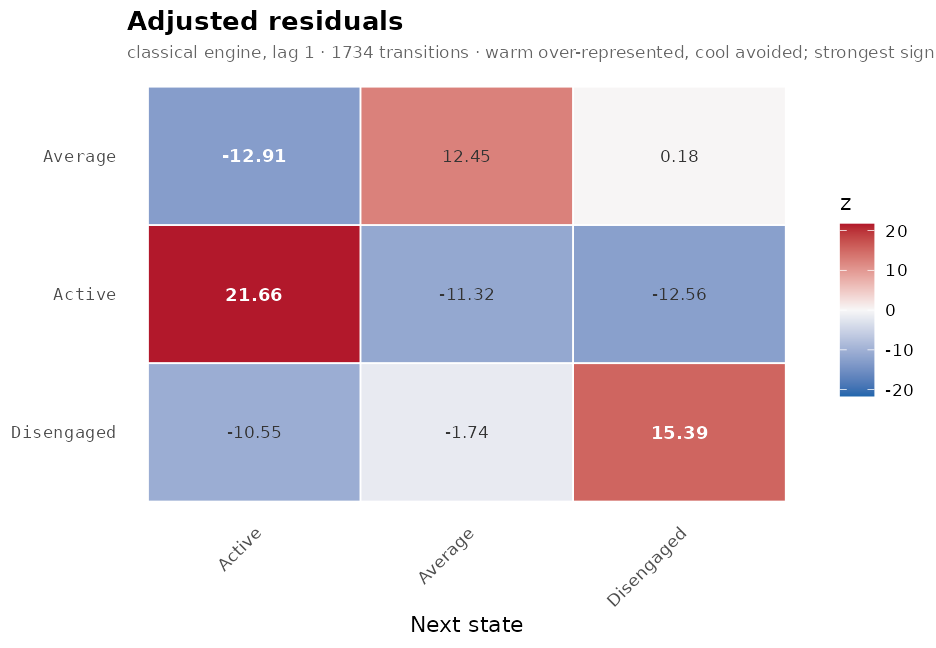

# Lag sequential analysis

Lag sequential analysis (LSA) studies the order in which categorical
events occur (Sackett, 1979; Bakeman & Gottman, 1997). A process is
coded as a sequence of states, such as weekly engagement levels or the
moves of a collaborative discussion, and the analysis asks whether one
state is followed by another more often, or less often, than the base
rates of the two states alone would predict. A transition that occurs
more often than expected is a sequential regularity of the process; a
transition that occurs less often is an avoidance. Neither can be read
from frequencies alone: a frequent transition may only reflect two busy
states, and a rare transition may still occur far more often than chance
allows.

The method reduces the data to a lagged contingency table and tests
every cell of it against sequential independence, the model in which the
next state carries no memory of the current one. The result is a set of
tested transitions, each with a direction, a size, and a p-value,
together with an omnibus test of the whole table. `lagdynamics` fits the
model in one call,
[`lsa()`](https://pak.dynasite.org/lagdynamics/reference/lsa.md), and
returns every part of it as a tidy data frame.

## Data

`engagement` records the weekly engagement state of 138 students over 15
weeks, one row per student and one column per week.

- **Sequence:** each row is one student’s sequence.
- **Order:** the column order (weeks 1 to 15) orders the states.
- **State:** each cell is `Active`, `Average`, or `Disengaged`; `NA`
  marks a missing week and is skipped rather than counted as a state.

Two rows are missing in every week, so the model is fitted to 136
sequences.

``` r

library(lagdynamics)
head(engagement)
#>         1          2          3          4          5          6       7       8       9
#> 1  Active Disengaged Disengaged Disengaged     Active     Active  Active  Active Average
#> 2 Average    Average    Average    Average    Average    Average Average Average Average
#> 3 Average     Active     Active     Active     Active     Active  Active  Active  Active
#> 4  Active     Active     Active     Active     Active    Average Average  Active  Active
#> 5  Active     Active     Active    Average     Active    Average  Active  Active  Active
#> 6 Average    Average Disengaged    Average Disengaged Disengaged Average Average Average
#>           10      11         12      13      14      15
#> 1     Active Average     Active    <NA>    <NA>    <NA>
#> 2     Active Average    Average Average Average Average
#> 3    Average  Active     Active  Active  Active  Active
#> 4     Active Average     Active Average  Active Average
#> 5 Disengaged  Active     Active  Active Average Average
#> 6 Disengaged Average Disengaged Average Average Average
```

## The lagged contingency table

Let the process visit $`K`$ states. At lag $`\ell`$, every pair of
positions $`\ell`$ steps apart within a sequence is one transition, and
the transitions are tabulated in a $`K \times K`$ table whose cell
$`O_{ij}`$ counts the occasions on which state $`i`$ was followed,
$`\ell`$ positions later, by state $`j`$. At lag 1 this is the table of
immediate successors. Pairs never cross the boundary between two
sequences, so the last week of one student and the first week of the
next are not counted.

Two descriptive quantities come directly from the table. The
transitional probability $`P(j \mid i) = O_{ij} / R_i`$, where $`R_i`$
is the row total, is the share of moves out of state $`i`$ that reach
state $`j`$; it describes where the process goes. The expected count
under independence,

``` math
E_{ij} = \frac{R_i \, C_j}{N},
```

with $`C_j`$ the column total and $`N`$ the number of transitions, is
the count the cell would reach if the next state were drawn from the
base rates regardless of the current one.

## Adjusted residuals and Yule’s Q

The adjusted residual standardises the gap between the observed and the
expected count (Haberman, 1973),

``` math
z_{ij} = \frac{O_{ij} - E_{ij}}
  {\sqrt{E_{ij}\,(1 - R_i/N)\,(1 - C_j/N)}},
```

and is approximately standard normal under independence. A residual
above 1.96 marks a transition that is over-represented at the 5% level,
and a residual below -1.96 one that is under-represented. The residual
is the evidential unit of LSA: it states how far a transition departs
from chance on a common scale, whatever the base rates of its states.

The residual is a test statistic, so it grows with the number of
transitions. Yule’s Q is the matching effect size. For each cell the
table is collapsed to a 2-by-2 table (from $`i`$ or not, to $`j`$ or
not) with cells $`a = O_{ij}`$, $`b`$, $`c`$, and $`d`$, and

``` math
Q_{ij} = \frac{ad - bc}{ad + bc},
```

which lies between -1 (the transition never occurs) and 1 (state $`i`$
is always followed by state $`j`$), with 0 at independence. Because it
does not grow with sample size, Q is the scale on which transitions of
different data sets or groups are compared (Bakeman & Quera, 2011).

## Fitting the model

[`lsa()`](https://pak.dynasite.org/lagdynamics/reference/lsa.md) takes
the wide data frame directly: rows are sequences and columns are ordered
positions. The default is the classical engine at lag 1.

``` r

fit <- lsa(engagement)
fit
#> Lag Sequential Analysis  -  classical  (lag 1, directed)
#>   3 states | 1734 transitions | 1870 events | 136 sequences
#>   states: Active, Average, Disengaged
#>   independence: G² = 618.3, df = 4, p <2e-16
#> 
#>   Significant transitions (p < 0.05): 7 of 9
#>   strongest over-represented (of 3):
#>     Active -> Active          z =  +21.7  ***
#>     Disengaged -> Disengaged  z =  +15.4  ***
#>     Average -> Average        z =  +12.5  ***
#> 
#>   Initial states:
#>     Active     0.382  ████████████████████████
#>     Average    0.368  ███████████████████████
#>     Disengaged 0.250  ████████████████
```

The model counts 1734 transitions among 1870 events in 136 sequences.
The omnibus likelihood-ratio test of independence is $`G^2 = 618.3`$ on
4 degrees of freedom, so the next week’s state depends strongly on the
current one. Seven of the nine transitions depart from independence, and
the three strongest over-represented transitions are the three
self-transitions.

## Which transitions depart from chance

[`transitions()`](https://pak.dynasite.org/lagdynamics/reference/transitions.md)
returns one row per ordered pair with the observed and expected counts,
the transitional probability (`prob`), the adjusted residual
(`adj_res`), its p-value, Yule’s Q, and further association measures.
The argument `significant = TRUE` keeps the transitions whose p-value is
below `alpha`, and `sort = "strength"` orders them by the absolute
residual.

``` r

transitions(fit, significant = TRUE, sort = "strength")
#>         from         to lag count expected  prob prob_col adj_res         p yules_q
#> 1     Active     Active   1   459      247 0.698   0.7051    21.7 4.60e-104   0.828
#> 2 Disengaged Disengaged   1   157       60 0.483   0.4906    15.4  1.90e-53   0.754
#> 3    Average     Active   1   153      282 0.204   0.2350   -12.9  4.16e-38  -0.601
#> 4     Active Disengaged   1    23      121 0.035   0.0719   -12.6  3.64e-36  -0.826
#> 5    Average    Average   1   458      330 0.610   0.6003    12.5  1.35e-35   0.553
#> 6     Active    Average   1   176      290 0.267   0.2307   -11.3  1.06e-29  -0.534
#> 7 Disengaged     Active   1    39      122 0.120   0.0599   -10.5  5.11e-26  -0.698
#>    kappa kappa_z  kappa_p  lift  sign significant
#> 1  0.444   19.19 4.68e-82 1.858  over        TRUE
#> 2  0.314   13.56 7.34e-42 2.618  over        TRUE
#> 3 -0.499  -14.70 6.81e-49 0.543 under        TRUE
#> 4 -0.827  -13.41 5.14e-41 0.189 under        TRUE
#> 5  0.227    9.83 7.97e-23 1.386  over        TRUE
#> 6 -0.424  -12.48 9.39e-36 0.608 under        TRUE
#> 7 -0.707  -11.46 2.03e-30 0.320 under        TRUE
```

`Active -> Active` is the strongest regularity: it occurred 459 times
against 247 expected, an adjusted residual of 21.7 and a Yule’s Q of
0.828. Active students therefore stay active from one week to the next
far more often than the base rate of activity predicts.
`Disengaged -> Disengaged` (z = 15.4, Q = 0.754) and
`Average -> Average` (z = 12.5, Q = 0.553) are the other two
persistences, so every state tends to repeat. The avoidances are as
informative. `Active -> Disengaged` occurred 23 times against 121
expected (z = -12.6, Q = -0.826): an active student almost never drops
to disengagement in a single week. `Disengaged -> Active` is also
avoided (z = -10.5, Q = -0.698), so recovery from disengagement to full
activity is rare. Moves between `Average` and `Disengaged`, by contrast,
occur at the rate the base rates predict.

The two transitions missing from this table, `Average -> Disengaged` and
`Disengaged -> Average`, are the ones that occur at the rate chance
predicts. `direction = "over"` or `direction = "under"` keeps only one
sign, and `min_count` drops pairs with few observations.

``` r

transitions(fit, direction = "under", sort = "strength")
#>         from         to lag count expected  prob prob_col adj_res        p yules_q  kappa
#> 1    Average     Active   1   153      282 0.204   0.2350   -12.9 4.16e-38  -0.601 -0.499
#> 2     Active Disengaged   1    23      121 0.035   0.0719   -12.6 3.64e-36  -0.826 -0.827
#> 3     Active    Average   1   176      290 0.267   0.2307   -11.3 1.06e-29  -0.534 -0.424
#> 4 Disengaged     Active   1    39      122 0.120   0.0599   -10.5 5.11e-26  -0.698 -0.707
#>   kappa_z  kappa_p  lift  sign significant
#> 1   -14.7 6.81e-49 0.543 under        TRUE
#> 2   -13.4 5.14e-41 0.189 under        TRUE
#> 3   -12.5 9.39e-36 0.608 under        TRUE
#> 4   -11.5 2.03e-30 0.320 under        TRUE
```

Four transitions are significantly avoided, and all four connect
`Active` with another state, in either direction. Active engagement is
therefore a closed state: students who hold it keep it, and students
outside it rarely reach it in one week (`Average -> Active`, z = -12.9).

## Is the table as a whole dependent

[`tests()`](https://pak.dynasite.org/lagdynamics/reference/tests.md)
returns the omnibus tests of independence for the whole table: the
likelihood-ratio statistic (`lrx2`) and Pearson’s chi-squared (`x2`).

``` r

tests(fit)
#>   test statistic df         p
#> 1 lrx2       618  4 1.69e-132
#> 2   x2       629  4 7.41e-135
```

Both statistics reject independence ($`G^2 = 618`$ and $`\chi^2 = 629`$
on 4 degrees of freedom, p far below 0.001). A non-significant omnibus
test would give no basis for interpreting individual residuals, so this
test is read before the transitions.

## States and starting points

[`nodes()`](https://pak.dynasite.org/lagdynamics/reference/nodes.md)
returns one row per state with the number of transitions it sends and
receives, and
[`initial()`](https://pak.dynasite.org/lagdynamics/reference/initial.md)
the share of sequences that start in each state.

``` r

nodes(fit)
#>        state outgoing incoming
#> 1     Active      658      651
#> 2    Average      751      763
#> 3 Disengaged      325      320
initial(fit)
#>        state init_prob
#> 1     Active     0.382
#> 2    Average     0.368
#> 3 Disengaged     0.250
```

`Average` is the busiest state (751 outgoing, 763 incoming transitions)
and `Disengaged` the least visited (325 and 320). These totals are what
the expected counts control for: `Average` is not credited with
regularities on the strength of its volume. Sequences start in `Active`
(0.382) and `Average` (0.368) more often than in `Disengaged` (0.250).

## A summary of the model

[`summary()`](https://rdrr.io/r/base/summary.html) returns a summary
object. Printed, it gives the model in a few lines; its tables are read
with [`as.data.frame()`](https://rdrr.io/r/base/as.data.frame.html).

``` r

fit_summary <- summary(fit)
fit_summary
#> Lag sequential analysis: classical engine, lag 1
#>   3 states, 1734 transitions, 1870 events, 136 sequences
#>   significant transitions (p < 0.05): 7 of 9
#>   likelihood-ratio test: G² = 618.31, df = 4, p <2e-16
#>   Pearson test: χ² = 629.20, df = 4, p <2e-16
#> 
#>   State activity (share of transitions out and in):
#>     Active      out 0.379 ██████████    in 0.375 ██████████
#>     Average     out 0.433 ████████████  in 0.440 ████████████
#>     Disengaged  out 0.187 █████         in 0.185 █████
as.data.frame(fit_summary)
#>      engine lag n_states n_sequences n_events n_transitions n_significant alpha lrx2
#> 1 classical   1        3         136     1870          1734             7  0.05  618
#>   lrx2_df    lrx2_p  x2 x2_df      x2_p
#> 1       4 1.69e-132 629     4 7.41e-135
as.data.frame(fit_summary, what = "nodes")
#>        state outgoing incoming out_share in_share init_prob
#> 1     Active      658      651     0.379    0.375     0.382
#> 2    Average      751      763     0.433    0.440     0.368
#> 3 Disengaged      325      320     0.187    0.185     0.250
```

The overview table is one row with the dimensions and omnibus tests of
the model, the form to collect when several models are fitted. The node
table adds the shares of outgoing and incoming transitions and the
initial probability for each state: `Average` carries 43.3% of the
outgoing transitions and `Disengaged` 18.7%.

## Transition probabilities

[`transition_probabilities()`](https://pak.dynasite.org/lagdynamics/reference/transition_probabilities.md)
returns the transitional probabilities $`P(\text{to} \mid \text{from})`$
as a tidy table, one row per ordered pair. They are the edge weights of
a transition network analysis model and the input that probability-based
tools expect.

``` r

transition_probabilities(fit)
#>         from         to  prob
#> 1     Active     Active 0.698
#> 2     Active    Average 0.267
#> 3     Active Disengaged 0.035
#> 4    Average     Active 0.204
#> 5    Average    Average 0.610
#> 6    Average Disengaged 0.186
#> 7 Disengaged     Active 0.120
#> 8 Disengaged    Average 0.397
#> 9 Disengaged Disengaged 0.483
```

Each state is most often followed by itself: 0.698 for `Active`, 0.610
for `Average`, and 0.483 for `Disengaged`. The probabilities and the
residuals answer different questions. `Disengaged -> Average` has a
probability of 0.397, the second largest move out of `Disengaged`, yet
its residual (-1.7) is not significant: the move is frequent because
`Average` is a busy state, not because disengaged students are drawn to
it.

## Residual heatmap

[`plot()`](https://rdrr.io/r/graphics/plot.default.html) draws a
residual heatmap by default. Rows are the current states, columns the
next states, and the fill is the adjusted residual on a diverging scale.

``` r

plot(fit)
```



The heatmap shows the structure of the model at a glance: the diagonal
is uniformly over-represented, the four off-diagonal cells in the
`Active` row and column are avoided, and the two cells linking `Average`
and `Disengaged` sit near zero. The process is one of persistence, with
movement mostly confined to the two lower states.

## Where next

- [Lag transition
  networks](https://pak.dynasite.org/lagdynamics/articles/lag-transition-networks.html):
  the fitted model drawn as a residual, Yule’s Q, or probability
  network.
- [Evaluating
  transitions](https://pak.dynasite.org/lagdynamics/articles/confirmatory.html):
  edge uncertainty, case-drop stability, split-half reliability, and a
  permutation null.
- [Comparing
  groups](https://pak.dynasite.org/lagdynamics/articles/group-comparison.html):
  grouped fits and permutation and Bayesian tests of group differences.
- [Workflow](https://pak.dynasite.org/lagdynamics/articles/workflow.html),
  [event
  logs](https://pak.dynasite.org/lagdynamics/articles/event-logs.html),
  [engines](https://pak.dynasite.org/lagdynamics/articles/engines.html),
  [lags and structural
  zeros](https://pak.dynasite.org/lagdynamics/articles/lags-structural-zeros.html),
  and
  [plotting](https://pak.dynasite.org/lagdynamics/articles/plotting.html):
  the guides to each part of the package.

## References

Bakeman, R., & Gottman, J. M. (1997). *Observing interaction: An
introduction to sequential analysis* (2nd ed.). Cambridge University
Press.

Bakeman, R., & Quera, V. (2011). *Sequential analysis and observational
methods for the behavioral sciences*. Cambridge University Press.

Haberman, S. J. (1973). The analysis of residuals in cross-classified
tables. *Biometrics, 29*, 205-220.

Sackett, G. P. (1979). The lag sequential analysis of contingency and
cyclicity in behavioral interaction research. In J. D. Osofsky (Ed.),
*Handbook of infant development* (pp. 623-649). Wiley.
