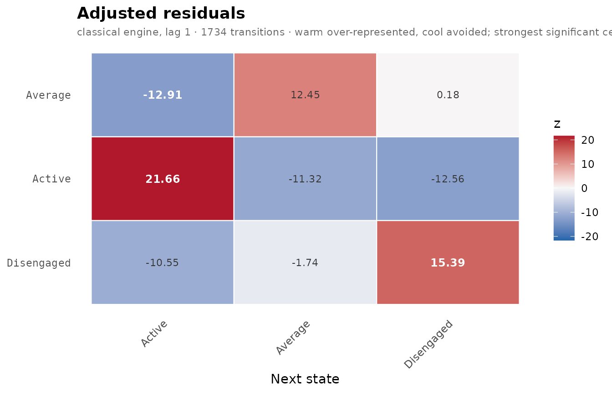
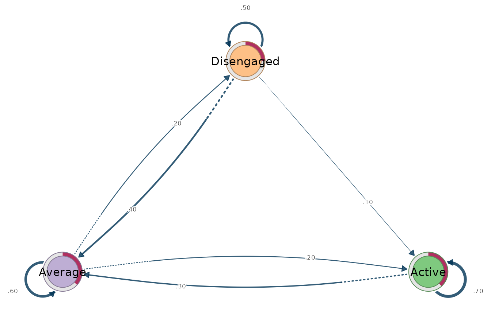
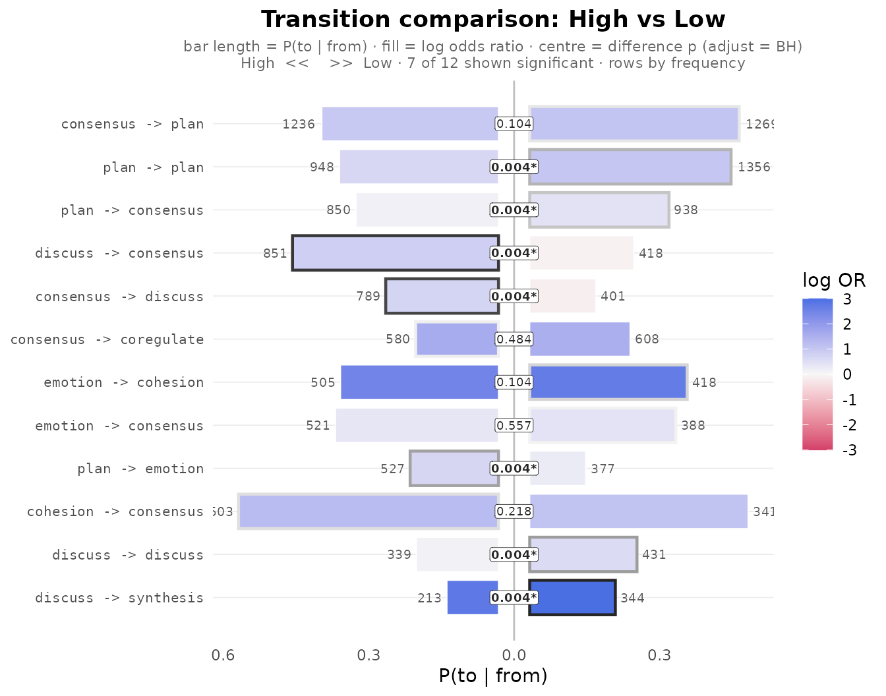

# A complete workflow

Lag sequential analysis (LSA) asks whether one event follows another
more often, or less often, than it would if the events of a sequence
were independent of each other (Bakeman & Gottman, 1997; Bakeman &
Quera, 2011). For every ordered pair of states it compares the observed
count of the transition with the count expected from the marginal
frequencies of the two states, and expresses the difference as an
adjusted residual: a positive residual marks a transition the process
favours, a negative residual marks a transition the process avoids.

A finding from LSA is a claim, and each kind of claim needs its own
evidence. A descriptive claim (“disengaged students tend to stay
disengaged”) rests on the fitted transition table. A claim about a
single transition adds an interval for it. A claim about the whole
network adds a check that the network reproduces in independent halves
of the data. A claim that two groups differ needs a test of the
difference. This guide runs that chain from end to end on the bundled
data: it fits a model to weekly engagement states, reads and draws the
result, adds uncertainty evidence, then fits one model per achievement
group from a raw event log and tests where the groups differ. The method
itself is introduced in [the LSA
vignette](https://pak.dynasite.org/lagdynamics/articles/lsa.md); the
full confirmatory battery is in [the confirmatory
vignette](https://pak.dynasite.org/lagdynamics/articles/confirmatory.md).

``` r

library(lagdynamics)
```

## Data

The first part of the guide uses `engagement`, a wide data frame with
one row per student and one column per week of a course.

- **Sequence:** each row is one student; 138 rows, of which 2 are empty.
- **Time point:** the 15 columns, in course order.
- **State:** the weekly engagement state, `Active`, `Average`, or
  `Disengaged`. A missing cell means no record that week.

``` r

head(engagement)
#>         1          2          3          4          5          6       7       8       9
#> 1  Active Disengaged Disengaged Disengaged     Active     Active  Active  Active Average
#> 2 Average    Average    Average    Average    Average    Average Average Average Average
#> 3 Average     Active     Active     Active     Active     Active  Active  Active  Active
#> 4  Active     Active     Active     Active     Active    Average Average  Active  Active
#> 5  Active     Active     Active    Average     Active    Average  Active  Active  Active
#> 6 Average    Average Disengaged    Average Disengaged Disengaged Average Average Average
#>           10      11         12      13      14      15
#> 1     Active Average     Active    <NA>    <NA>    <NA>
#> 2     Active Average    Average Average Average Average
#> 3    Average  Active     Active  Active  Active  Active
#> 4     Active Average     Active Average  Active Average
#> 5 Disengaged  Active     Active  Active Average Average
#> 6 Disengaged Average Disengaged Average Average Average
```

The second part uses `group_regulation_long`, an event log of
collaborative learning with one coded regulation action per row.

- **Actor:** `Actor`, the student who acted; 2,000 actors.
- **Action:** `Action`, one of nine regulation codes (`adapt`,
  `cohesion`, `consensus`, `coregulate`, `discuss`, `emotion`,
  `monitor`, `plan`, `synthesis`).
- **Time:** `Time`, the time stamp that orders the actions.
- **Group:** `Achiever`, `High` or `Low` achievement, fixed for each
  actor.

``` r

head(group_regulation_long)
#>   Actor Achiever Group Course                Time    Action
#> 1     1     High     1      A 2025-01-01 08:27:07  cohesion
#> 2     1     High     1      A 2025-01-01 08:35:20 consensus
#> 3     1     High     1      A 2025-01-01 08:42:18   discuss
#> 4     1     High     1      A 2025-01-01 08:50:00 synthesis
#> 5     1     High     1      A 2025-01-01 08:52:25     adapt
#> 6     1     High     1      A 2025-01-01 08:57:31 consensus
```

## Fit the model

[`lsa()`](https://pak.dynasite.org/lagdynamics/reference/lsa.md) turns
the rows into sequences, counts every lag-1 transition, computes the
counts expected under independence, and tests each cell. The print
method gives the size of the data, the tablewise independence test, and
the strongest favoured transitions.

``` r

fit <- lsa(engagement)
fit
#> Lag Sequential Analysis  -  classical  (lag 1, directed)
#>   3 states | 1734 transitions | 1870 events | 136 sequences
#>   states: Active, Average, Disengaged
#>   independence: G² = 618.3, df = 4, p <2e-16
#> 
#>   Significant transitions (p < 0.05): 7 of 9
#>   strongest over-represented (of 3):
#>     Active -> Active          z =  +21.7  ***
#>     Disengaged -> Disengaged  z =  +15.4  ***
#>     Average -> Average        z =  +12.5  ***
#> 
#>   Initial states:
#>     Active     0.382  ████████████████████████
#>     Average    0.368  ███████████████████████
#>     Disengaged 0.250  ████████████████
```

The model rests on 1,734 transitions from 136 sequences: the two empty
rows contribute nothing. The likelihood-ratio test of independence is G²
= 618.3 on 4 degrees of freedom, so the weekly states are far from
independent of the previous week’s state. Seven of the nine transitions
depart from chance, and the three favoured ones are the three
self-transitions: `Active -> Active` (z = 21.7),
`Disengaged -> Disengaged` (z = 15.4), and `Average -> Average` (z =
12.5). Engagement is persistent.

## Overview of the fit

[`summary()`](https://rdrr.io/r/base/summary.html) returns the same
overview as one table row, and the `nodes` table describes the states:
how many transitions leave and enter each state, their shares, and the
share of sequences that start in it.

``` r

as.data.frame(summary(fit))
#>      engine lag n_states n_sequences n_events n_transitions n_significant alpha lrx2
#> 1 classical   1        3         136     1870          1734             7  0.05  618
#>   lrx2_df    lrx2_p  x2 x2_df      x2_p
#> 1       4 1.69e-132 629     4 7.41e-135
as.data.frame(summary(fit), what = "nodes")
#>        state outgoing incoming out_share in_share init_prob
#> 1     Active      658      651     0.379    0.375     0.382
#> 2    Average      751      763     0.433    0.440     0.368
#> 3 Disengaged      325      320     0.187    0.185     0.250
```

`Average` carries the largest share of activity (0.433 of outgoing
transitions), `Disengaged` the smallest (0.187). A quarter of the
students (0.250) start the course disengaged, against 0.382 who start
active.

## Which transitions depart from chance

[`transitions()`](https://pak.dynasite.org/lagdynamics/reference/transitions.md)
returns one row per transition, with the observed and expected counts,
the transition probability, the adjusted residual and its p-value, and
effect sizes (Yule’s Q, kappa, lift). `sort = "strength"` orders the
rows by the absolute residual; `significant = TRUE` would keep only the
transitions significant at `alpha = 0.05`.

``` r

transitions(fit, sort = "strength")
#>         from         to lag count expected  prob prob_col adj_res         p yules_q
#> 1     Active     Active   1   459      247 0.698   0.7051  21.663 4.60e-104   0.828
#> 2 Disengaged Disengaged   1   157       60 0.483   0.4906  15.390  1.90e-53   0.754
#> 3    Average     Active   1   153      282 0.204   0.2350 -12.906  4.16e-38  -0.601
#> 4     Active Disengaged   1    23      121 0.035   0.0719 -12.557  3.64e-36  -0.826
#> 5    Average    Average   1   458      330 0.610   0.6003  12.453  1.35e-35   0.553
#> 6     Active    Average   1   176      290 0.267   0.2307 -11.319  1.06e-29  -0.534
#> 7 Disengaged     Active   1    39      122 0.120   0.0599 -10.549  5.11e-26  -0.698
#> 8 Disengaged    Average   1   129      143 0.397   0.1691  -1.736  8.25e-02  -0.108
#> 9    Average Disengaged   1   140      139 0.186   0.4375   0.176  8.60e-01   0.011
#>     kappa kappa_z  kappa_p  lift  sign significant
#> 1  0.4438   19.19 4.68e-82 1.858  over        TRUE
#> 2  0.3136   13.56 7.34e-42 2.618  over        TRUE
#> 3 -0.4994  -14.70 6.81e-49 0.543 under        TRUE
#> 4 -0.8272  -13.41 5.14e-41 0.189 under        TRUE
#> 5  0.2275    9.83 7.97e-23 1.386  over        TRUE
#> 6 -0.4242  -12.48 9.39e-36 0.608 under        TRUE
#> 7 -0.7069  -11.46 2.03e-30 0.320 under        TRUE
#> 8 -0.1618   -2.96 3.03e-03 0.902 under       FALSE
#> 9 -0.0903   -1.66 9.79e-02 1.010  over       FALSE
```

Four of the six moves between different states are avoided. The
strongest avoidance is `Average -> Active` (z = -12.9, Yule’s Q =
-0.601), followed closely by `Active -> Disengaged` (z = -12.6): an
active student almost never drops to disengagement in one week (23
observed against 121 expected, probability 0.035). The remaining two
moves, `Disengaged -> Average` (z = -1.74, p = 0.083) and
`Average -> Disengaged` (z = 0.18, p = 0.86), occur about as often as
chance predicts. The probability column is the transition probability
that a transition network displays; the residual and Yule’s Q say
whether that probability is larger or smaller than chance.

## Display the model

A residual heatmap shows the residual of every cell: rows are the
current state, columns the next state, and the colour gives the sign and
size of the departure from chance.

``` r

plot(fit)
```



The three red cells are the self-transitions and the blue cells the
avoided moves between states, which is the persistence reported above in
one display. The rows are ordered by how many transitions leave each
state, so the self-transitions do not form a visual diagonal.

A transition network draws the same process with edges weighted by
transition probability, the form used in transition network analysis. It
answers a different question: where the process tends to go next, rather
than which moves are surprising.

``` r

plot(fit, type = "network", weights = "tna")
```



The two displays answer different questions, and they part ways on
`Disengaged -> Average`: with a probability of 0.397 it is one of the
heaviest edges in the transition network, yet its residual is not
significant, because `Average` is common enough that chance alone
predicts a move of that size. Every display is covered in [the plotting
guide](https://pak.dynasite.org/lagdynamics/articles/plotting.md).

## How precise are the transition probabilities

[`certainty_lsa()`](https://pak.dynasite.org/lagdynamics/reference/certainty_lsa.md)
gives analytic credible intervals for each transition probability from a
Dirichlet-multinomial posterior, and marks an edge as stable when its
residual keeps its sign across the interval.

``` r

cert <- certainty_lsa(fit)
cert
#> <lsa_certainty>  (analytic Dirichlet-Multinomial)
#>   engine:        classical
#>   prior:         Dirichlet(0.50)
#>   CI level:      95%  |  inference: stability
#>   certain edges: 7 of 9
transitions(cert, sort = "strength")
#>         from         to observed prob_observed prob_mean prob_se prob_ci_low prob_ci_high
#> 1     Active     Active      459         0.698    0.6967 0.01789      0.6611        0.731
#> 2 Disengaged Disengaged      157         0.483    0.4824 0.02761      0.4284        0.537
#> 3    Average     Active      153         0.204    0.2040 0.01468      0.1760        0.233
#> 4     Active Disengaged       23         0.035    0.0356 0.00721      0.0229        0.051
#> 5    Average    Average      458         0.610    0.6093 0.01777      0.5742        0.644
#> 6     Active    Average      176         0.267    0.2676 0.01723      0.2345        0.302
#> 7 Disengaged     Active       39         0.120    0.1210 0.01802      0.0879        0.158
#> 8 Disengaged    Average      129         0.397    0.3966 0.02703      0.3443        0.450
#> 9    Average Disengaged      140         0.186    0.1867 0.01420      0.1597        0.215
#>    p_value stable adj_res_observed adj_res_stable
#> 1 5.56e-20   TRUE           21.663           TRUE
#> 2 9.44e-06   TRUE           15.390           TRUE
#> 3 6.06e-04   TRUE          -12.906           TRUE
#> 4 2.19e-01  FALSE          -12.557          FALSE
#> 5 3.14e-17   TRUE           12.453           TRUE
#> 6 1.21e-04   TRUE          -11.319           TRUE
#> 7 9.45e-02  FALSE          -10.549          FALSE
#> 8 2.23e-04   TRUE           -1.736           TRUE
#> 9 1.17e-03   TRUE            0.176           TRUE
```

Seven of the nine probabilities are certain. The probability of the
strongest edge, `Active -> Active`, lies between 0.661 and 0.731 with
95% credibility. The two uncertain ones are the two rarest transitions,
`Active -> Disengaged` (23 observations, interval 0.023 to 0.051) and
`Disengaged -> Active` (39 observations): their intervals are wide
relative to the probability itself, so the posterior does not stay
within 75% to 125% of the observed value. Their residuals are strongly
negative all the same; the uncertainty concerns the size of a small
probability, not the avoidance.

## Do the residuals hold when sequences are resampled

[`bootstrap_lsa()`](https://pak.dynasite.org/lagdynamics/reference/bootstrap_lsa.md)
resamples whole sequences with replacement, refits the model on each
resample, and reports a percentile interval for every statistic (Efron,
1979). Resampling sequences keeps each student’s transitions together,
so the interval reflects variation between students. The seed makes the
resamples reproducible.

``` r

set.seed(2026)
boot <- bootstrap_lsa(fit, R = 1000)
boot
#> <lsa_bootstrap>
#>   engine:        classical
#>   level:         sequence
#>   replicates:    1000
#>   CI level:      95%
#>   stable edges:  7 of 9
transitions(boot, significant = TRUE, sort = "strength") |> head(5)
#>         from         to observed count_mean count_se count_ci_low count_ci_high
#> 1     Active     Active      459      461.1    52.50          360           568
#> 2 Disengaged Disengaged      157      156.1    28.06          106           213
#> 3    Average     Active      153      152.8    14.79          124           182
#> 4     Active Disengaged       23       22.7     4.99           14            32
#> 5    Average    Average      458      458.8    39.30          383           532
#>   adj_res_observed adj_res_mean adj_res_se adj_res_ci_low adj_res_ci_high adj_res_p_boot
#> 1             21.7         21.6       1.55          18.65           24.61              0
#> 2             15.4         15.3       1.96          11.10           18.95              0
#> 3            -12.9        -12.9       1.52         -15.79           -9.99              0
#> 4            -12.6        -12.5       1.06         -14.68          -10.42              0
#> 5             12.5         12.5       1.37           9.84           15.16              0
#>   adj_res_stable prob_observed prob_mean prob_ci_low prob_ci_high yules_q_observed
#> 1           TRUE         0.698    0.6974      0.6371        0.752            0.828
#> 2           TRUE         0.483    0.4800      0.3846        0.564            0.754
#> 3           TRUE         0.204    0.2041      0.1623        0.247           -0.601
#> 4           TRUE         0.035    0.0346      0.0205        0.049           -0.826
#> 5           TRUE         0.610    0.6102      0.5640        0.655            0.553
#>   yules_q_mean yules_q_ci_low yules_q_ci_high
#> 1        0.826          0.760           0.882
#> 2        0.750          0.633           0.834
#> 3       -0.601         -0.700          -0.489
#> 4       -0.826         -0.900          -0.745
#> 5        0.553          0.451           0.648
```

Seven of the nine residuals are stable across 1,000 resamples of
students, and every interval shown excludes zero by a wide margin: the
residual of `Active -> Disengaged` stays between -14.7 and -10.4, so the
avoidance of that move holds across students even though its probability
is small. The persistence findings and the avoided moves are therefore
not produced by a few unusual students.

## Is the whole network reproducible

[`reliability_lsa()`](https://pak.dynasite.org/lagdynamics/reference/reliability_lsa.md)
splits the sequences into two random halves, fits the model to each
half, and correlates the two sets of edge weights. A high split-half
correlation means the network as a whole would be recovered from a
different sample of the same size.

``` r

rel <- reliability_lsa(fit, R = 100)
rel
#> <lsa_reliability>
#>   engine:        classical
#>   replicates:    100
#>   weights:       prob
#>   method:        pearson
#>   n sequences:   136
#>   split-half r:  0.961  (sd = 0.034)
#>   95% CI:        [0.890, 0.993]
#>   failed:        0 of 100 replicates
```

Across 100 random splits the two halves agree closely: the mean
split-half correlation is 0.961, with a 95% interval from 0.890 to
0.993, and no split failed. The engagement network is reproducible at
this sample size.

## From an event log to sequences

Process data usually arrives as an event log rather than as wide
sequences.
[`lsa()`](https://pak.dynasite.org/lagdynamics/reference/lsa.md) builds
the sequences itself when the columns are named: `actor` identifies the
sequence, `action` is the state, and `time` orders the events. A new
sequence also starts whenever two consecutive events of an actor are
more than `time_threshold` seconds apart (900 by default). The column
grammar and its options are covered in [the event-log
guide](https://pak.dynasite.org/lagdynamics/articles/event-logs.md).

``` r

fit_log <- lsa(group_regulation_long, actor = "Actor", action = "Action",
               time = "Time")
fit_log
#> Lag Sequential Analysis  -  classical  (lag 1, directed)
#>   9 states | 25533 transitions | 27533 events | 2000 sequences
#>   states: adapt, cohesion, consensus, coregulate, discuss, emotion, monitor, plan, synthesis
#>   independence: G² = 13203.8, df = 64, p <2e-16
#> 
#>   Significant transitions (p < 0.05): 72 of 81
#>   strongest over-represented (of 23):
#>     emotion -> cohesion      z =  +58.2  ***
#>     discuss -> synthesis     z =  +48.0  ***
#>     synthesis -> adapt       z =  +38.8  ***
#>     consensus -> coregulate  z =  +35.3  ***
#>     consensus -> plan        z =  +32.6  ***
#>     ... and 18 more
#> 
#>   Initial states:
#>     consensus  0.214  ████████████████████████
#>     plan       0.204  ███████████████████████
#>     discuss    0.175  ████████████████████
#>     emotion    0.151  █████████████████
#>     monitor    0.144  ████████████████
#>     cohesion   0.060  ███████
#>     synthesis  0.019  ██
#>     coregulate 0.019  ██
#>     adapt      0.011  █
```

The 27,533 actions form 2,000 sequences, one per actor, and 25,533
transitions. Seventy-two of the 81 transitions depart from chance. The
strongest favoured transition is `emotion -> cohesion` (z = 58.2),
followed by `discuss -> synthesis` (z = 48.0).

## One model per group

Naming a grouping column with `group` fits one model per group under the
same set of states. The grouping column must be constant within each
sequence.

``` r

gfit <- lsa(group_regulation_long, actor = "Actor", action = "Action",
            time = "Time", group = "Achiever")
summary(gfit)
#>   group    engine lag n_states n_sequences n_events n_transitions n_significant alpha
#> 1  High classical   1        9        1000    13721         12721            66  0.05
#> 2   Low classical   1        9        1000    13812         12812            67  0.05
#>   lrx2 lrx2_df lrx2_p   x2 x2_df x2_p
#> 1 6147      64      0 6807    64    0
#> 2 7715      64      0 9197    64    0
```

Each group contributes 1,000 sequences: 12,721 transitions for the high
achievers and 12,812 for the low achievers. Both tables reject
independence, and the groups have a similar number of significant
transitions (66 and 67). Every reading verb returns a leading `group`
column for a grouped fit.

``` r

transitions(gfit, significant = TRUE, sort = "strength") |> head(6)
#>   group      from         to lag count expected   prob prob_col adj_res         p yules_q
#> 1  High   emotion   cohesion   1   505    114.0 0.3258  0.53953    40.6  0.00e+00   0.847
#> 2  High consensus  consensus   1   283    917.0 0.0834  0.08229   -28.6 3.68e-180  -0.698
#> 3  High   discuss  synthesis   1   213     46.1 0.1063  0.72696    27.1 1.79e-161   0.881
#> 4  High   discuss       plan   1    25    458.8 0.0125  0.00858   -25.1 2.35e-139  -0.934
#> 5  High consensus coregulate   1   580    254.4 0.1710  0.60797    24.8 1.21e-135   0.663
#> 6  High consensus       plan   1  1236    777.0 0.3644  0.42416    21.9 2.64e-106   0.447
#>    kappa kappa_z   kappa_p   lift  sign significant
#> 1  0.425    37.7 6.36e-311 4.4280  over        TRUE
#> 2 -0.709   -30.1 5.36e-199 0.3086 under        TRUE
#> 3  0.613    25.5 5.39e-143 4.6169  over        TRUE
#> 4 -0.949   -26.0 3.81e-149 0.0545 under        TRUE
#> 5  0.462    24.6 9.79e-134 2.2801  over        TRUE
#> 6  0.180    19.0  3.49e-80 1.5907  over        TRUE
```

The strongest residual in the high achievers is `emotion -> cohesion` (z
= 40.6). The question of the next section is whether any transition is
stronger in one group than in the other.

## Do the groups differ

[`compare_lsa()`](https://pak.dynasite.org/lagdynamics/reference/compare_lsa.md)
tests the difference between the groups edge by edge. The statistic is
the difference in the log odds ratio of each transition between the
groups; its null distribution comes from permuting the group labels of
whole sequences, `R` times. With many edges tested at once, the p-values
are corrected for multiplicity: `adjust = "BH"` applies the
Benjamini-Hochberg false discovery rate correction, and the
`significant` column below refers to the adjusted p-values (`p_adj`).
The package default is no adjustment, so the argument is passed
explicitly.

``` r

set.seed(2026)
cmp <- compare_lsa(gfit, R = 1000, adjust = "BH")
cmp
#> <lsa_comparison>
#>   groups:   High vs Low
#>   measure:  log_or difference (High - Low)
#>   R:        1000 label permutations
#>   edges:    39 significant of 78 tested (adjust = BH)
#>   omnibus:  statistic = 79.48, p = 0.000999
as.data.frame(cmp, what = "global")
#>   group_a group_b statistic  p_value    R
#> 1    High     Low      79.5 0.000999 1000
```

The omnibus test rejects the hypothesis that the two groups share one
transition structure (statistic 79.5, p = 0.000999). That p-value is 1 /
(R + 1), the smallest value 1,000 permutations can give, so the
difference is at least as extreme as the permutation null allows. Of the
78 edges with enough observations to test (the default `min_count = 5`),
39 differ after the Benjamini-Hochberg correction. Sorting by the size
of the difference shows the largest ones.

``` r

transitions(cmp, significant = TRUE, sort = "strength") |> head(8)
#>        from         to log_or_a log_or_b  diff   p_perm   p_adj significant
#> 1  cohesion      adapt   -0.794   -3.921  3.13 0.000999 0.00354        TRUE
#> 2   emotion  synthesis   -1.619   -4.522  2.90 0.000999 0.00354        TRUE
#> 3      plan  synthesis   -2.145   -4.951  2.81 0.001998 0.00577        TRUE
#> 4  cohesion  synthesis   -1.355   -3.945  2.59 0.005994 0.01461        TRUE
#> 5 synthesis    monitor   -3.229   -0.975 -2.25 0.008991 0.02063        TRUE
#> 6 synthesis       plan   -0.581   -2.680  2.10 0.000999 0.00354        TRUE
#> 7     adapt coregulate   -3.146   -1.176 -1.97 0.013986 0.02871        TRUE
#> 8      plan      adapt   -2.338   -4.230  1.89 0.024975 0.04995        TRUE
```

The `diff` column is the high-achiever log odds ratio minus the
low-achiever one. The largest difference is `cohesion -> adapt` (3.13):
the move is avoided in both groups but far more strongly by the low
achievers (-3.921 against -0.794). Three of the next differences end in
`synthesis` (`emotion`, `plan`, and `cohesion -> synthesis`), each
avoided much more strongly by the low achievers. The negative
differences run the other way: `synthesis -> monitor` (-2.25) is avoided
more strongly by the high achievers.

A comparison barrel plot shows the two groups side by side for the most
frequent transitions: the high achievers’ transition probability runs to
the left and the low achievers’ to the right, the bar labels give the
counts, the fill gives the log odds ratio, and the centre carries the
adjusted p-value of the difference.

``` r

plot(cmp)
```



Seven of the twelve most frequent transitions differ between the groups.
The high achievers move between discussion and consensus far more often
(`discuss -> consensus`: 851 against 418 observations;
`consensus -> discuss`: 789 against 401), while the low achievers more
often follow discussion with synthesis (`discuss -> synthesis`: 344
against 213). The backbone transition `consensus -> plan` is equally
frequent in both groups (p = 0.104).

## When to use which

| Claim | Evidence | Call |
|----|----|----|
| The process is not memoryless | Tablewise G² test | [`lsa()`](https://pak.dynasite.org/lagdynamics/reference/lsa.md), [`tests()`](https://pak.dynasite.org/lagdynamics/reference/tests.md) |
| This transition is favoured or avoided | Adjusted residual | `transitions(fit, significant = TRUE)` |
| The transition probability is known to this precision | Credible interval | [`certainty_lsa()`](https://pak.dynasite.org/lagdynamics/reference/certainty_lsa.md) |
| The residual holds across students | Sequence bootstrap | [`bootstrap_lsa()`](https://pak.dynasite.org/lagdynamics/reference/bootstrap_lsa.md) |
| The network would reproduce in new data | Split-half correlation | [`reliability_lsa()`](https://pak.dynasite.org/lagdynamics/reference/reliability_lsa.md) |
| The groups differ on this transition | Permutation test, BH-adjusted | `compare_lsa(adjust = "BH")` |

Descriptive claims use the fitted tables and the displays. A claim about
one edge adds an interval, a claim about the whole network adds
reliability, and a claim about groups adds the permutation comparison
with the multiplicity correction stated.

## References

Bakeman, R., & Gottman, J. M. (1997). *Observing interaction: An
introduction to sequential analysis* (2nd ed.). Cambridge University
Press.

Bakeman, R., & Quera, V. (2011). *Sequential analysis and observational
methods for the behavioral sciences*. Cambridge University Press.

Efron, B. (1979). Bootstrap methods: Another look at the jackknife. *The
Annals of Statistics*, 7(1), 1-26.
